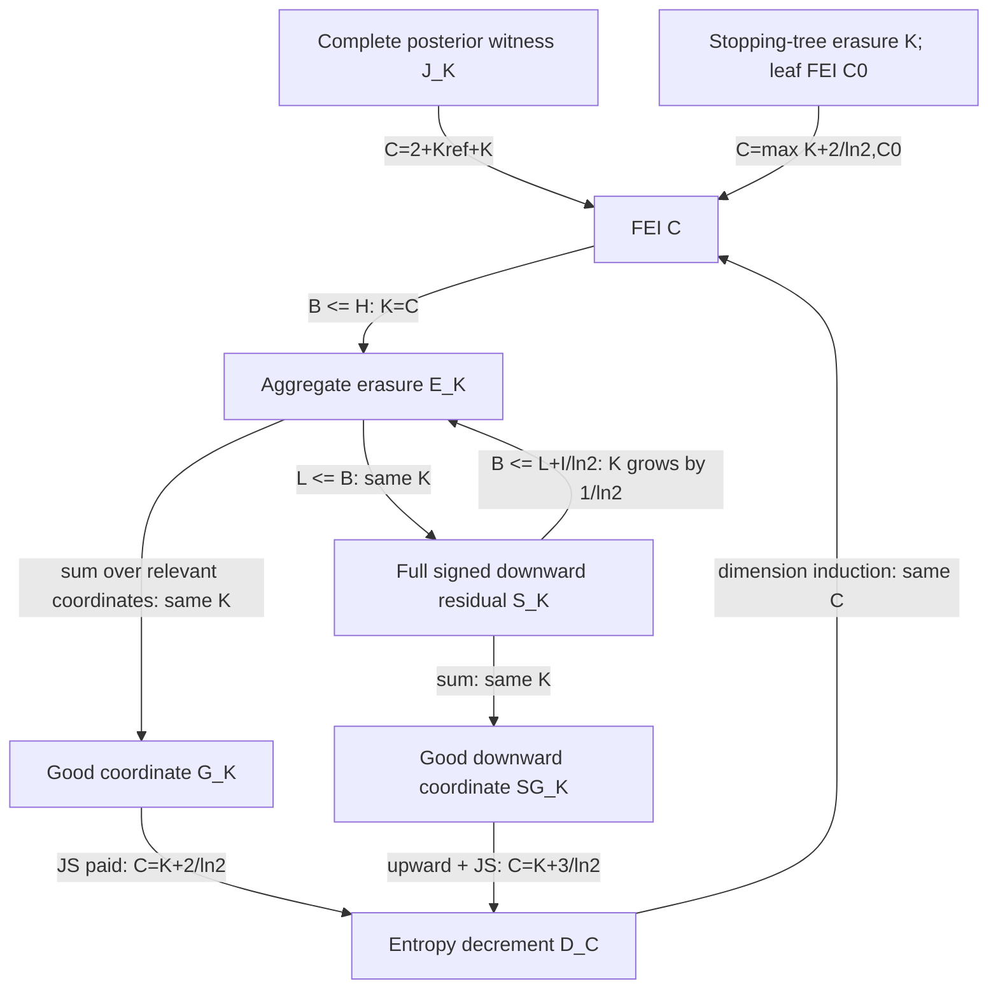

# exact target, quantifiers, hypotheses and units

A003 / B01, run 20261011T221324Z-account05-A003-minimal-target-formulation. Full FEI remains OPEN. This packet compares universal targets and proves an explicit optimized-witness debt identity and a complete-cost calibration. Independent review is pending. A 'smallest stronger lemma' below means the first additional inequality needed within the frozen route, after removing already-paid terms; there is no canonical smallest element among all conceivable FEI lemmas.

For every n>=0 and Boolean sign f on the uniform cube, put a_S=fhat(S), p_S=a_S^2, H=sum p_S log2(1/p_S), I=sum |S|p_S and alpha_i=sum_{S containing i}p_S. All entropy and coding costs are in bits. Terms at zero atoms are zero. Constants have H=I=0 and need no selected coordinate. All universal constants must be finite and independent of n,f and representation. Let

    B_i=H(S_i|S_-i), B=sum_i B_i,
    L_i=sum_{T not containing i, p_(T+i)>0} p_(T+i) log2(1+p_T/p_(T+i)),
    L=sum_i L_i, a=2/ln2, b=1/ln2.

This L is the downward signed-Booleanity route's logarithmic target, not the B05 mismatch quantity also named L. Signed admission means ALL constraints sum_S a_S^2=1 and sum_S a_S a_(S xor U)=0 for every U!=empty, with real coefficients.

# sources actually read, revisions and theorem locators

EXECUTION_PROTOCOL.json revision 2026-10-11-execution-v2 governs this run. out/SOURCE_MANIFEST.json pins 38 actual local files by SHA256 and size: all eight required campaign entries including the plan and packet ledger, the three earlier REPORTs B05/B09/B19, five supplement entries, all twelve curated source notes, all four context manuscript texts, the recovered reductions manuscript's forests/restrictions/main sources, BOARD, A001's quantifier report, and A031's signed derivation. The source helper reads those files and saves numbered manuscript texts; this is not an independent certification of every theorem in those texts. Mathematical inspection used the following exact interfaces.

* Recovered reductions forests.tex: eq:forestpacking, eq:forestcost, thm:posteriorforest, lem:forestpath, eq:foresttarget. This source is essential: the 38-page threshold paper Proposition 5.5 is the earlier unconditioned witness version, not the conditioned posterior theorem.
* ERASURE_REDUCTION.md sections 1-6: Delta_i=B_i+JS_i, JS_i<=a alpha_i, B<=H, L<=B<=L+bI, and full signed admission. restrictions.tex prop:restrictioninduction and the tree telescopes; BLOCK_RESTRICTION_IDENTITY sections 1-3 for proper blocks.
* A001 run 20261011T210330Z, REPORT routes R03,R05-R07 and the next-action handoff. This run consumes that audit and adds the exact debt identity rather than redoing its inventory.
* A031 run 20261011T214115Z, DERIVATION: full signed orthogonal involution and point-defect tensor obstruction to a positive single-anchor Cauchy cost. That refuted cost is excluded from the implication graph.
* T38 Proposition 5.5 and Section 5.8; Lemma 2.1 (h2(Var)<=2I); T29 introduction and corresponding formula scope. P30/P31 introduction/Theorem 1.1 and scope: spatial crossing theorems do not admit arbitrary Boolean sources. The alternate percolation version's singularity assertions differ; neither is used as a proof dependency here.
* Supplement CLAIMS C018-C020,C024 and COUNTEREXAMPLES X001-X003,X006,X010; SEED_LEMMAS and NATIVE_MAPPING as route/navigation material. Earlier B05/B19 preserve the independently reviewed all-coordinate local no-go; B09 core remains pending review and its upper tax does not prove endpoint necessity.

The supplied claude/B01/STREAM_NOTES.md path is absent, as in A001's run. BOARD at stage start was the supervisor's 2026-10-11 22:05 UTC snapshot. No lead direction was inferred.

# complete derivation or exact first unsupported line

## 1. Explicit implication diagram and constants

For each node below, quantify over ALL finite Boolean cubes. E_K means B<=KI. G_K means each nonconstant f has a relevant i with B_i<=K alpha_i. D_C means each nonconstant f has a relevant i with Delta_i<=C alpha_i. S_K means L<=KI under full signed admission. SG_K means each nonconstant f has a relevant i with L_i<=K alpha_i. J_K means for every f there exists one admissible representation, one globally feasible positive lambda, and distinct-run posteriors with complete residual R<=KI. There is no change of representation per individual spectral coordinate.

Here Kref=3+2log2(3)+log2(6e). FEI(C) also directly implies S_C and SG_C. FEI(C) implies G_C via E_C. G_K implies E_(K+a) via FEI; SG_K implies S_(K+3b) via FEI. No same-constant reverse arrow FEI(C)->D_C or FEI(C)->J_K is proved. The general block analogue retains H(S_A|S_Ac), not sum of child erasures, and queries actual physical coordinates. Choosing all coordinates merely restates FEI and supplies no smaller reduction.

Proof of the arrows: conditioning and the entropy chain rule give B<=H. For each edge (T,T+i), binary entropy gives

    B_i=L_i+sum_T p_T log2(1+p_(T+i)/p_T).

The second sum is between zero and alpha_i/ln2 because ln(1+x)<=x, including zero endpoints by continuity. Consequently L<=B<=L+bI. Summing inequalities weighted by positive alpha_i gives existence of the required coordinate; irrelevant coordinates have zero B_i,L_i,Delta_i. Actual Boolean restrictions give Delta_i=B_i+JS_i with 0<=JS_i<=a alpha_i. Finally I=alpha_i+(I(f_+)+I(f_-))/2 makes dimension induction exact, with constant functions as the base case. Full signed admission is equivalent to Booleanity: inverse Walsh transforming the convolution equations gives f(x)^2=1 at every point. Thus the signed vector target has exactly the same domain, not a relaxation to positive laws.

The tree arrow follows by telescoping H and I over a finite adaptive restriction tree. If q_v are actual reach probabilities, cumulative erasure <=K sum_v q_v alpha_(i_v)(f_v) and each leaf H<=C0 I imply H(root)<=max(K+a,C0)I(root). A terminal class defined only by B=0 is inadmissible: parity lifts preserve arbitrary seed entropy. One must retain its full terminal H. This is C019's precise remaining payment.

## 2. Exact minimal posterior and the extra coding debt

Freeze an admissible gate union and ordered covers from forests.tex, its feasible lambda and the finite set W_A of distinct actual partition-forest runs for each nonempty spectral A. Let B_r=B_lambda(A;r), c=Lambda+log2 Z, and t_A=sum_{r in W_A}2^(-B_r). All these t_A are positive on spectral support. They are not asserted to be probabilities. The Gibbs variational identity gives exactly

    min_P [E_P B_r-H(P)] = -log2 t_A,
    P_A^*(r)=2^(-B_r)/t_A.

Proof: E B-H(P)=-log2 t_A+D(P||P_A^*). Distinctness is essential; counting multiple descriptions of one actual run would invalidate the mass bound. Define the fully optimized residual

    R_* = v c + sum_{A!=empty} p_A[-log2 t_A],  v=1-p_empty.

For each run the recovered proof gives q(r)>=2^(-c-Kref|A|-B_r), where q is the root-conditioned actual queue law. Hence

    U(A)=2^(-c-Kref|A|)t_A <= Q_*(A), sum_A U(A)<=1.

U is a strictly positive subprobability on spectral support. It may assign mass to nonspectral nonempty sets too. For v>0 set P^+(A)=p_A/v. The generalized divergence D(P^+||U)=sum_A P^+(A)log2(P^+(A)/U(A)) is nonnegative: if m=sum U, it equals D(P^+||U/m)-log2 m. Direct substitution, with no inequality, proves

    h2(v)+Kref I+R_* = H(f)+v D(P^+||U).             (A003.1)

The v=0 case is declared trivial separately; no P^+ is defined there. This identity is a sharpened comparison of the routes. A fixed witness reference asks to pay exactly an additional coding-divergence debt. Discarding posterior entropy cannot help: every other posterior has residual at least R_*. Retaining only its reference normalization cannot help either: it leaves the shape divergence D(P^+||U/m) unpaid.

Thus J_K implies FEI with C=2+Kref+K using h2(v)<=2I, but FEI alone does not establish J_K for this restricted coding family. A sufficient reverse admission lemma, conditional on FEI(C), is: for every f choose an admissible reference with vD(P^+||U)<=d I, with one finite d; then R_*<=(C+d-Kref)I, and certainly R_*<=(C+d)I. This is a conditional inference, not a claim that d is bounded or that reverse implication is false. For unrestricted references U=P^+, the debt vanishes, but their admission into the actual forest family is precisely unproved.

The weakest exact certificate within the frozen forest upper-bound method for a specified final C is

    exists admissible choices: R_* <= (C-Kref)I-h2(v).

The campaign's R_*<=KI is a convenient slightly stronger payment because it pays h2(v) separately. It cannot be replaced by a per-coordinate forest cost or a posterior on repeated descriptions.

## 3. Smallest additional inequalities for the three routes

| Route | Already proved interface | First additional inequality, with exact scope | Why materially stronger than the interface |
|---|---|---|---|
| Witness C020 | Complete variational forest bound and (A003.1) | One finite K, every Boolean f, one global admissible representation/lambda with R_*<=KI; or the exact C-certificate above | Finite covers, queue normalization and optimal posteriors provide no uniform expected payment. The full weighted divergence remains. |
| Erasure C018 | Delta_i=B_i+JS_i and the exact influence decrement | One finite K, every nonconstant Boolean f, some relevant i with B_i<=K alpha_i | It is existential and hereditary over all actual reached restrictions. Requiring every coordinate is strictly unnecessary and defeated by the archived sparse split. The even weaker exact C-certificate is some i with B_i<=C alpha_i-JS_i. |
| Signed Booleanity | All signed XOR identities; L<=B<=L+bI | One finite K, every real coefficient vector obeying ALL signed constraints, some relevant i with L_i<=K alpha_i | This gives C=K+3/ln2. Aggregate L<=KI is a stronger, tensor-additive implementation target. Normalization, low-order constraints, a controlled phase marginal, and unsigned cancellation do not supply this edge-log payment. |

The signed-coordinate target is smaller than the aggregate signed target in the sense that aggregate implies selection at the same K. The signed target is not a new proof merely because Booleanity has been written algebraically. The A031 positive single-anchor Cauchy remainder is actually false as a universal O(I) target on Boolean tensors; replacing it by S/SG preserves a live target and avoids repackaging a refutation as an open lemma.

## 4. Full witness residual on a low-energy, zero-erasure family

Let g_n(x)=1-2*1_{x=(1,...,1)} on n>=2 bits and F_n(x,z)=g_n(x_1 z,...,x_n z), with d=n+1 and N=2^n. Its spectrum is p_empty=(1-2/N)^2 and p_A=4/N^2 on every nonempty even-cardinality A subset [d]; odd sets have zero mass. Consequently

    H(F_n)=H(g_n), B(F_n)=L(F_n)=0,
    I(F_n)=2d/N ->0, v=4(N-1)/N^2.

This follows by the injective parity lift of spectral labels and sum of cardinalities over even subsets. Every spectral edge has at least one zero endpoint. The n=2 case and all boundary atoms are included.

Choose the output-complement -F_n as a single arbitrary gate h, full ordered support 1,...,d, M=1, lambda=1, pi=Pr(h=1)=1/N, and a point posterior on its only partition-forest run for each A. Output complementation leaves p,H,I unchanged. The conditioned forest theorem permits an arbitrary nonconstant gate with an ordered support; regularity is required only in the later fractional pivotal-witness theorem, which is not used here. Each run has one root, one selected subset A, and zero children. Thus no attachment/label/posterior term is omitted. In particular

    Lambda+log2 Z=log2 pi=-n,
    B_lambda(A)=n+(6/5)sum_{j=1}^{|A|}log2(i_j/j),

where i_1<...<i_|A| are its ranks. The root rarity cancels EXACTLY against conditioning. Hence the complete R is

    R=(6/5)sum_{A!=empty}p_A log2[(product_j i_j)/|A|!].

Because i_j<=d-|A|+j,

    1 <= (product_j i_j)/|A|! <= binom(d,|A|) <=2^d.

Therefore R<=(6/5)vd <=(24/5)d/N=(12/5)I(F_n), with strict improvement by the factor (N-1)/N if retained. This explicitly closes J at K=12/5 on the family and gives the forest-derived H<=(2+Kref+12/5)I. It is a calibration on a known easy family, not a new universal class result or improved FEI constant. Its purpose is to show that B=0 can coexist with a nonzero, completely paid reference residual: neither statistic measures the other's missing cost pointwise.

The same one-gate construction for an arbitrary Boolean source only yields the rank upper bound (6/5)E log2 binom(d,|S|), which can lose log(d/I). The unjustified universal step is paying this rank expectation or choosing a better representation/reference for EVERY seed; the family computation does not do that. For general parity lifts a B=0 leaf still contains the arbitrary seed.

# executed validation with domain, arithmetic, commands and outputs

FROZEN_SPEC.json was persisted before the checks. code/check.py uses integer Walsh transforms and Fraction arithmetic. Entropies and edge logarithms are exact rational linear combinations of log2 primes; restriction identities are compared symbolically. Strict inequalities use outward rational atanh-series enclosures, 80 terms after power-of-two reduction; the remainder is bounded by 2|z|^161/[161(1-z^2)]. No floating number is a proof premise. The displayed floating residual ratios in out/VALIDATION.json are explicitly evidence only.

Commands: python -X utf8 runs/20261011T221324Z-account05-A003-minimal-target-formulation/code/audit_sources.py; python -X utf8 runs/20261011T221324Z-account05-A003-minimal-target-formulation/code/check.py; python -X utf8 runs/20261011T221324Z-account05-A003-minimal-target-formulation/code/finalize.py. Validation exhausts all 278 labelled tables in dimensions 0 through 3, checking all signed shifts, Parseval, exact Delta=B+JS, influence decrements, L<=B<=H, and separately the seven declared parity-defect cases n=2 through 8, including every rank subset and root cancellation. Actual counts/runtime/status are in out/VALIDATION.json. The universal debt identity and rank-family bound are algebraic proofs above; finite checks are supplementary implementation validation. No heavy job, GPU, dimension escalation, random search or formal-assistant certification occurred.

# proof dependencies and changed downstream conclusions

The two authored claims use the source-established conditioned forest probability bound and elementary entropy, Fourier and rank identities. The implication graph consumes ERASURE_REDUCTION and the actual restriction identities; it does not assume FEI except on explicitly labelled converse arrows. A031's signed cost obstruction is used only to exclude a false proposal, not as a premise for the new debt algebra. The reviewed B05 no-go is kept at its exact all-coordinate scope. No new universal FEI payment is asserted.

B02/A006 can now optimize the finite posterior exactly and distinguish the remaining weighted coding debt from entropy itself. B06/A026 can target existential selection rather than all-coordinate control. B07/A034 should preserve a tensor-additive edge-log residual or a smaller existential coordinate payment, while retaining full signed admission and conditional entropy. A005/A094 can use (A003.1) to audit any claimed converse from FEI to the forest endpoint. Nothing here proves C024's history-transfer payment; its natural-unit comparison must not be silently substituted for this bit-valued forest reference.

# one next mathematical action and independent reviewer

Next: bound the optimal weighted coding divergence vD(P^+||U) for one representation of a parity-lifted arbitrary-core tensor family, keeping its seed entropy visible; test whether a reference-construction improvement changes the debt rather than merely renaming H. This is a concrete B01/B02 interface consuming the new identity. Independent reviewer A086 should reconstruct distinct-run normalization and the one-gate admission; A094 should reconstruct all arrows and constants, including the lack of a proved J converse. Reviews have not occurred.

# actual persistence receipts or precise save blocker

All outputs are saved only under A003, with complete run files, code/, out/, and rolling STATUS.md/WORKLOG.md/LEARNED.md. out/ARTIFACT_RECEIPTS.json holds SHA256/size receipts and out/SCHEMA_VALIDATION.json records exact protocol-field and claim-hash checks. External source trees, other agents, shared indices, brain stores, git and protected trading folders were not modified. Supervisor copying, independent acceptance, mirror verification and downstream adoption are not claimed. Missing B01 lead notes are the sole source-access limitation, not a blocker for the self-contained work.

**Universal bridge:** This stage sharpens C020 into an exact optimized-reference identity: the full forest upper bound pays H plus vD(P^+||U), and all constants and posterior/normalization terms are retained. It also aligns C018 and the full-signed downward route through G/SG with additive losses 2/ln2 and 3/ln2, and pays C020 at K=12/5 on a zero-erasure low-energy calibration. The universal selection inequality and universal admissible coding-debt payment remain wholly open; no numerical improvement to a universal FEI constant is claimed. NEXT is shortest toward full FEI because it directly measures the additional debt of a universal candidate representation on arbitrary cores, instead of spending another stage proving FEI for a separate easy class.
