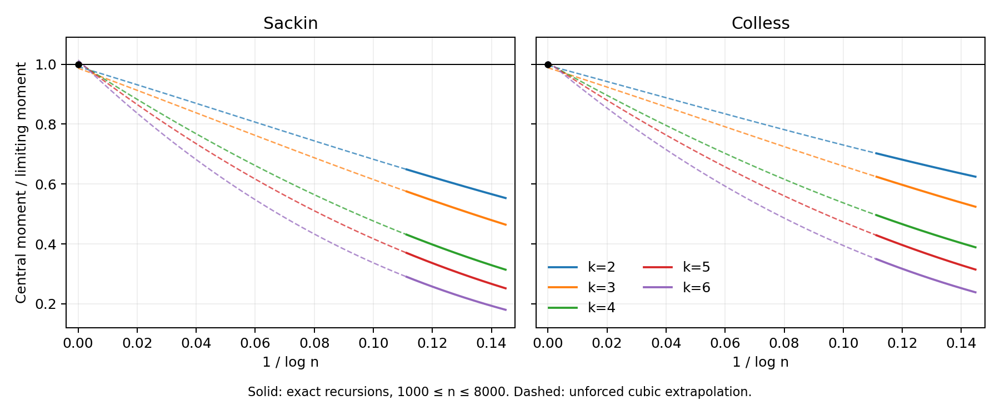

PROVED

# The centered Sackin limit for the critical beta-splitting tree

12 November 2026. All logarithms are natural.

For the splitting law in the question, there is a centered, nondegenerate, non-Gaussian random variable (W) such that

\[
 \frac{S_n-\mathbb ES_n}{n\log n}\ \xrightarrow{d}\ W.
 \tag{1}
\]

Every integer moment converges, and so does every absolute moment of positive real order. The same assertions hold for the centered Colless index, with the same limit. Its law is uniquely determined by the recurrence (4) below. In particular,

\[
 |\mathbb EW^k|\le 2^k k!,\qquad
 \mathbb E e^{t|W|}<\infty\quad(0\le t<1/2).
 \tag{2}
\]

The conjectural characteristic equation in §9 of [REPORT_P0347.md](REPORT_P0347.md) is therefore valid. Among centered probability laws having an exponential moment, its solution is unique. The proof uses the supplied mean estimates, extended central-moment recursions, endpoint cancellation, and an explicit factorial bound. It does not assume a continuum fragmentation limit or a contraction bounded away from one.

## 1. Literature and the new result

The two supplied texts were checked before deriving the extension.

[Aldous–Janson, *The Critical Beta-splitting Random Tree II: Overview and Open Problems*](https://arxiv.org/abs/2303.02529), §§4.8–4.9, discusses balance indices mainly through expected values and asks for variances and limit distributions. Its Open Problem 9 asks for joint clade-count information from which covariances and CLTs could be obtained. A non-Gaussian limit for a statistic whose mean is dominated by growing clades is a distinct part of that program. This report does not solve the general joint clade-count problem. The local source is [AJ_overview_2303.02529.txt](AJ_overview_2303.02529.txt).

[Brandenberger–Chin–Mossel, *Asymptotics for the harmonic descent chain and applications to critical beta-splitting trees*](https://arxiv.org/html/2505.24821v3), Proposition 1.3 and Corollaries 1.4–1.5, proves CLTs for fixed clade counts and total **continuous-time edge length**. Its proposition assumes linear mean and variance with power-saving remainders. Sackin has mean of order (n\log^2 n) and variance of order (n^2\log^2 n), so that proposition does not apply. Discrete total leaf depth is different from total continuous edge length. Neither Sackin nor Colless appears as a statistic treated in the supplied text. The local source is [BCM_2505.24821.txt](BCM_2505.24821.txt).

A supplementary primary-source check found that [Kolesnik, *Critical beta-splitting, via contraction*](https://arxiv.org/html/2404.16021), Theorem 1, treats a uniformly sampled leaf's height. The later [Chorbadzhiyska–Minchev–Savov preprint](https://arxiv.org/html/2608.18320v1), abstract, results and full-text searches, treats tagged-leaf heights, occupation probabilities, continuous length and maximum continuous height; it does not state the present discrete total-depth theorem. A sampled-leaf CLT does not identify the fluctuation of the sum over correlated leaf depths.

Relative to the supplied report, the new results are: convergence of central moments of **every** order; a universal factorial majorant; convergence in distribution to a moment-determinate law; existence and uniqueness in the stated class for the proposed infinitesimal equation; and the corresponding full Colless limit. The values through order four and the variance constant were already established there. The novelty statement is relative to these inspected sources, not an exhaustive priority claim.

## 2. Specification of the limit

Write

\[
 z=\zeta(2),\quad \nu(dx)=\frac{dx}{2x(1-x)},\quad
 H(x)=-x\log x-(1-x)\log(1-x),\quad g(x)=-H(x)/z,
\]

and (h_j=\sum_{r=1}^j1/r). Put (a_0=1,a_1=0). For (k\ge2), define the polynomial in lower moments

\[
 R_k(x)=
 \sum_{\substack{a+b+c=k\\0\le a,b<k}}
 \frac{k!}{a!b!c!}\,a_a a_b\,x^a(1-x)^b g(x)^c.
 \tag{3}
\]

Here (c\ge0); terms containing (a_1) vanish. The recurrence specifying the law is

\[
 \boxed{\quad
 h_{k-1}a_k=k a_{k-1}+\int_0^1R_k(x)\,\nu(dx),
 \qquad k\ge2.\quad}
 \tag{4}
\]

All integrals in (4) converge. A term with (c=0) has both daughter exponents at least two. A term with (c\ge1) contains (g), which vanishes at either endpoint like (O(x(1+|\log x|))) or its reflection. Existence of a probability law with these moments is proved below, rather than assumed from the recurrence.

The first constants are

| (k) | (a_k=\mathbb EW^k) |
|---:|---:|
| 0 | 1 |
| 1 | 0 |
| 2 | 0.280574126406891865 |
| 3 | 0.107604590414363714 |
| 4 | 0.308012262394708858 |
| 5 | 0.366233676893089714 |
| 6 | 0.819173199226021623 |

The characteristic function (\chi(t)=\mathbb Ee^{itW}) satisfies, for every real (t),

\[
 \boxed{\quad
 0=it\chi(t)+\int_0^1
 \left[e^{-itH(x)/z}\chi(tx)\chi(t(1-x))-\chi(t)\right]\nu(dx),
 \quad \chi(0)=1,\quad\chi'(0)=0.
 \quad}                                                   \tag{5}
\]

Equivalently its bilateral Laplace transform (\phi(s)=\mathbb Ee^{-sW}), for (|s|<1/2), satisfies

\[
 0=-s\phi(s)+\int_0^1
 [e^{sH(x)/z}\phi(sx)\phi(s(1-x))-\phi(s)]\,\nu(dx),
 \quad\phi(0)=1,\quad\phi'(0)=0.                         \tag{6}
\]

The mean condition matters: translation preserves these equations because the daughter weights sum to one. We assert uniqueness among centered laws with some exponential moment, without requiring a prescribed radius of that moment.

## 3. Mean and transfer estimates

Let (X_n) denote Sackin or Colless and (\mu_n=\mathbb EX_n). Its toll is (t_n(i)=n) or (|n-2i|). The established mean estimates in §5 of the supplied report are

\[
 \mu_n=n\left[\frac{\log^2 n}{2z}+b_X\log n\right]+O(n),
 \quad
 b_S=\frac\gamma z+\frac{\zeta(3)}{z^2},\qquad
 b_C=b_S-\frac{2\log2}{z}.                              \tag{7}
\]

Here is a brief verification of the input and transfer argument. Define

\[
 (\mathcal Df)_n=f_n-\sum_{i=1}^{n-1}q(n,i)(f_i+f_{n-i}).
\]

For (p>1) and an integer (r\ge0), expansion of the logarithms gives

\[
 \mathcal D[n^p\log^r n]
 \sim\psi(p)\frac{n^p\log^r n}{h_{n-1}},\qquad
 \psi(p)=\int[1-x^p-(1-x)^p]\,d\nu.                    \tag{8}
\]

The main term is its improper Riemann sum. All other terms have factors (1/\log^j n), (j\ge1), and integrable endpoint bounds involving (x^{p-1}|\log x|^j). Such mesh sums converge: truncate at (\varepsilon), use ordinary Riemann convergence on the compact interval, and bound the omitted part by a constant times (\varepsilon^\alpha(1+|\log\varepsilon|^j)), plus a vanishing mesh term, for some (\alpha>0). For integers (k\ge2),

\[
 \psi(k)=h_{k-1}.                                      \tag{9}
\]

Indeed (\psi(2)=1) and (\psi(k+1)-\psi(k)=1/k).

Consequently, if (\mathcal Du=t) and

\[
 t_n/[n^p\log^r n/h_{n-1}]\longrightarrow T,
\]

then (u_n/[n^p\log^r n]\to T/\psi(p)), including (T=0) and signed sequences. To prove this, compare with

\[
 (T/\psi(p)+\varepsilon)n^p\log^r n+Kn,
 \qquad
 (T/\psi(p)-\varepsilon)n^p\log^r n-Kn.
\]

Their defects eventually bracket (t_n) by (8). Since (\mathcal Dn=0), choose (K) to bracket the finitely many earlier values. Positivity of the recursion coefficients propagates the inequalities. Divide by (n^p\log^r n) and let (\varepsilon\downarrow0). This argument also gives the corresponding (O) transfer bound.

For (7), put (f_n=n[\log^2n/(2z)+b_S\log n]). Define

\[
 A_n=\sum_{i<n}\frac{-\log(i/n)}{n-i}
     =z+O(\log n/n),\qquad
 B_n^*=\sum_{i<n}\frac{\log^2(i/n)}{n-i}
     =2\zeta(3)+O(\log^2 n/n).
\]

Integral comparison, followed by the nonnegative geometric series for (1/(1-x)), proves these estimates. Direct substitution yields

\[
 (\mathcal Df)_n=\frac n{h_{n-1}}
 \left[\frac{\log n}{z}A_n-\frac{B_n^*}{2z}+b_S A_n\right]
 =n+O(\log n).
\]

The positive defect of (v_n=n-\sqrt n) is asymptotic to a positive multiple of (\sqrt n/h_{n-1}), and dominates (\log n). This follows by the same power calculation as (8), now at (p=1/2), where (\psi(p)<0). Comparison with (Kv_n) gives (\mu_n-f_n=O(n)). For Colless, the difference toll is (2\min(i,n-i)), whose expectation is (2n\log2/h_{n-1}+O(1/h_{n-1})). The defect of ((2\log2/z)n\log n) matches it with bounded error. Comparison with (K(n-1)), whose defect is (K), proves the second mean formula.

## 4. Bounds on the centered split toll

Let

\[
 Y_n=X_n-\mu_n,\quad u_{j,n}=\mathbb EY_n^j,\quad
 B_n(i)=t_n(i)+\mu_i+\mu_{n-i}-\mu_n,
 \qquad u_{0,n}=1,\quad u_{1,n}=0.
\]

The two centered daughter variables are independent conditional on (I=i). With (L=\log n), (x=i/n), (y=1-x), (7) gives uniformly in (1\le i<n)

\[
 B_n(i)=nL g(x)+O(n),\qquad \mathbb EB_n(I)=0.           \tag{10}
\]

Uniformity follows from boundedness of (x\log^j x), (j=1,2), and from the uniform (O(n)) mean remainders. The tolls are bounded by (n).

The same endpoint estimates as in (8) give

\[
 h_{n-1}\mathbb E|g(I/n)|^c\longrightarrow\int |g|^c\,d\nu
 \quad(c\ge1),\qquad \int|g|\,d\nu=1.                 \tag{11}
\]

In particular,

\[
 \mathbb E|B_n(I)|=O(n),\qquad
 \mathbb E|B_n(I)|^c=O(n^cL^c/h_{n-1})\quad(c\ge2).
 \tag{12}
\]

For every fixed (c\ge2), replacing (B_n^c) by (n^cL^cg(x)^c) in expectation has error (o(n^cL^c/h_{n-1})), even after multiplication by any bounded function of (x). Indeed expansion of the (O(n)) remainder bounds the error by

\[
 O\left(n^c\left[1+\sum_{j=1}^{c-1}\frac{L^j}{h_{n-1}}\right]\right),
\]

which is of smaller order. For the linear power, the uniform remainder alone is insufficient; the following cancellation supplies the missing factor.

## 5. All central moments converge

We prove by induction that, for each integer (k\ge2),

\[
 \frac{u_{k,n}}{n^k\log^k n}\longrightarrow a_k.          \tag{13}
\]

The exact conditional recursion is

\[
 u_{k,n}=\mathbb E[u_{k,I}+u_{k,n-I}]+T_{k,n},
\]

\[
 T_{k,n}=
 \sum_{\substack{a+b+c=k\\0\le a,b<k}}
 \frac{k!}{a!b!c!}\,
 \mathbb E[u_{a,I}u_{b,n-I}B_n(I)^c].                   \tag{14}
\]

Only lower-order moments appear in its toll. For (k=2), only (\mathbb EB_n^2) remains, so the argument below also supplies the base case.

Suppose (13) holds for orders below (k). For (2\le r<k) it implies both

\[
 |u_{r,j}|\le K_r j^r\log^r(ej),\qquad
 \sup_{1\le i<n}
 \left|\frac{u_{r,i}}{n^rL^r}-a_r(i/n)^r\right|\to0.
 \tag{15}
\]

For the second assertion, separate finitely many (i), bound the asymptotic error uniformly on the rest, and expand ((L+\log x)^r). Boundedness of (x^r|\log x|^j) makes the resulting difference uniform. The assertions for orders zero and one have their exact meanings (u_0=1,u_1=0).

We evaluate the toll on the scale (n^kL^k/h_{n-1}).

**Terms with (c=0).** The only nonzero terms have (a,b\ge2). After normalization, (15) and improper Riemann convergence give

\[
 \frac{h_{n-1}}{n^kL^k}
 \mathbb E[u_{a,I}u_{b,n-I}]
 \longrightarrow a_a a_b\int x^ay^b\,d\nu.
 \tag{16}
\]

The bounds in (15) dominate the mesh integrands by a constant times (x^{a-1}y^{b-1}), so the small-daughter endpoints are controlled.

**Terms with (c\ge2).** The uniform normalized daughter errors in (15), multiplied by (12), are (o(n^kL^k/h_{n-1})). The replacement of (B_n^c) is justified after (12). Riemann convergence for the integrable entropy product then gives

\[
 \frac{h_{n-1}}{n^kL^k}
 \mathbb E[u_{a,I}u_{b,n-I}B_n^c]
 \longrightarrow a_a a_b\int x^ay^b g(x)^c\,d\nu.
 \tag{17}
\]

This includes zero daughter exponents. Exponents equal to one give zero terms.

**Terms with (c=1) and both daughter exponents positive.** Again (a,b\ge2). The uniform product error from (15), multiplied by (\mathbb E|B_n|=O(n)), is (o(n^kL^{k-1})), the desired order. In the main term, the (O(n)) remainder in (10) is multiplied by (x^ay^b). Its expectation has the extra factor (O(1/h_{n-1})), so its contribution is negligible. The limit is the expression in (17) with (c=1).

**The linear terms with one zero daughter exponent.** Put (r=k-1). These terms together are

\[
 k\mathbb E[B_n(u_{r,I}+u_{r,n-I})]
 =k\mathbb E[B_n(u_{r,I}+u_{r,n-I}-u_{r,n})],           \tag{18}
\]

using the exact centering (\mathbb EB_n=0). For (k=2) this is identically zero. Otherwise (15) gives the uniform replacement

\[
 \frac{u_{r,i}+u_{r,n-i}-u_{r,n}}{n^rL^r}
 =a_r[x^r+y^r-1]+o(1).                                \tag{19}
\]

Its error, multiplied by (\mathbb E|B_n|=O(n)), is of smaller order than the toll scale. Write (D_r(x)=x^r+y^r-1). It vanishes linearly at either endpoint, and (\mathbb E|D_r(I/n)|=O(1/h_{n-1})). Thus the (O(n)) remainder in (10) contributes only (O(n^kL^{k-1}/h_{n-1})). Consequently (18), after normalization, tends to

\[
 k a_{k-1}\int g(x)[x^{k-1}+y^{k-1}-1]\,\nu(dx).
 \tag{20}
\]

This is the cancellation that makes an induction without any convergence-rate assumption possible.

Combining (16)–(20), the normalized toll tends to

\[
 k a_{k-1}\int gD_{k-1}\,d\nu
 +\int\!\sum_{\substack{a+b=k\\a,b\ge2}}
       \frac{k!}{a!b!}a_a a_b x^ay^b\,d\nu
 +\int\!\sum_{\substack{a+b=k-1\\a,b\ge2}}
       \frac{k!}{a!b!}a_a a_b x^ay^b g\,d\nu
 +\int\!\sum_{\substack{a+b+c=k\\c\ge2}}
       \frac{k!}{a!b!c!}a_a a_b x^ay^b g^c\,d\nu.
 \tag{21}
\]

Terms with a daughter exponent one vanish. Since (\int g\,d\nu=-1), (21) equals (k a_{k-1}+\int R_k\,d\nu). Apply the signed transfer lemma (8)–(9) with (p=r=k). It proves (13), with exactly the recurrence (4). This completes the induction for both statistics.

## 6. Factorial growth, existence and determinacy

The recurrence alone does not yet prove distributional convergence. We establish

\[
                         |a_k|\le 2^k k!\quad(k\ge0).   \tag{22}
\]

It holds for (k=0,1). Assume it below (k\ge2), and use the canceled expression (21). We have (|g|\le\log2/z<1), (\int|g|d\nu=1), and

\[
 \sum_{a+b=r}x^ay^b\le(x+y)^r=1,
\]

\[
 \sum_{\substack{a+b=r\\a,b\ge2}}x^ay^b
 \le x^2y^2(x+y)^{r-4}=x^2y^2\quad(r\ge4),
 \qquad \int x^2y^2\,d\nu=\frac1{12}.                 \tag{23}
\]

An empty sum is zero. For the first term in (21), (|D_{k-1}|\le1), giving, after division by (k!2^k), a bound (1/2). The (c=0) cross terms are bounded by (1/12); the (c=1) cross terms by (1/24). For (c\ge2), the bound is

\[
 \sum_{c=2}^k\frac{2^{-c}}{c!}
   \int |g|^c\sum_{a+b=k-c}x^ay^b\,d\nu
 \le\sum_{c=2}^\infty\frac{2^{-c}}{c!}
 =e^{1/2}-1-\frac12.
\]

Therefore

\[
 \frac{h_{k-1}|a_k|}{k!2^k}
 \le\frac1{12}+\frac{13}{24}+e^{1/2}-1-\frac12
 =0.773721270700128\ldots<1.
 \tag{24}
\]

As (h_{k-1}\ge1), (22) follows. The strict inequality can also be checked without decimals: (e^{1/2}<7/4), by its elementary series, makes the displayed bound less than (7/8).

Let (Z_n=(X_n-\mu_n)/(n\log n)), (n\ge2). Its bounded second moments imply tightness. Along any weakly convergent subsequence, bounded higher even moments from (13) ensure uniform integrability of every fixed power. Its limit (W) consequently has moments (a_k). In particular the even (a_k) are nonnegative.

For (0\le t<1/2), monotone convergence in the nonnegative cosh series gives

\[
 \mathbb E\cosh(tW)
 =\sum_{j\ge0}\frac{a_{2j}t^{2j}}{(2j)!}
 \le\sum_{j\ge0}(2t)^{2j}
 =\frac1{1-4t^2}.
 \tag{25}
\]

Since (e^{t|w|}\le2\cosh(tw)), (W) has an exponential absolute moment. Its moments therefore determine its moment generating function near zero and its probability law uniquely. All weakly convergent subsequences have that law, proving (1) for the full sequence. Higher even moment bounds also imply uniform integrability of (|Z_n|^p) for each real (p>0); thus their expectations converge to (\mathbb E|W|^p).

The variance and third moment recover the earlier formulas:

\[
 a_2=\int g^2\,d\nu
 =\frac{2\zeta(3)-z}{z^2}>0,
\]

\[
 a_3=\frac{a_2}{z}-\frac{2J_3}{3z^3},\qquad
 J_3=\int H^3d\nu=6\zeta(4)-3\zeta(3)-\frac32z.
 \tag{26}
\]

Moreover (J_3\le(\log2)\int H^2d\nu=(\log2)z^2a_2), so

\[
 a_3\ge\frac{a_2}{z}(1-2\log2/3)>0.
\]

A centered Gaussian has zero third moment. Hence (W) is nondegenerate and non-Gaussian.

On a common tree, the supplied report's (L^2) equivalence of centered Sackin and Colless, together with (1), also gives convergence of the centered pair to ((W,W)). The all-order bounds above imply convergence of every mixed polynomial moment by uniform integrability and Hölder's inequality.

## 7. The fixed-point equation is valid and unique in the stated class

Let (M(t)=\mathbb Ee^{tW}). By (25), it is holomorphic on the strip (|\Re t|<1/2). On this strip define

\[
 F(t)=tM(t)+\int[e^{tg(x)}M(tx)M(t(1-x))-M(t)]\,d\nu.
 \tag{27}
\]

The integral converges locally uniformly and defines a holomorphic function. Indeed near (x=0), uniformly on compact subsets of the strip,

\[
 e^{tg(x)}-1=O(x(1+|\log x|)),\quad
 M(tx)-1=O(x),\quad M(t(1-x))-M(t)=O(x).
\]

These follow from the exponential moment and a bounded derivative on slightly larger compact sets. The reflected bounds hold at one. Dividing by (x(1-x)) leaves an integrable bound. They justify differentiating under the integral at zero.

The constant coefficient of (F) is zero. Its linear coefficient is (1+\int g\,d\nu=0). For (k\ge2), its coefficient multiplied by (k!) is

\[
 k a_{k-1}-h_{k-1}a_k+\int R_k\,d\nu=0
\]

by (4). Thus all Taylor coefficients vanish, and the identity theorem gives (F=0) on the entire connected strip. Setting (t=iu) proves (5) for every real (u), and (t=-s) proves (6).

Conversely, suppose a centered real probability law has (\mathbb Ee^{\eta|V|}<\infty) for some (\eta>0), and satisfies (5), or (6) on a neighborhood of zero. The same endpoint estimates justify coefficient extraction. Its moments satisfy (4), starting from (a_0=1,a_1=0). The recurrence determines each subsequent moment since (h_{k-1}>0). They equal the moments of (W); exponential-moment determinacy implies equality of the laws. This proves existence and uniqueness with no unproved passage from the finite root recursion to a generator equation.

## 8. Numerical verification

All calculations below use the scripts in this directory. The analytic argument above does not use numerical fits as a premise. “Exact recursion” means the exact finite conditional-moment identity evaluated in floating arithmetic, without Monte Carlo, size truncation or asymptotic substitution.

### Finite recursions and independent checks

[moments.cpp](moments.cpp) computes both means and central moments of orders 2–6 for **every** (2\le n\le8000). It stores (\mu_n/n) and (u_{k,n}/n^k), keeping intermediate scales moderate, pairs symmetric splits, and outputs the normalized moments, nonrecursive tolls and centering checks in [finite_moments.csv](finite_moments.csv). The center at (n) is calculated before its higher moments. Conditional independence gives the binomial daughter moments, followed by a binomial shift by (B_n).

[verify_raw.cpp](verify_raw.cpp) independently evaluates raw moments through order six for every (n\le8000), using **all ordered splits**, and centers afterward. It agrees with the central recursion at (n=8000) to relative error at most (1.08\times10^{-9}). The worst relative discrepancy over all nontrivial sizes and orders is (6.47\times10^{-8}), arising in the cancellation-prone sixth raw-to-central calculation. See [raw_audit.json](raw_audit.json) and [raw_verification.csv](raw_verification.csv).

[verify.py](verify.py) additionally implements the raw recursion with exact rational arithmetic through (n=20) and 60-digit Decimal arithmetic through (n=200). On nonzero moments, its worst relative discrepancy with the central calculation is (1.35\times10^{-13}). Zero central moments at deterministic sizes are treated separately. See [verification.json](verification.json).

The probability normalization error is at most (1.12\times10^{-14}); the maximum residual (|\mathbb EB_n|/n) is (3.37\times10^{-13}). Across every computed size and split, the maximal remainder (|B_n/n+LH/z|) is at most 1.020 for Sackin and 1.059 for Colless. The Sackin mean remainder (\mu_n/n-L^2/(2z)-b_SL) stays between 0.302 and 0.783. These checks test the centering and uniform mean/toll expansions actually used in the induction.

The verification script also computes the transfer defects for (p=r=2,\ldots,6), and the entropy first-integral Riemann sum. At (n=8000), the latter divided by (z) is 0.999550692; the former retain visible (1/L) corrections. These are finite-size checks, not assumptions about a convergence rate.

[audit.py](audit.py) separately reconstructs all four toll categories in (21), including the canceled parent term, at (n=1000,2000,4000,8000). Their sum reproduces the stored tolls with maximum normalized discrepancy (1.77\times10^{-13}); subtracting the parent changes the linear term by at most (7.75\times10^{-13}) relatively. It independently integrates the polynomial defect exactly as a rational number for every integer (2\le k\le24), confirming (\psi(k)=h_{k-1}), and checks the positive definiteness of the limit moment matrix through degree six. Detailed finite and limiting contributions are in [audit.json](audit.json).

### Limiting constants

[constants.py](constants.py) evaluates the canceled recurrence (21) by 55-digit entropy quadrature. It independently extracts coefficients from the unmodified formal drift/generator equation using SciPy quadrature; the resulting constants through order six differ by at most (4.5\times10^{-16}). A separate vectorized coefficient recurrence on 512- and 1024-point Gauss–Legendre meshes agrees through order six within (2.54\times10^{-11}). Zeta evaluations reproduce (a_2,a_3), and the entropy normalization gives 1. The mesh calculation extends through order 24 and satisfies the factorial bound at every checked order. These checks and the constants are saved in [constants.json](constants.json).

The central-moment ratios (u_{k,n}/(n^k\log^k n)) are:

| Index | (n) | (k=2) | (k=3) | (k=4) | (k=5) | (k=6) |
|---|---:|---:|---:|---:|---:|---:|
| S | 1000 | .155205152 | .049963858 | .096682518 | .092170731 | .147387996 |
| S | 2000 | .165476933 | .054505449 | .109890685 | .107760481 | .178885473 |
| S | 4000 | .174338547 | .058453080 | .121890291 | .122191899 | .209060175 |
| S | 8000 | .182019118 | .061894016 | .132738330 | .135430907 | .237527813 |
| C | 8000 | .197066470 | .067171967 | .152783948 | .156992628 | .285963203 |
| Limit | (\infty) | .280574126 | .107604590 | .308012262 | .366233677 | .819173199 |

### Inverse-log fits and their sensitivity

The verifier fits unforced polynomials in (1/\log n), using 160 approximately log-spaced integer sizes per window. Degrees 2, 3 and 4 and lower cutoffs 256, 1000 and 2000 are all retained in [fits.csv](fits.csv). The limiting constant is **not** supplied to the fit. For the window (1000\le n\le8000):

| (k) | Proved (a_k) | S quadratic intercept | S cubic intercept | S quartic intercept | C cubic intercept |
|---:|---:|---:|---:|---:|---:|
| 2 | .280574126 | .288627713 | .278410505 | .274020490 | .279524309 |
| 3 | .107604590 | .111034595 | .106214042 | .104681196 | .106357534 |
| 4 | .308012262 | .312743273 | .309984956 | .298016790 | .309094233 |
| 5 | .366233677 | .367068819 | .369712430 | .353350094 | .368259200 |
| 6 | .819173199 | .780797142 | .830911550 | .795350589 | .827185770 |

All cubic intercepts in this window are within 1.5% of the proved constants. Quartic residuals are smaller but their extrapolated intercepts can be worse. The available range is too short for a high-precision numerical determination of the asymptotic constants by extrapolation. No asymptotic expansion or (O(1/\log n)) convergence rate for all moments is claimed by the proof.



The solid curves are the exact finite-recursion ratios divided by (a_k); dashed curves are unforced cubic extrapolations. The common limit is the black point at (1/\log n=0). A standalone vector figure is [moment_convergence.pdf](moment_convergence.pdf).

## 9. Reproduction, resources and scope

Run from this directory:

```sh
clang++ -O3 -std=c++17 moments.cpp -o moments
./moments 8000
python3 constants.py
clang++ -O3 -std=c++17 verify_raw.cpp -o verify_raw
./verify_raw 8000
python3 verify.py
python3 figures.py
python3 audit.py
```

The Python programs require NumPy, SciPy and mpmath; the optional figure requires Matplotlib. Numerical library threads are restricted to one before importing them. No dependencies were installed and no worker pool was used. The supplied launcher starts Codex with nice 10. An additional nice request inside the sandbox was refused; no privilege escalation was attempted.

Every array was sized before allocation. The central and raw C++ programs planned respectively 2.08 MB and 2.80 MB including workspace allowance; reported peak RSS was 2.30 MB and 3.48 MB. The Python verifier budgeted 128 MB for CSV objects, decoded tables and working storage and reported about 66 MB total RSS including its interpreter and libraries. The separate plotting process reported 114 MB peak RSS, and the final audit reported 97 MB. Every process stays far below 4 GB; there are no quadratic-size arrays. On this ARM system C++ long double occupies 8 bytes, so the independent Decimal checks provide actual higher precision. Exact resource records are in the audit JSON files.

The requested limit law and convergence of all moments are proved. No result about a density, a closed-form distribution, uniqueness outside the exponential-moment class, or a sharp convergence rate is asserted. These are further questions, rather than gaps in (1)–(6).

Task: “prove that (S_n - E S_n)/(n log n) converges in distribution, identify the limit … and prove convergence of all moments” — received 12 November 2026, approximately 23:43 Asia/Tbilisi.
