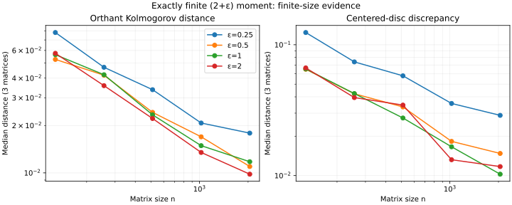

PARTIAL

# C0109: quantitative circular law with a finite (2+epsilon) moment

The optimal exponent was not determined. This report establishes a nonoptimal explicit upper rate and a fixed-law lower obstruction. The literature search found nearly optimal results under stronger moments, but no checked theorem identifying the optimal dependence under only a finite (2+epsilon) moment. This is a dated search conclusion, not proof that no such publication exists.

Write A_n=n^(-1/2) M_n, let mu_n be its empirical eigenvalue probability measure, and let sigma be uniform probability measure on the unit disk. Throughout, x is a **fixed entry law**, E x=0, E|x|^2=1, and E|x|^(2+epsilon)<infinity. Constants and thresholds may depend on the entry law. Unless stated otherwise, finite moments mean population moments, not moments imposed separately on each matrix sample.

The proved results are:

1. For both the orthant Kolmogorov metric d_K and discrepancy D over all disks, every exponent

   delta < min(epsilon,1)/24

   is valid with failure probability O(n^(-D_0)) for any fixed D_0>0, and almost surely eventually. In particular **delta(epsilon)=min(epsilon,1)/25** is an explicit choice. This follows by combining printed theorems with the concentration and integration argument proved below; no novelty claim is made.
2. For 0<epsilon<2/3, there is one symmetric real variance-one law with finite p=2+epsilon moment and infinite every higher moment, and sizes n_k, such that with probability tending to one

   d_K(mu_{n_k},sigma) >= n_k^(-b)/(32 pi k^4),

   D(mu_{n_k},sigma) >= n_k^(-b)/(4 k^4),    b=2epsilon/(2+epsilon).

   Hence no exponent delta>b works for every law in that class, even in probability. This lower obstruction is not a matching lower bound for the upper theorem.
3. In W_1, the elementary quantization lower bound 2/(3 sqrt(n)) holds for any n-point empirical measure. Jalowy's printed Ginibre upper bound matches its order. This settles that separate metric/law combination, not C0109 under minimal moments.

For 0<epsilon<2/3, these results leave a substantial gap between the available upper theorem (any delta<epsilon/24) and the obstruction at 2epsilon/(2+epsilon). Neither endpoint sharpness nor the optimal exponent is claimed.

## The original passage and its metric

I fetched [arXiv:0810.2994v3](https://arxiv.org/abs/0810.2994v3) and read Section 6, including the circular-law paragraph on manuscript p.22. The survey is Tao and Vu, *From the Littlewood-Offord problem to the circular law: universality of the spectral distribution of random matrices*, Bull. Amer. Math. Soc. 46 (2009), 377–396. The page number 22 refers to the arXiv manuscript, not the journal pagination.

The paragraph says that their earlier paper gives some polynomial rate under the additional moment hypothesis. Its final sentence is: “The exact dependence between ε and δ is not clear.” It does **not** name a metric, supply an exponent, or formulate an optimality convention.

Reference [54] is Tao–Vu, *Random matrices: The circular law*, Communications in Contemporary Mathematics 10(2) (2008), 261–307, [arXiv:0708.2895](https://arxiv.org/abs/0708.2895). Section 14, equation (54), manuscript pp.42–43, specifies

    d_K(mu_n,sigma)
      = sup_{s,t in R} |mu_n((−infinity,s] × (−infinity,t])
                         − sigma((−infinity,s] × (−infinity,t])|.

The statement is almost sure, for all sufficiently large n, with a positive unspecified exponent depending on the excess moment. The discussion is a proof sketch, rather than a numbered theorem establishing an explicit exponent. Remark 14.1 distinguishes the stronger finite-n probability estimate that the authors say should also be obtainable.

For comparison, disk discrepancy is

    D(mu,nu) = sup_{z in C, r>0} |mu(B_r(z))−nu(B_r(z))|.

These metrics and Wasserstein distances must not be interchanged. A fixed smooth test function is also different from a supremum over indicator functions or all Lipschitz functions.

## Literature checked

Page numbers in this table refer to the stored arXiv/electronic-reprint text, unless a journal range is explicitly given. Version identifiers are recorded in the texts and sources/manifest.jsonl. Later arXiv revisions can have different numbering from earlier ones.

| Reference and exact location | Assumptions, metric, and conclusion |
|---|---|
| [Tao–Vu 0708.2895](https://arxiv.org/abs/0708.2895), Theorem 1.2, p.3; Section 14, (54), pp.42–43 | Finite 2+epsilon moment. Almost sure polynomial orthant Kolmogorov convergence, with unspecified positive exponent in the rate sketch. Theorem 2.1, p.6, supplies arbitrarily high polynomial confidence for a sufficiently weak polynomial least-singular-value cutoff, under finite nonzero variance. |
| [Götze–Tikhomirov 0709.3995v4](https://arxiv.org/abs/0709.3995v4), Ann. Probab. 38(4) (2010), 1444–1491; Theorems 1.1–1.2, reprint p.2 | Their main theorem is weak convergence of the **expected** complex ESD under a second moment with a logarithmic weight. It is not a stated optimal Kolmogorov rate for the random complex ESD. |
| Same paper, Theorem 2.2, (2.2), reprint p.7; Remark 2.1, p.6 | An explicit Kolmogorov bound for the **mean squared-singular-value law of the shifted matrix**: O(phi(sqrt(n))^(-1/6)) in the dense case. Choosing phi(t)=(1+|t|)^min(epsilon,1) gives exponent min(epsilon,1)/12. This is a Hermitized rate, not directly an eigenvalue ESD rate. It is the quantitative input used below. |
| [Bourgade–Yau–Yin 1206.1449v3](https://arxiv.org/abs/1206.1449v3), PTRF 159 (2014), 545–595; Theorem 2.2, p.4 | Uniform subexponential tails. Away from the unit-circle edge, smooth local statistics at scale n^(-a), a<=1/2, have error dominated by n^(-1+2a) times the L^1 norm of the Laplacian. This is not a theorem under just 2+epsilon moments. |
| [Bourgade–Yau–Yin 1206.3187v3](https://arxiv.org/abs/1206.3187v3), PTRF 159 (2014), 619–660; Theorems 1.2–1.3, p.3 | At the edge: subexponential entries with vanishing third moments allow the optimal local scale, with n^(-1+2a) error. Without that condition this paper gives a<=1/4 and n^(-1/2+2a). Later local laws improve the assumptions. |
| [Tao–Vu 1206.1893](https://arxiv.org/abs/1206.1893), Ann. Probab. 43(2) (2015), 782–874; Theorem 20, pp.19–20; Theorem 25, p.21 | Condition C1 requires exponentially decaying tails; the quoted local-law/log-determinant results use matching to real or complex Gaussian through order three. Correlation-function universality elsewhere in the paper uses further moment matching. These are not minimal-moment uniform ESD rate theorems. |
| [Alt–Erdős–Krüger 1612.07776](https://arxiv.org/abs/1612.07776), Theorem 2.5, pp.5–6; assumptions (A)–(C), p.4 | Local inhomogeneous circular law in the bulk, with smooth local error n^(-1+2a+eta). The stored version assumes all normalized moments bounded and a density condition used for the least singular value. |
| [Alt–Erdős–Krüger 1907.13631](https://arxiv.org/abs/1907.13631), Probability and Mathematical Physics 2(2) (2021), 221–280; Theorem 2.3, p.5; Lemma 6.1, p.37 | Extends the local law to the edge with all normalized moments bounded; see also Remark 2.5 for removal of the density hypothesis in the iid setting. This is the AEK paper actually cited by Götze–Jalowy for their global rate, distinct from 1612.07776. |
| [Götze–Naumov–Tikhomirov 1708.06950](https://arxiv.org/abs/1708.06950), Theorem 2.3 and Corollary 2.4, p.4 | Finite 4+delta moments. Theorem 2.3 includes an entry cutoff and has overwhelming probability; Corollary 2.4 removes the cutoff with polynomial confidence. Away from the edge, smooth local error is O(log^5(n) n^(-1+2a)). The distinction between the two probability modes matters. |
| [Götze–Jalowy 1807.00489v3](https://arxiv.org/abs/1807.00489v3), Random Matrices: Theory and Applications 10(3) (2021), 2150026, online 2020, DOI [10.1142/S201032632150026X](https://doi.org/10.1142/S201032632150026X); Theorems 6–7, p.6 | All moments finite, condition (A). Global disk discrepancy and orthant Kolmogorov distance are <=n^(-1/2+eta) with overwhelming probability. This paper is **not** an Annals of Probability paper. Section 2.3, p.7, expressly treats it as a partial answer to the survey's question. |
| Same paper, Theorem 8, pp.6–7; condition (B), p.4 | As stated there, finite 4+delta moments allow n^(-1/2+eta) for disks contained in B_(1−tau), excluding the edge. This statement should not be silently substituted for a global theorem. Its probability statement is quoted as printed; the directly related GNT untruncated theorem above states polynomial confidence. Neither is used for this report's upper/lower proofs. |
| [Jalowy 1912.09300v2](https://arxiv.org/abs/1912.09300v2), *Rate of convergence for products of independent non-Hermitian random matrices*, Theorems 3–4, pp.2–4; Theorem 6 and Corollary 7, pp.5–6 | Gaussian products give the n^(-1/2) mean-law order and centered-disk random estimates up to logarithms. Under 4+delta moments, Theorem 6 concerns disks avoiding the edge; when m=1 its displayed rate is n^(-1/2) log^2(n). Product-specific restrictions near the origin also appear. It does not identify the optimal 2+epsilon exponent for one iid matrix. |
| [Jalowy 2111.03595v3](https://arxiv.org/abs/2111.03595v3), Ann. Inst. H. Poincaré Probab. Statist. 59(4) (2023), 2285–2307; Theorem 1 and Corollary 2, p.2; Theorem 3, p.3 | All moments finite give W_1<=n^(-1/2+eta) with overwhelming probability and the same expected order. For complex Ginibre, E W_1<=4/sqrt(n). For p>=2, Theorem 1 bounds **W_p^p**, not W_p, by n^(-1/2+eta). |
| [Cipolloni–Erdős–Schröder 1912.04100](https://arxiv.org/abs/1912.04100), CPAM 76(5) (2023), 946–1034; Assumption 2.1 and Theorem 2.2, pp.5–6 | All entry moments are assumed. For a fixed H^(2+eta) test function, the centered unnormalized sum has order-one Gaussian fluctuations, so its normalized statistic has order n^(-1), with a deterministic bias expansion. The 2+eta here describes **test-function regularity**, not the entry-moment hypothesis. It is not a uniform metric bound. |
| [Bordenave–Caputo–Chafaï–Tikhomirov 1607.05484](https://arxiv.org/abs/1607.05484), Ann. Probab. 46(4) (2018), 2268–2286; Theorem 1.3, p.3 | Symmetric entries with a finite 2+epsilon moment: P(rho(A_n)>=1+tau)<=C/(log n)^2. The heavy tails do not create persistent macroscopic outliers. |
| [Bordenave–Chafaï–García-Zelada 2012.05602v2](https://arxiv.org/abs/2012.05602v2), PTRF 182 (2022), DOI [10.1007/s00440-021-01079-9](https://doi.org/10.1007/s00440-021-01079-9); Theorem 1.1, p.2 | Finite variance alone suffices for rho(A_n)->1 in probability. This rules out the proposed generic outlier-count explanation for a typical-sample lower bound. |
| [Bai–Hu 2408.13490](https://arxiv.org/abs/2408.13490), *A revisit of the circular law*, Theorem 1.1, p.1 | A Lindeberg-condition circular-law convergence theorem, not an optimal polynomial rate theorem. |
| [Osman 2508.03631](https://arxiv.org/abs/2508.03631), *Bulk universality for sparse complex non-Hermitian random matrices*, Definition 1.1, p.1; Theorems 1.1 and 1.3, pp.2 and 5 | Bulk local statistics for a sparse moment hierarchy; the stated fixed-law truncation consequence is for 4+eta moments. This does not resolve the original minimal-moment global rate problem. |

A Williams SMALL 2018 group manuscript, dated November 24, 2020, has an indexed Proposition 1 claiming an exponent proportional to min(epsilon,1), with an unspecified absolute constant. Its primary-host PDF returned HTTP 403 on repeated direct attempts; I read the indexed statement but did not verify the full proof. It does not claim optimality, and no argument below depends on it. [Primary-host manuscript](https://sites.williams.edu/mstoiciu/files/2020/11/Random_Matrix_Theory.pdf).

Searches included the named authors/titles and combinations of circular law, rates, finite 2+epsilon moments, heavy tails, Kolmogorov, discrepancy, Wasserstein, and years through 2026. The primary texts stored here support the distinctions in the table. Search-engine publication/crawl dates were not treated as theorem dates. No exact optimal minimal-moment result was located.

## Truncation: what it proves and what it does not

Let p=2+epsilon, K_p=E|x|^p, and T=n^(1/2−c), 0<c<1/2. Markov's inequality and elementary tail integration give

    P(|x|>T) <= K_p T^(−p),
    E[|x|^2 1_{|x|>T}] <= K_p T^(−epsilon),
    |E[x 1_{|x|<=T}]| <= K_p T^(−1−epsilon).

The last line uses E x=0. If x_T=x 1_{|x|<=T}, then

    0 <= 1−Var(x_T)
       = E[|x|^2 1_{|x|>T}] + |E x_T|^2
       <= K_p T^(−epsilon) + K_p^2 T^(−2−2epsilon).

If N_T is the number of altered entries, then

    E(N_T/n) <= K_p n^(−epsilon/2+(2+epsilon)c).

Deleting those entries changes matrix rank by at most N_T; centering adds rank at most one. Hermitian interlacing therefore controls the **singular-value** CDF error by at most 2(N_T+1)/n. It does not give this control for the eigenvalue measure of a nonnormal matrix. For any eta>0, Markov gives N_T/n=O_P(n^(−theta+eta)), theta=epsilon/2−(2+epsilon)c; binomial tail bounds can give stronger confidence at a slightly weaker cutoff.

Variance lost at this cutoff is of order at most n^(−epsilon(1/2−c)). For the cutoff c=epsilon/[4(2+epsilon)], theta=epsilon/4. These are explicit valid truncation estimates, not eigenvalue convergence rates.

For clarity, suppose an applicable local/global Hermitized law supplied an L^r log-potential error O_P(n^(−a(c))), with uniform constants for this triangular array and adequate singular-value bounds. Combining the rank comparison through a clamped logarithm and the variance error would lead to the candidate log-potential exponent

    m(c)=min(a(c), theta(c), epsilon(1/2−c)),

and smoothing would give any eigenvalue exponent below

    m(c)/(2+1/r).

This is a **conditional calculation**. One cannot set a(c)=1 merely because the truncated variables have finite moments of every order. Their higher moments grow with n. For k>p,

    E|x_T|^k <= K_p T^(k−p),

which fails the uniform all-moment assumptions in the cited dense local laws. Also, for epsilon<2,

    P(any entry exceeds T) <= K_p n^(1−epsilon/2+(2+epsilon)c)

does not even tend to zero as a consequence of the moment hypothesis. A coupling argument that discards every sample containing one large entry therefore fails.

The proved upper theorem below instead uses the global Götze–Tikhomirov Hermitized estimate, which tracks the available moment explicitly. It avoids applying a stronger-moment local theorem outside its hypotheses. The least-singular-value cutoff enters the logarithm through its total variation O(log n); it does not by itself determine the final power.

The outlier premise also fails deterministically. An arbitrarily large off-diagonal matrix unit t E_12 is nilpotent. More strongly, deleting one entry of the cyclic permutation matrix changes rank by one but changes its spectrum from all n-th roots of unity to n zeros; the disk discrepancy changes by one. Large entries, singular values, rank changes, and outlier eigenvalues cannot be counted interchangeably.

## Proof of the explicit upper rate

The following is the full derivation from the three printed inputs. The exponent is nonoptimal.

```text
AN EXPLICIT NONOPTIMAL UPPER RATE BY HERMITIZATION

Statement. Suppose x is a fixed complex or real law with E x=0, E|x|^2=1,
and E|x|^(2+epsilon)<infinity. Let kappa=min(epsilon,1). For each
0<delta<kappa/24 and each D>0 there is C<infinity such that, for all
sufficiently large n,

 P(max(d_K(mu_n,sigma),D_disc(mu_n,sigma)) > C n^(-delta)) <= C n^(-D).

Here sigma is the uniform probability law on the unit disk. Consequently these
bounds hold almost surely for all sufficiently large n, for any coupling of the
matrices, with an almost surely finite prefactor. One concrete choice is
delta(epsilon)=min(epsilon,1)/25. No optimality is asserted.

Printed inputs (all read in sources/).

(A) Götze--Tikhomirov, arXiv:0709.3995v4, Theorem 2.2, equation (2.2),
p.7 (electronic-reprint pagination). In the dense case p_n=1, the expected
CDF of squared singular values of A_n-zI differs uniformly in its real
argument from its deterministic limiting CDF by at most
C E[|x|^2 phi(x)] phi(sqrt(n))^(-1/6), provided phi tends to infinity
and t/phi(t) is nondecreasing. Choose phi(t)=(1+|t|)^kappa. This gives
O(n^(-kappa/12)). The limiting (unsquared) singular-value law has bounded
density and compact support for z in a fixed compact set: Remark 2.1,
p.6. These bounds and the constants in the proof of Theorem 2.2 can be
taken uniformly for z in that compact set. Its log integral is the circular
law log potential; see their Section 3, equation (3.15).

(B) Tao--Vu, arXiv:0708.2895, Theorem 2.1, p.6. For every fixed compact
set of z and every Q>0, some B<infinity gives
P(s_min(A_n-zI)<n^(-B))<=C n^(-Q), pointwise in z, with constants uniform
on that compact set. To obtain the normalized version apply the theorem
with deterministic matrix -sqrt(n) z I and absorb sqrt(n) into n^B.
It assumes only a fixed entry law with nonzero finite variance.

(C) Götze--Jalowy, arXiv:1807.00489v3, Theorem 5, p.5, and Corollary 13,
pp.11--12. For each fixed 1<=r<infinity, and a>=2, they bound disk
discrepancy and the orthant metric by

 C_r [ a^(1+1/r) ||U_mu-U_sigma||_{L^r(K)} + a^(-1) ],

where K can be a fixed square containing the disk and a neighborhood.
For disks one can enlarge the ball in Theorem 5 to this square. The remainder
is O(1/a) because sigma has bounded density and compact support.
U_mu(z)=-integral log|z-w| dmu(w).

Proof, including the probabilistic passage from (A) to (C).
Write alpha=kappa/12, q=n^(-alpha). Fix a compact square K and Q>0.
Let F_n(s,z) be the RANDOM empirical CDF of the UNSQUARED singular
values of A_n-zI, and F(s,z) its deterministic limit. Taking square roots
of the threshold in (A) gives

 sup_s |E F_n(s,z)-F(s,z)| <= C q.

For a fixed z and threshold s, replacing a row of M_n changes the Hermitian
dilation of A_n-zI by rank at most 2. Hermitian interlacing therefore changes
F_n(s,z) by at most 2/n. To see the factor, the dilation has size 2n and its
CDF changes by at most 2/(2n); recovering the positive singular-value CDF
costs at most another factor 2. McDiarmid's bounded-differences inequality
applied to the n independent rows yields

 P(|F_n(s,z)-E F_n(s,z)|>t) <= 2 exp(-n*t^2/2).

Pick deterministic quantile cutpoints of the continuous F(.,z) with increments
at most q, including endpoints of its compact support. There are O(q^(-1))
cutpoints. A union bound with t=q, followed by monotonic interpolation between
cutpoints, gives

 P(sup_s |F_n(s,z)-F(s,z)|>C' q)
       <= C q^(-1) exp(-n*q^2/2) <= C_Q n^(-Q).

The last inequality uses alpha<=1/12, so n*q^2>=n^(5/6). The constants
are uniform in z in K. This is a pointwise-in-z probability assertion, not
a simultaneous assertion about every z.

Next E||A_n||_F^2=n. Hence for any L>0,
P(||A_n||>n^L)<=n^(1-2L). Choose L large enough, and combine this with
(B). Outside an event of probability O(n^(-Q)), all singular values of
A_n-zI lie in [n^(-B),n^L+sup_K|z|]. Increase L by 1 to absorb the shift.
Clamp log(s) below n^(-B) and above n^(L+1), obtaining a continuous
nondecreasing function ell_n with total variation (B+L+1)log n.
Stieltjes integration by parts gives, on this event,

 |integral ell_n(s) d(F_n-F)(s,z)| <= C q log n.

The lower-clamp error for F is at most C n^(-B), since its density is
bounded and integral_0^h log(h/s)ds=h. The upper-clamp error vanishes
for large n because F has uniformly compact support. Increase B if needed
so B>alpha. Thus

 P(|U_n(z)-U_sigma(z)|>C_Q q log n)<=C_Q n^(-Q)                 (1)

uniformly pointwise in z in K.

Fix a finite r>=1. We now justify the spatial L^r estimate needed in (C).
For a deterministic matrix with ||A_n||<=n^L,

 ||U_n-U_sigma||_{L^(2r)(K)} <= C_{r,K,L} log n.               (2)

Indeed |lambda_j|<=||A_n|| and Minkowski bounds the norm of the average
of -log|z-lambda_j| by the average of their norms. The integral of
|log|z-w||^(2r) over |z-w|<=1 is uniformly finite in w, and on the rest
of K its size is O(1+log(1+|w|)). This proves (2). Infinite values at the
finite set of eigenvalues do not affect these Lebesgue norms.

Define E_n={z in K: |U_n(z)-U_sigma(z)|>C_Q q log n}. By (1),
Fubini gives E|E_n|<=C_Q n^(-Q). For any H>0 Markov yields
P(|E_n|>n^(-H))<=C_Q n^(-Q+H). On its complement and the norm event,
Hölder and (2) give

 ||U_n-U_sigma||_{L^r(K)}
 <= C q log n + |E_n|^(1/(2r))*||U_n-U_sigma||_{L^(2r)(K)}
 <= C log n [q+n^(-H/(2r))].

Take H>=2r alpha, Q>=H+D+2, and L with 2L-1>=D+2. We have proved

 P(||U_n-U_sigma||_{L^r(K)}>C q log n)<=C n^(-D)               (3)

for arbitrary fixed D. Crucially, (3) did not take a supremum over z
or assert a lower singular-value bound simultaneously at every z.

Finally use (C) with a=n^s and s=alpha/(2+1/r). From (3), with failure
probability at most C n^(-D), each metric is at most C n^(-s) log n.
Given delta<kappa/24=alpha/2, choose a finite r large enough that delta<s.
Then n^(-s)log n=O(n^(-delta)), proving the assertion. A union bound covers
both metrics. Choose D=2 and sum failure probabilities to obtain the almost
sure assertion by Borel--Cantelli; independence between matrix sizes is not
needed. QED.

Audit of limitations. This is a synthesis of printed input theorems, not a
claim to solve the optimal-rate problem or a claim that this exponent is new.
The proof tracks a nonoptimal exponent of the mean Hermitized law; the
smallest-singular-value exponent B affects constants and logarithms, not the
power displayed. All entry-law and moment-bound constants may affect the
threshold in n. No all-moment local law is applied to an n-dependent truncation.

```

## Proof of a fixed-law lower obstruction

The construction uses variance that a finite matrix is unlikely to sample. It does not require outliers. Its entry law is fixed across matrix sizes and has exactly the stated finite-moment endpoint.

```text
FIXED-LAW OBSTRUCTION FROM UNSAMPLED VARIANCE

Statement. Let 0<epsilon<2/3, p=2+epsilon, and b=2epsilon/(2+epsilon).
There exist a fixed symmetric real law X, E X=0, E X^2=1,
E|X|^p<infinity, and E|X|^(p+r)=infinity for every r>0,
and integers n_k tending to infinity such that, for iid-entry matrices,

 P(d_K(mu_{n_k},sigma_1) >= n_k^(-b)/(32*pi*k^4)) -> 1,
 P(D_disc(mu_{n_k},sigma_1) >= n_k^(-b)/(4*k^4)) -> 1.

Here sigma_v is uniform on the disk of radius sqrt(v), d_K uses lower-left
orthants, D_disc uses all disks, and mu_n is the ESD of n^(-1/2) M_n.
In particular neither distance is O_P(n^(-delta)) for any delta>b.
This is an obstruction, not a matching convergence theorem.

Input theorem. Götze--Jalowy, arXiv:1807.00489v3, Theorems 6 and 7,
p.6: for any fixed centered variance-one real law with all moments finite,
and any gamma<1/2, each of the two distances is <=n^(-gamma) with
probability >=1-n^(-2), for every sufficiently large n. Constants and the
threshold may depend on the fixed law. No uniformity over truncations is used.

Proof. Put gamma=(b+1/2)/2. Let G be standard real Gaussian. Inductively,
having fixed n_1,...,n_{k-1}, define independent symmetric variables Z_j by

 a_j=n_j^(-b)/j^4, q_j=n_j^(-2)/j^2, B_j=n_j^(2/p)/j,
 P(Z_j=B_j)=P(Z_j=-B_j)=q_j/2, P(Z_j=0)=1-q_j.

Then q_j B_j^2=a_j, since 4/p-2=-b. Let
Y_k=G+sum_{j<k} Z_j, v_k=Var(Y_k)=1+sum_{j<k}a_j.
This finite sum has all moments. Choose n_k so large that

 (i) n_k>=exp(k^2), n_k>=2 n_{k-1}, a_k<=2^(-k);
 (ii) both input-theorem conclusions for Y_k/sqrt(v_k), with exponent gamma,
      hold at n_k, each with failure probability <=n_k^(-2);
 (iii) n_k^(-gamma)<=n_k^(-b)/(32*pi*k^4).

All these are possible because b<gamma<1/2 and Y_k is already fixed.
The variance parameters satisfy 1<=v_k<=V:=1+sum_j a_j<=2.

Define W=G+sum_{j>=1}Z_j and X=W/sqrt(V). The series converges in L^p:

 E|Z_j|^p=q_j B_j^p=j^(-p-2)=j^(-4-epsilon),
 sum_j ||Z_j||_p=sum_j j^(-(p+2)/p)<infinity.

Consequently W is centered, Var(W)=V, and E|X|^p<infinity. For r>0,
let R_k=W-Z_k, independent of Z_k and with variance <=2. Since B_k->infinity,
Chebyshev gives P(|R_k|<=B_k/2)>=1/2 for all sufficiently large k. Therefore

 E|W|^(p+r)>= (q_k/2)*(B_k/2)^(p+r)
             = 2^(-p-r-1)*n_k^(2r/p)/k^(p+r+2) -> infinity.

The left side does not depend on k, so it is infinite. Scaling by sqrt(V)
preserves this conclusion.

Couple an n_k-by-n_k W-matrix with its Y_k-matrix using the same Gaussian
and rare variables. The probability that ANY variable Z_j with j>=k is active
in ANY of its n_k^2 entries is at most

 n_k^2 sum_{j>=k}q_j <= k^(-2) sum_{l>=0}4^(-l) = 4/(3k^2).

Outside that event the two matrices, hence their eigenvalues, coincide exactly.
The input theorem and a union bound imply that, with probability at least
1-4/(3k^2)-2*n_k^(-2), their ESD nu_k satisfies

 d_K(nu_k,sigma_{v_k})<=a_k/(32*pi),
 D_disc(nu_k,sigma_{v_k})<=a_k/(32*pi).

For this step, rescaling the standardized Y_k-matrix multiplies every eigenvalue
by sqrt(v_k); both metrics are invariant under common positive dilations.

We now compare the TWO DETERMINISTIC disk laws. For s=sqrt(v_k)/2, the
CDF of the real marginal of sigma_u, u in [v_k,V], is

 F_u(s)=1/2+[arcsin(s/sqrt(u))+s*sqrt(u-s^2)/u]/pi,
 dF_u(s)/du=-s*sqrt(u-s^2)/(pi*u^2).

Since 1<=v_k<=u<=2, s>=1/2 and u-s^2>=3/4, the derivative's absolute
value is at least sqrt(3)/(16*pi)>1/(16*pi). Hence

 d_K(sigma_{v_k},sigma_V)>=F_{v_k}(s)-F_V(s)
                          >=(V-v_k)/(16*pi)>=a_k/(16*pi).

Real-marginal CDF differences are bounded by d_K, by letting the second
orthant threshold tend to infinity. The triangle inequality yields

 d_K(nu_k,sigma_V)>=a_k/(32*pi).

For disks, take the centered disk of radius sqrt(v_k). Its probabilities
under sigma_{v_k} and sigma_V are 1 and v_k/V respectively, so

 D_disc(sigma_{v_k},sigma_V)>=(V-v_k)/V>=a_k/2.

Thus D_disc(nu_k,sigma_V)>=a_k/2-a_k/(32*pi)>=a_k/4.
Finally divide all eigenvalues and the reference disk by sqrt(V). This gives
the asserted bounds for the variance-one law X. For any delta>b,
n_k^(delta-b)/k^4 tends to infinity by (i), proving failure of O_P(n^(-delta)).
This also rules out O(n^(-delta)) almost surely with an almost surely finite
constant, since that would imply O_P(n^(-delta)). QED.

Audit. The entries form ONE law independent of n. The asymptotics are along a
subsequence; there is no claim at every n. The law has exactly p finite moments
in the endpoint sense stated. Rare variance, not outliers, is the mechanism.

```

## A matching order in a different metric

For completeness, there is a short deterministic lower bound in W_1. Let S be any set of at most n points in the plane, and let nu be supported on S. Every transport from sigma to nu moves z by at least dist(z,S). The union of n disks of radius t has sigma-mass at most n t^2. The layer-cake identity therefore gives

    W_1(sigma,nu)
      >= integral dist(z,S) dsigma(z)
      >= integral_0^(1/sqrt(n)) (1−n t^2) dt
       = 2/(3 sqrt(n)).

This proof allows any weights on S and any positions of the points. For the complex Ginibre empirical measure, Jalowy, Theorem 3, manuscript p.3, gives E W_1<=4/sqrt(n) for sufficiently large n. Thus the n^(-1/2) expected order is matched for that entry law and metric. It cannot be substituted for an optimal minimal-moment orthant theorem.

## Numerical evidence

The simulated real entry law was genuinely at the endpoint: it has finite moment of order p=2+epsilon and infinite moment of every order p+r, r>0. A pure Pareto with tail exponent p would instead have an infinite p-th moment and would not meet the hypothesis.

Let Y>=0 have density proportional to exp(−p y)/(1+y)^2, let an independent sign be uniform on {−1,+1}, and set

    x = sign * exp(Y) / sqrt(I(epsilon)/I(2+epsilon)),
    I(a)=integral_0^infinity exp(−a y)/(1+y)^2 dy
        =1−a exp(a) E_1(a),  a>0; I(0)=1.

For r<=p, E exp(rY)=I(p−r)/I(p); for r>p the integral diverges. Hence the normalization gives E x=0 and E x^2=1 and establishes the endpoint assertion. The sampler uses rejection from an exponential random variable of rate p, with acceptance probability (1+Y)^(-2). There was no normalization by the observed sample variance.

I simulated epsilon=0.25,0.5,1,2, sizes 128,256,512,1024,2048, and three independent matrices at each setting: 60 matrices total. Eigenvalues, seeds, population normalization, empirical second moments, timing, and peak process RSS are saved. Runs inherited nice 10 and configured all available BLAS/OpenMP thread controls to one; matrices were processed sequentially. The peak reported RSS was 440.8125 MiB, far below 4 GB. Total measured generation/eigenvalue/metric time was 73.26 seconds. These timings describe this run, not an algorithmic complexity claim.

The original d_K was computed over all empirical CDF cells, including left limits at ties and the marginal limits at infinity. The reference circular CDF is continuous and monotone in each coordinate, so its extrema on each cell lie at the lower-left and upper-right corners. This reduces the supremum to finitely many exactly enumerated corners; it is not a coarse test grid. The second metric was the exact supremum over **centered** disks, a lower bound for full disk discrepancy, computed from sorted eigenvalue radii. No full all-center disk supremum was computed.

The following slopes fit log(median distance) against log n. The last-three-size slope is included to expose finite-size drift. They are descriptive fits; the regression standard errors in data/fits.json do not quantify the uncertainty in an asymptotic exponent.

| epsilon | fitted delta, d_K | last 3 sizes, d_K | fitted delta, centered disks | last 3 sizes, centered disks | median d_K at 2048 |
|---:|---:|---:|---:|---:|---:|
| 0.25 | 0.542 | 0.458 | 0.526 | 0.502 | 0.01789 |
| 0.5 | 0.582 | 0.572 | 0.548 | 0.591 | 0.01097 |
| 1 | 0.602 | 0.495 | 0.670 | 0.713 | 0.01177 |
| 2 | 0.651 | 0.588 | 0.659 | 0.781 | 0.00981 |




The apparent slopes exceed 1/2 in several fits and vary when small sizes are excluded. They do not establish an asymptotic rate, monotonic dependence on epsilon, or a contradiction to the lower obstruction. That obstruction uses a different, highly lacunary fixed law and sizes chosen far beyond ordinary simulations. Three replicates per size cannot resolve rare-event behavior. Finite-size observations do not prove sharpness.

## Audit, reproduction, and remaining gap

The load-bearing exponent calculation was re-derived directly: phi(sqrt(n))^(-1/6)=n^(-kappa/12), and optimizing a^(1+1/r)n^(-kappa/12)+a^(-1) gives s=kappa/(24+12/r), tending to kappa/24. The lower law was checked independently through q_k B_k^2=a_k and q_k B_k^p=k^(-p−2), and the real-marginal derivative was checked analytically and by finite differences.

The numerical checks saved in data/audit.json and data/verification.json include:

- circular-law CDF versus independent quadrature: maximum absolute error 7.57e−10;
- optimized orthant-distance implementation versus direct brute-force corner counting, including ties: error 0 on the checked cases;
- population second-moment normalization versus an independent compact-interval quadrature: agreement within 2.4e−13;
- real-marginal derivative versus finite differences: maximum error 9.36e−12;
- one atom at the origin gives d_K=3/4 and centered-disk discrepancy 1.

The proofs distinguish squared singular values, unsquared singular values, and eigenvalues, and distinguish mean measures, random measures, pointwise probability bounds, and simultaneous spatial estimates. No eigenvalue rank inequality or unsupported entry-to-outlier count is used. In the upper proof the singular-value limit is the push-forward under square root of the squared-singular-value limit; logarithmic integrals are taken in the unsquared variable, avoiding a factor-of-two ambiguity.

To reproduce the saved numerical analysis from this directory:

```sh
python3 code/simulate.py
python3 code/analyze.py
python3 code/audit.py
python3 code/plot.py
```

code/simulate.py refuses sizes above 2500 and requires inherited nice>=10. It configures one thread before importing numerical libraries. The source fetcher streams PDF bytes through pdftotext stdin/stdout and writes only text. sources/manifest.jsonl records retrieval URLs, text hashes, and page counts. No PDF, paper image, or scan is retained. The plot is generated from the numerical data, not from any source document.

The precise optimal exponent under only a finite (2+epsilon) moment remains unproved here. The explicit upper theorem and the fixed-law lower obstruction do not match. The endpoint, possible logarithmic corrections, and any stronger theorem outside the checked references remain unresolved. The source's original unspecified-exponent question must not be reported as solved by an all-moment n^(-1/2) theorem.

Task: “Open problem C0109” — received 2026-11-13 approximately 09:00 Asia/Tbilisi; first recorded clock 09:00:40.
