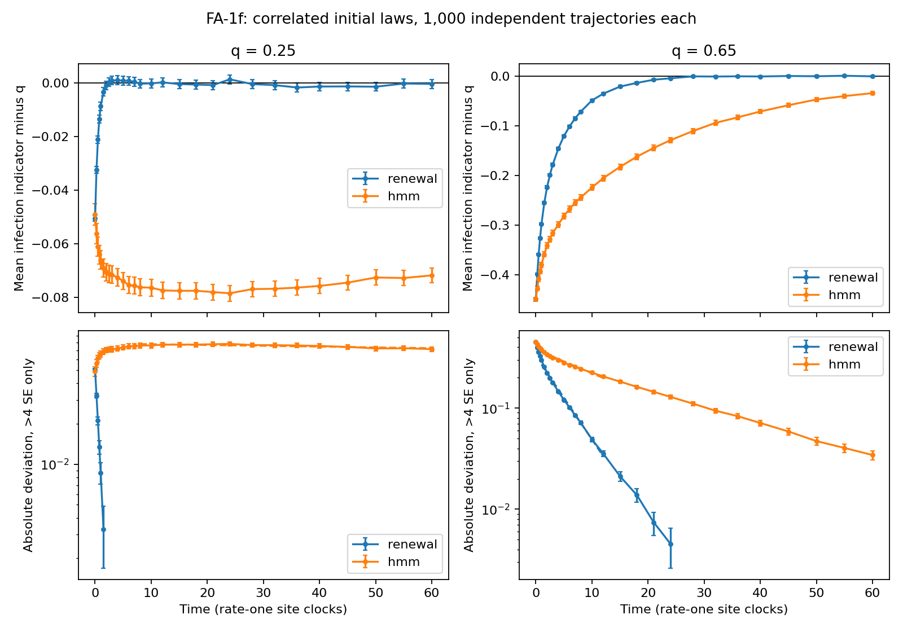
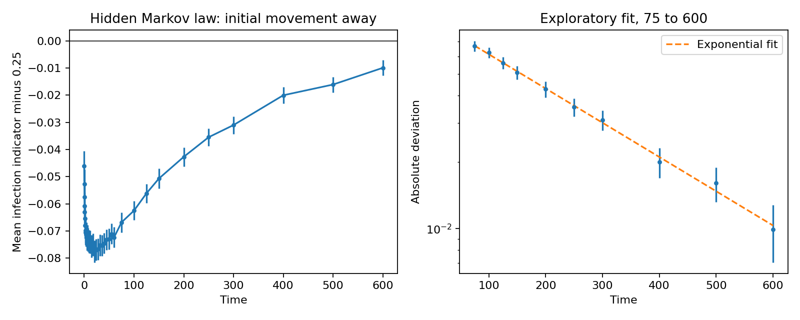

PARTIAL

# D0027: exponential relaxation for one-dimensional FA-1f

The all-density conjecture is not proved here, and no counterexample or published resolution was found in the searches recorded below. A proof is given for **every q > 1/2 under exactly the stated, origin-centered gap hypothesis**, allowing arbitrary correlations, finitely many infections, and nonstationary initial laws. A second result gives exponential relaxation for every q in (0,1) under a quantitative local absolute-continuity assumption, including a class of correlated Markov laws. These are consequences of existing methods; no claim of novelty is made. The unresolved regime is general initial laws satisfying only the gap hypothesis when 0 < q <= 1/2.

## 1. Exact question and conventions

Martinelli–Shapira–Toninelli, *Long time behaviour of one facilitated kinetically constrained models: results and open problems*, arXiv:2510.20461v1 (23 October 2025), Section 1.1, PDF p. 2, Conjecture 2, considers **general probability measures** nu on {0,1}^Z. It imposes no product, stationarity, ergodicity, mixing, or infinite-infection assumption. The condition is at the single center 0:

\[
 \nu(\eta_x=1\text{ for every }x\in[-\ell,\ell])\le A e^{-\kappa\ell}
 \quad(\ell\ge\ell_0),\qquad \kappa>0.                 \tag{G}
\]

Infection/vacancy is spin **0**; healthy/occupied is spin **1**. Write p=1-q, where 0<q<1. At each site a rate-one clock proposes an independent spin, 0 with probability q, and 1 with probability p. The proposal is accepted if either nearest neighbor is 0. The reversible law is pi=Bernoulli(p)^{tensor Z}, so pi(eta_0=0)=q. For local f (a real function of finitely many binary spins, hence bounded), the conjecture asks for constants C,c>0, allowed to depend on q,nu,f, such that

\[
 |\nu P_t f-\pi f|\le C e^{-ct}.                       \tag{C2}
\]

Set R(eta)=min{|x|:eta_x=0}, with min(empty set)=infinity. Then (G) is an exponential upper bound on nu(R>ell). It implies nu(R<infinity)=1, but does **not** imply infinitely many infections: the deterministic configuration with its only zero at 0 satisfies it.

The related Conjecture 1, equation (1.1), PDF p. 2, asks for convergence without a rate under **nu(at least one infected vertex)=1**. “Infinitely many” in the supplied paraphrase is stronger than the source. An atom on the all-healthy configuration would prevent convergence; (G) excludes that atom.

Source: https://arxiv.org/abs/2510.20461; locally `sources/2510.20461.txt`.

## 2. What the existing special cases actually use

BCMRT means Blondel–Cancrini–Martinelli–Roberto–Toninelli, *Fredrickson–Andersen one spin facilitated model out of equilibrium*, Markov Processes and Related Fields 19 (2013), 383–406. The author preprint saved here has 21 PDF pages and is dated 25 November 2011; all its page citations below refer to that specific preprint, not to the journal pagination.

**Uniform gap moments, without independence.** BCMRT Theorem 2.1, preprint pp. 4–5, proves exponential relaxation on Z for q>1/2 if, for some theta>1,

\[
 \sup_{x\in\mathbb Z}\nu(\theta^{D_x})<\infty,
 \qquad D_x(\eta)=\min_{y:\eta_y=0}|x-y|.                \tag{U}
\]

This is a statement about arbitrary initial measures, including correlated measures. Product structure is only one way to verify (U); see Remark 2.4, p. 5. Deterministic configurations with bounded gaps also qualify (Remark 2.3). The abstract's informal “mean distance” is weaker sounding than the actual exponential-moment hypothesis and should not replace it.

The proof first uses finite propagation to reduce to a box of length O(t). It partitions that box into blocks of length epsilon*t and compares to a chain restricted to configurations with at least two zeros per block. Proposition 3.1, p. 6, gives the comparison bound; Proposition 3.4, p. 9, supplies a uniform spectral gap and a logarithmic Sobolev bound proportional to block size. Proposition 4.1, pp. 10–11, propagates distance moments. Section 5, pp. 11–12, uses (U) at all the block centers to bound the probability of an empty-of-infections block uniformly over the time interval. No independence of those bad-block events is used: a union bound suffices.

**A single seed, high q.** Mountford–Valle, *Exponential convergence for the Fredrickson–Andersen one-spin facilitated model*, J. Theoret. Probab. 32 (2019), 282–302; arXiv:1609.01364v1. Theorem 1.1, preprint p. 2, gives exponential local convergence from a single infection when q is sufficiently close to 1 on a class of bounded-degree subexponential-growth graphs containing Z. Remark 1.2, p. 3, explicitly extends this to any initial law with an exponentially decaying distance from one fixed center to the nearest infection. Thus the exact centered hypothesis is already covered at sufficiently high q. Their proof constructs a graphical coupling with equilibrium and controls backward paths using a high-q percolation structure. This is not an all-q theorem. Their spin convention is reversed: particle 1 corresponds to our infection 0.

**A neighborhood of equilibrium, all q.** Cancrini–Martinelli–Schonmann–Toninelli (CMST), *Facilitated oriented spin models: some non equilibrium results*, J. Stat. Phys. 138 (2010), 1109–1123; arXiv:0810.4237. Theorem 2.1, preprint p. 4, covers any one-dimensional finite-range KCM with positive spectral gap when finite-window densities relative to equilibrium grow sufficiently slowly exponentially in the window radius. This does not require a product initial law. The proof on pp. 4–5 combines finite propagation, a local density comparison, and L2 spectral contraction. Part 5 below gives a self-contained version of that argument with explicit sufficient constants.

**The distinguished zero needs orientation.** CMST Theorems 3.1–3.2, preprint p. 5, prove the much stronger all-q statements for the East model. Lemma 3.5, p. 6, says an equilibrium interval behind a distinguished zero remains at product equilibrium conditional on its trajectory. When the marker moves, it exposes a spin with the correct independent Bernoulli law. The trajectory is determined by the independent environment on the facilitating side. In FA-1f the constraint at the marker also depends on the side being equilibrated. Conditioning on its trajectory can therefore bias that side. Merely marking a zero in FA-1f does not give the conditional-product property. The issue persists even for a deterministic single initial infection, so correlations of nu alone are not the fundamental obstruction.

**What the centered bound leaves uncontrolled.** It says nothing uniform about gaps centered far from 0. The single-zero configuration has D_x=|x| and fails (U). Even finite-range mixing or stationarity of an initial law does not, by itself, prove the low-q dynamical estimate. A positive equilibrium spectral gap controls L2(pi) densities, whereas a point mass or a different infinite Bernoulli product may be singular to pi. Finite-box spectral contraction from a worst-case configuration pays an exp(C*box size) density cost; finite propagation requires a box of size O(t), so the spectral decay need not beat that cost. Restricting to infected blocks addresses that cost only after proving persistent infections in the relevant blocks.

For q<=1/2 the simple inward-distance drift used below has the wrong sign. A large healthy gap is not permanently blocked, but a sufficiently strong uniform estimate on its filling and on relaxation behind the advancing infections is missing from this argument. Treating the front as a symmetric random walk and asserting a diffusive filling time ignores branching and would not constitute a counterexample.

The survey's other all-q results concern different generators: Theorem 3.1 (East-polluted FA-1f, pp. 14–15), Theorem 4.1 (small-delta West, p. 16), and Theorem 5.2 (double flip process, p. 20, used for BABP). FA-1f and BABP have comparable Dirichlet forms, but that comparison does not order arbitrary-start semigroups or transfer the double-flip duality.

## 3. A finite-propagation lemma

Let two FA-1f chains use the same clocks and coins, with initial configurations agreeing on I=[-r,r]. Let f have support S contained in [-m,m], and let d=r-m>=1. Then, for u>=0,

\[
 \Pr(\text{a disagreement reaches }S\text{ by time }u)
 \le |S|\sum_{n\ge d}\frac{(2u)^n}{n!}.                \tag{FP}
\]

In particular, if d>=8e*u, the right side is at most (4/3)|S|4^{-d}.

**Proof.** When a new disagreement is created at an updating site whose spins previously agreed, at least one neighboring pair must already disagree; otherwise both chains accept or reject the same coin and still agree. Trace this cause backward from a disagreement in S until it leaves I. Each spatial step is to a nearest neighbor and uses a strictly earlier clock ring. A path must have at least d such steps. There are at most |S|2^n candidate spatial sequences of length n. For a fixed sequence, the expected number of ordered n-tuples of Poisson rings in a time interval of length u is u^n/n!, including sequences revisiting a site (by Poisson factorial moments). Markov's inequality and a union bound give (FP). Finite boxes justify the tracing construction first; the same bounds give its infinite-volume limit. Since n!>=(n/e)^n, for n>=d>=8e*u each summand is at most 4^{-n}. Summing the geometric series gives the assertion. For expectations multiply the disagreement bound by 2||f||_infinity. No order comparison or attractiveness is involved. QED.

## 4. Main partial theorem: the centered hypothesis suffices for q>1/2

**Theorem A.** Fix q in (1/2,1) and a finite S. There exist gamma,c,C>0, depending only on q and S, such that for every probability law nu on {0,1}^Z, every f supported on S, and every t>=0,

\[
 |\nu P_t f-\pi f|
 \le \|f\|_\infty\left(Ce^{-ct}+2\nu(R>\gamma t)\right).\tag{A}
\]

Consequently (G) implies exponential convergence for q>1/2. More generally, a tail exp(-kappa*r^beta), 0<beta<1, yields that stretched-exponential rate, and nu(R<infinity)=1 gives qualitative convergence. No condition on the number or spatial distribution of other infections is imposed.

The one non-elementary relaxation input in this proof is the published BCMRT Theorem 2.1, stated in Part 2. Its constants may be taken uniform over laws satisfying (U) for fixed theta and a fixed moment bound K; this is also visible in its Proposition 3.1 and Section 5 proof. We do not claim to reprove that published theorem here. The reduction from its uniform hypothesis to the centered hypothesis is proved in full below.

**Distance drift.** Choose theta with 1<theta<q/p, and put

\[
 a=\log\theta,\quad
 \lambda=(\theta-1)(q/\theta-p)>0,\quad
 B=\frac{q}{q-p\theta}.
\]

For all deterministic configurations with D_x finite,

\[
 \mathbb E_\eta[\theta^{D_x(\eta(s))}]
 \le e^{-\lambda s}\theta^{D_x(\eta)}+B.              \tag{D}
\]

Here is a direct proof, also establishing the infinite-volume version of BCMRT Proposition 4.1. If D_x=d>=1, an infection can be created at distance d-1 at total rate at least q. The distance can increase only if its unique closest zero heals. That happens at rate at most p; if legal it has another infected neighbor, so the increase is at most one. Extra closest zeros prevent an increase, and extra births only decrease the distance. Hence

\[
 L\theta^{D_x}\le\theta^d[p(\theta-1)+q(\theta^{-1}-1)]
 =-\lambda\theta^d\quad(d\ge1).
\]

If D_x=0, healing has rate at most p and leaves an infection at distance 1, so the drift is at most p(theta-1). Together these bounds give

\[
 L\theta^{D_x}\le-\lambda\theta^{D_x}+b,
 \qquad b=q(\theta-1)/\theta,
\]

because -lambda+b=p(theta-1). Apply Dynkin's formula and Gronwall to a finite interval with frozen infected exterior; distance there is bounded and the same generator bound holds. Start with the restriction of eta and zeros outside. Its initial D_x is at most the original D_x. Finite propagation gives convergence of every fixed local cylinder as the interval expands. Applied to min(theta^{D_x},M), which depends on a finite neighborhood, and then M increasing to infinity, Fatou/monotone convergence gives (D), with b/lambda=B. This also proves that the distance is finite at every fixed time whenever its initial exponential moment is finite. QED.

**Proof of Theorem A.** We first prove a bound uniform over deterministic initial configurations with R<=gamma*t. Fix

\[
 \rho=\gamma=\lambda/(8a),\qquad
 \epsilon=\min\{1/4,\rho/(32e)\},\qquad
 h=\epsilon t,\quad s=(1-\epsilon)t,\quad
 r=\lfloor\rho t\rfloor.
\]

For such a configuration eta and |x|<=r, the triangle inequality gives D_x(eta)<=|x|+R<=(rho+gamma)t. Therefore (D) implies

\[
 \mathbb E_\eta[\theta^{D_x(\eta(s))}]
 \le\exp[-\lambda(1-\epsilon)t+2a\rho t]+B
 \le e^{-\lambda t/2}+B\le 1+B.                     \tag{4.1}
\]

At deterministic time s, replace every spin outside [-r,r] by 0. Call the resulting random configuration zeta and its law mu_{eta,t}. This replacement is used only to define a new initial law for the remaining time h; it is **not** a monotone comparison of the two evolving FA-1f chains. The nearest-infection distance in zeta is no larger than the original distance inside [-r,r], and it is zero outside. Thus

\[
 \sup_x\mu_{\eta,t}(\theta^{D_x})\le1+B.              \tag{4.2}
\]

Apply BCMRT Theorem 2.1 to this law for duration h. The fixed theta and bound 1+B are independent of eta and t, so for constants C_0,c_0>0 depending only on q,S,

\[
 |\mu_{\eta,t}P_hf-\pi f|\le C_0\|f\|_\infty e^{-c_0h}
 \quad(h\ge2).                                      \tag{4.3}
\]

Couple the original chain after s and the chain started from zeta using fresh common clocks. Conditional on eta(s), their initial spins agree in [-r,r]. For all sufficiently large t (depending only on q,S),

\[
 r-m\ge\rho t/2\ge 8e h,
\]

since epsilon<=rho/(32e). Part 3 bounds the expectation difference by

\[
 (8/3)|S|\|f\|_\infty4^{-(r-m)}\le C_1\|f\|_\infty e^{-c_1t}. \tag{4.4}
\]

The Markov property, (4.3), and (4.4) prove

\[
 \sup_{\eta:R(\eta)\le\gamma t}|P_tf(\eta)-\pi f|
 \le C\|f\|_\infty e^{-ct}.                         \tag{4.5}
\]

Increasing C covers the bounded interval of t where h<2 or the distance comparison was unavailable. Finally integrate (4.5) on {R<=gamma*t}, and use the elementary bound 2||f||_infinity on its complement. This proves (A). Under (G), nu(R>gamma*t)<=A' exp(-kappa*gamma*t) for large t, with integer rounding absorbed in A'. The exponential rate can be chosen as min(c,kappa*gamma). QED.

**Where the proof stops.** For q<=1/2, q-p*theta<0 for every theta>1, so lambda is not positive. There is then no expanding interval estimate (4.1) from this Lyapunov function. A comparison of spectral gaps with East does not repair this missing infection-persistence estimate. Theorem A therefore does not resolve the conjecture as stated for all q.

## 5. An all-q result under local density control

Fix any q in (0,1), and let g=g(q)>0 be the infinite-volume L2(pi) spectral gap of FA-1f. Positivity for this model is a published equilibrium result (see the references below). Let v=16e.

**Theorem B.** Suppose for some K<infinity and b>=0,

\[
 M_r:=\max_{\omega\in\{0,1\}^{[-r,r]}}
 \frac{\nu(\eta_{[-r,r]}=\omega)}{\pi(\eta_{[-r,r]}=\omega)}
 \le K e^{br}\quad(r=0,1,\ldots),\qquad b<2g/v.       \tag{B}
\]

Then every local f converges exponentially, at a rate at least the minimum of g-bv/2 and a positive finite-propagation rate. This is a quantitative version of CMST Theorem 2.1, not a new resolution of Conjecture 2.

**Proof.** For r=ceil(v*t)+m+1, form mu_r by sampling the configuration inside [-r,r] from nu's marginal and the exterior independently from pi. It agrees with nu inside the interval under an initial coupling. Part 3 bounds

\[
 |\nu P_tf-\mu_rP_tf|\le C_S\|f\|_\infty e^{-c_{FP}t}.
\]

The global density h_r=dmu_r/dpi depends only on [-r,r], is nonnegative, has pi(h_r)=1, and satisfies

\[
 \|h_r-1\|_2^2=\pi(h_r^2)-1\le M_r-1\le K e^{br}.
\]

Reversibility and the spectral-gap inequality give

\[
 |\mu_rP_tf-\pi f|
 =|\pi((h_r-1)P_t(f-\pi f))|
 \le\sqrt K e^{br/2}e^{-gt}\sqrt{\operatorname{Var}_\pi f}
 \le C_{K,b,m}\|f\|_\infty e^{-(g-bv/2)t}.
\]

Both exponents are positive by assumption. Adjust constants for bounded t. QED.

For an explicit correlated class, let nu be a stationary two-state Markov chain in space with transition matrix T, positive entries, stationary marginal alpha, and

\[
 T_{ij}\le e^d\pi(j)\quad(i,j\in\{0,1\}),\qquad
 0\le d<\min\{g/v,-\log p\}.                        \tag{M}
\]

The probability of a word of length 2r+1 divided by its pi probability is at most K_0 exp(2dr), where K_0=max_i alpha_i/pi(i). Thus (B) holds with b=2d. These laws are mixing exponentially in space because the positive 2x2 transition matrix has a nontrivial eigenvalue of modulus less than 1; for example its rows can be chosen distinct and arbitrarily close to pi. They also satisfy (G), since

\[
 \nu(\eta_{[-r,r]}\equiv1)=\alpha_1T_{11}^{2r}
 \le\alpha_1\exp[-2(-\log p-d)r].
\]

This proves the conjectured conclusion for a correlated class at every q. The quantitative closeness in (M), not mixing alone, pays for the L2 density cost. It may be extremely restrictive at small q, where g is small.

## 6. Literature search, exact locations, and limits

Searches were performed on 13 November 2026, before the proof attempt, using the exact arXiv identifier and title, the named authors/titles, “FA-1f 2025/2026 convergence equilibrium”, and related front, cutoff, and local-relaxation terms. Later queries followed citation leads. Primary paper texts were read; plain-text copies and download hashes are in `sources/`. The table gives locations in the **specific saved PDF-to-text versions**. Thus a preprint page need not equal the journal page with the same theorem.

| Work | Verified result/location | Relevance and restriction |
|---|---|---|
| Martinelli–Shapira–Toninelli (2025), [arXiv:2510.20461v1](https://arxiv.org/abs/2510.20461) | Section 1.1, Conjectures 1–2 and equation (1.1), PDF p. 2 | Exact problem, general nu, infection=0. It explicitly says the all-q problem remains open. |
| Blondel–Cancrini–Martinelli–Roberto–Toninelli (2013), MPRF 19, 383–406, [author preprint](https://perso.pages.math.cnrs.fr/users/cyril.roberto/Articles/Blondel-Cancrini-Martinelli-Roberto-Toninelli-MPRF-13.pdf) | Theorem 2.1, PDF pp. 4–5; Proposition 3.1 p. 6; Proposition 3.4 p. 9; Proposition 4.1 pp. 10–11; main proof pp. 11–12 | q>1/2 and uniform exponential distance moments; arbitrary correlated initial measures. Theorem A reduces the centered hypothesis to this result. |
| Mountford–Valle (2019), J. Theoret. Probab. 32, 282–302, [arXiv:1609.01364v1](https://arxiv.org/abs/1609.01364) | Theorem 1.1 PDF p. 2; Remark 1.2 p. 3; graphical coupling and Proposition 1.2 pp. 3–4 | Exponential local relaxation from one infection; Remark 1.2 covers precisely the centered exponential distance tail. Requires q sufficiently close to 1. |
| Cancrini–Martinelli–Schonmann–Toninelli (2010), J. Stat. Phys. 138, 1109–1123, [arXiv:0810.4237v1](https://arxiv.org/abs/0810.4237) | Theorem 2.1 and proof PDF pp. 4–5; East Theorems 3.1–3.2 p. 5; distinguished-zero Lemma 3.5 p. 6; proofs pp. 7–8 | The all-q FA-1f statement is perturbative in initial local densities. The nonperturbative distinguished-zero conclusions are for oriented East. |
| Cancrini–Martinelli–Roberto–Toninelli (2008), PTRF 140, 459–504, [author journal copy](https://perso.pages.math.cnrs.fr/users/cyril.roberto/Articles/Cancrini-Martinelli-Roberto-Toninelli-PTRF-08.pdf) | Theorem 6.3 and Theorem 6.4, journal p. 484 / PDF p. 26 | Positive FA-1f spectral gap at all q; this is an equilibrium L2 result. It supplies g(q)>0 in Theorem B. |
| Chleboun–Faggionato–Martinelli (2016), *Relaxation to equilibrium of generalized East processes on Z^d: renormalization group analysis and energy-entropy competition*, Ann. Probab. 44, 1817–1863, [arXiv:1404.7257](https://arxiv.org/abs/1404.7257) | Theorems 1, 2, 3, saved PDF pp. 7, 8, 9 respectively | Infinite-volume relaxation time, finite-box relaxation times with boundary sensitivity, and infection hitting times in the low-q limit. These concern oriented East-like models; they do not prove the arbitrary-start FA-1f estimate. |
| Ertul (2022), *Cutoff for the Fredrickson-Andersen one spin facilitated model*, ALEA 19, 511–536, [journal copy](https://alea.impa.br/articles/v19/19-20.pdf) | Theorem 2.1 journal pp. 513–514 / PDF pp. 3–4; Theorem 2.2 p. 514 / PDF p. 4 | Precise relaxation in terms of the largest initial healthy block and cutoff at L/(2v), with a square-root window. Requires q above a threshold; uses threshold-contact-process coupling and a zeros lemma. |
| Ganguly–Lubetzky–Martinelli (2015), *Cutoff for the East process*, Comm. Math. Phys. 335, 1287–1322, [arXiv:1312.7863](https://arxiv.org/abs/1312.7863) | Theorem 1 PDF p. 2; Theorem 2 p. 3; Theorem 3.1 p. 10 | East front LLN/CLT and finite-volume cutoff. Theorem 3.1 gives exp(-t^alpha) convergence to the front invariant law. This is neither a claimed exponential-in-t front bound nor an all-q FA-1f theorem. |
| Blondel (2013), *Front progression in the East model*, Stochastic Process. Appl. 123, 3430–3465, [arXiv:1212.4435](https://arxiv.org/abs/1212.4435) | Proposition 2.3 PDF p. 6; Theorem 4.7 p. 19; Theorem 5.1 p. 21; Theorem 6.1 p. 30 | Local relaxation via a distinguished zero, equilibration behind the front, uniqueness of the front invariant law, and a front LLN. All concern East, not FA-1f. |
| Blondel–Deshayes–Toninelli (2019), *Front evolution of the Fredrickson-Andersen one spin facilitated model*, Electron. J. Probab. 24, paper 1, 1–32, [arXiv:1803.08761](https://arxiv.org/abs/1803.08761) | Theorems 2.1–2.2, saved preprint PDF p. 5 | FA-1f front invariant law and LLN/CLT, for q above a threshold. The front-frame convergence is not a proof of low-q relaxation from general nu. |
| Pillai–Smith (2017), *Mixing times for a constrained Ising process on the torus at low density*, Ann. Probab. 45, 1003–1070, [arXiv:1501.05263](https://arxiv.org/abs/1501.05263) | Theorem 2, saved preprint PDF p. 3 | Finite tori, d>=3, density c/n, discrete random-site updates, n^3 to n^3 log n mixing bounds. Different dimension, density limit, and time normalization from fixed-q infinite-line local relaxation. |
| Pillai–Smith (2019), *Mixing times for a constrained Ising process on the two-dimensional torus at low density*, AIHP Probab. Stat. 55, 1649–1678, [arXiv:1708.03838v1](https://arxiv.org/abs/1708.03838) | Theorem 1, saved preprint PDF p. 3 | Two-dimensional extension with n^3 to n^3 log(n)^14 bounds in that preprint. Does not imply a one-dimensional infinite-volume statement. |
| Marêché (2020), *Exponential convergence to equilibrium in supercritical kinetically constrained models at high temperature*, MPRF 26, 861–884, [arXiv:1907.05844v2](https://arxiv.org/abs/1907.05844) | Theorem 3, saved preprint PDF p. 3 | Nontrivial Bernoulli initial law, supercritical update families in dimensions 1 and 2; equilibrium q close enough to 1, with threshold allowed to depend on initial density. |
| Hartarsky–Fabio Lucio Toninelli (2024), *Kinetically constrained models out of equilibrium*, Probab. Math. Phys. 5, 461–489, [arXiv:2212.08437v2](https://arxiv.org/abs/2212.08437) | Theorem 3.1 PDF pp. 8–9; Theorem 3.3 p. 9; comparison with prior work pp. 10–11; proof strategy pp. 12–14 | Linear finite-box mixing and exponential relaxation from suitable Bernoulli initial laws for general update families, with equilibrium q close to 1. Their renormalization and graphical coupling do not remove that restriction. Fabio Lucio Toninelli here is a different coauthor from Cristina Toninelli. |
| Campailla–Martinelli (2025), *Cutoff for East models*, [arXiv:2504.05760v3](https://arxiv.org/abs/2504.05760) | Theorem 1.1, PDF p. 4 | A 2025 related development for oriented East models, not a resolution of D0027. The title of v1 included “at high temperature”; the saved v3 title does not. |
| Martinelli (2026), *Kinetically Constrained Spin Models: A Short Survey*, ICM 2026, Volume 5, 497–515, [DOI 10.1137/25M180425X](https://epubs.siam.org/doi/full/10.1137/25M180425X) | Section 2.2.1, Conjecture 2.11; primary publisher HTML; reference [48] cites 2510.20461 | Still states convergence from an infection as a conjecture and notes the threshold restriction in available results. Exact chapter page not verified because direct PDF/HTML download was blocked; indexed publisher text was readable. |

The requested Mountford title appears to refer to T. S. Mountford, *Exponential convergence for attractive reversible subcritical nearest particle systems*, Stochastic Process. Appl. 59 (1995), 235–249, [DOI 10.1016/0304-4149(95)00048-c](https://doi.org/10.1016/0304-4149(95)00048-c). Crossref metadata confirmed the exact title and DOI. The publisher full-text endpoint returned HTTP 429, so **its theorem number and full hypotheses were not verified** and it is not used as an input in either proof. The named attractiveness assumption cannot be assumed for FA-1f.

For post-2025 follow-up, OpenAlex's citation query for W4416620060 returned one citing work, the 2026 ICM survey above. Both the response and the query result are saved as text. Semantic Scholar returned HTTP 429. Exact-identifier/title searches, author publication pages, and 2025–2026 FA-1f searches found no published all-q resolution. This is a bounded literature search, not a certificate that no unindexed resolution exists. A 2026 MPI seminar on “patch-positive” spin systems was also checked; its announced application is the East model with independent noise, not the noiseless FA-1f problem.

## 7. Simulation evidence

### Initial laws and their gap bounds

Both simulated initial laws are stationary on Z, have infection density 0.2, and are correlated.

1. **Renewal law.** Interinfection distances are iid D=1+Geom(1/4), with Geom supported on {1,2,...}. Equivalently, for the spatial spin chain, T(0,1)=1, T(1,0)=1/4, and T(1,1)=3/4. Its stationary marginal is nu(eta_x=0)=1/5. Thus

   \[
    \nu(\eta_{[-r,r]}\equiv1)=\frac45(3/4)^{2r}.
   \]

   A stationary renewal law with **unshifted geometric** distances would just be iid Bernoulli; the one-step shift here deliberately makes this a correlated example.

2. **Hidden Markov law.** The stationary hidden chain H_x has transition matrix

   \[
    T=\begin{pmatrix}.97&.03\\.03&.97\end{pmatrix}
   \]

   and uniform marginal. Conditional on H, emissions are independent with infection probabilities .02 and .38. Its mean infection density is .20. Since every conditional healthy-emission probability is at most .98,

   \[
    \nu(\eta_{[-r,r]}\equiv1)\le .98^{2r+1}.
   \]

   More precisely, with D_1=diag(.98,.62) and alpha=(1/2,1/2), the probability of a healthy word of length L is alpha*D_1*(T*D_1)^(L-1)*1. The spectral radius of T*D_1 is approximately .952159. Exact matrix evaluations for r=0,...,20 are saved in `data/initial_gap_probabilities.csv`. Positive hidden transitions and emissions make this a spatially mixing law, with substantially longer healthy regions than the renewal example.

### Dynamics, observables, and uncertainty

`code/simulate.cpp` uses an exact Gillespie construction for the finite interval: sample the next legal-site proposal time at rate equal to the current number of legal sites, choose one such site uniformly, and resample its spin with infection probability q. Proposals that leave the spin unchanged are retained in this clock. The constraint is an OR of infected neighbors; a site with two infected neighbors still has proposal rate **one**, so this simulates FA-1f, not BABP. Frozen zeros are used just outside the interval.

The first runs used N=1024, 1,000 independent trajectories per law/q combination, q=.25 and .65, and 28 observation times through t=60. We recorded f(eta)=1{eta_0=0}, its adjacent-pair analogue, and averages of their translates over the central 256 sites. Translation invariance of the infinite initial laws makes the latter averages estimators of the same local expectations. They reduce variance, but the error calculation treats **whole independent trajectories** as the sampling units; it does not assume independence between sites or times.

The middle block is at least 384 graphical steps from the exterior. Part 3 gives, uniformly through t=60, a boundary-influence probability at most

\[
 256\sum_{n\ge384}\frac{120^n}{n!}<4.69\times10^{-27}.
\]

Thus the finite-interval approximation error is negligible relative to Monte Carlo uncertainty for these particular runs. This control is limited to the stated time horizon.

An exploratory follow-up for the hidden Markov law at q=.25 used N=8192, 500 independent trajectories, and ten additional times through t=600. The central block was again 256 sites; its buffer of at least 3968 gives a union influence bound below 10^(-337). This longer run and its fitted window were chosen after seeing the early nonmonotonic behavior; they are identified as exploratory.

### Observed decay and fits

We fitted log(abs(mean-q))=log(A)-c*t by least squares on the reported windows, retaining only deviations larger than four empirical standard errors and with a consistent sign. Percentile uncertainty intervals resample whole trajectories 400 times using fixed seeds. These intervals measure Monte Carlo variability of the chosen finite-window fit; they do not account for asymptotic model error or the choice of window.

| Initial law | q | Fit times | Fitted c | Trajectory bootstrap 95% interval | Log-fit R^2 |
|---|---:|---|---:|---|---:|
| Renewal | .65 | 1–12 | .18978 | [.18527, .19460] | .9956 |
| Hidden Markov | .65 | 1–12 | .05400 | [.05266, .05559] | .9804 |
| Renewal, exploratory early window | .25 | .25–1.5 | 1.8323 | [1.5554, 2.3140] | .9993 |
| Hidden Markov, exploratory long run | .25 | 75–600 | .003563 | [.003196, .003973] | .9964 |

For renewal/q=.25 the original later window 8–60 had no resolved signal and **no fit**; those data were retained. For hidden-Markov/q=.25 the initial mean infection density drops from about .20 to about .172 before recovering. An exponential fit over the initial 8–60 window has R^2=.7004 and is not convincing; its rate .001378 and all fit details remain in `data/fits.json`. The longer run gives a much straighter semilog curve. Allowing a free exponent beta in A*exp(-c*t^beta) over 75–600 gives beta=1.01 on the searched grid [.25,1.75]. In contrast the short q=.65 windows have fitted beta about .79 and .545 for renewal and hidden Markov. This window dependence illustrates why finite-time fitted exponents do not settle the conjecture.

The hidden Markov process's slower rate is consistent with the effect of longer initial healthy regions. These simulations provide evidence compatible with exponential decay after a transient; they neither prove an exponential asymptotic rate nor exclude slower ultimate relaxation for other laws.





Raw trajectory data, signed means, standard errors, seeds, and fits are saved under `data/`. `summary.csv`, `long_summary.csv`, `fits.json`, and `extra_fits.json` contain the numerical values behind these figures.

## 8. What was checked

- Re-read the original conjectures and conventions against the saved source, and checked that the proof never substitutes a product-law assumption or infinitely-many-infections assumption.
- Derived the Lyapunov coefficient twice: directly from the generator and from the finite-volume Proposition 4.1 in BCMRT. Checked the algebra linking the coefficient to the cone's expansion rate and the second stage's finite-propagation requirement.
- Audited the use of the patched configuration: only its initial infection distances are compared, and the two subsequent evolutions are related by graphical finite propagation. No attractive coupling or censoring theorem is assumed.
- Checked that the BCMRT input is uniform over initial laws with fixed theta and moment bound, so the time-dependent patched law is allowed. The only established inputs used are that theorem and the all-q equilibrium spectral gap.
- Independently built the N=8 generator with infected boundary, verified row sums, detailed balance, and pi-stationarity, and compared matrix-exponential expectations to 6,000 independently simulated trajectories for each of three initial-law/q cases. Across density, pair, origin, and origin-pair observables at all 28 times, the largest standardized discrepancy was 2.330. Details: `data/verification.json`.
- Checked the active-site bookkeeping after every update in three smoke runs, including a single infection. Independently enumerated all 1,024 N=10 configurations for six q values and three theta values: the distance-generator inequality held with maximum positive residual below 1.6e-15. A negative lambda at low q is recorded, not interpreted as decay.
- Two larger equilibrium controls (500 trajectories for each q) kept central infection and pair means within 2.59 empirical standard errors of q and q^2 over the sampled times; direct single-site observables were noisier, with maximum standardized deviation 3.09. Temporal correlation and multiple comparisons are retained in interpreting these numbers.
- Numerically evaluated the finite-boundary bounds using log-factorials and the geometric upper bound on the remaining series, independently of the simulation.
- All simulations used one thread, inherited nice 15 (lower priority than nice 10). Numerical-library thread counts were fixed at one. The longer simulation used 14.69 CPU seconds and 15.70 wall seconds on this run. The analysis process reported peak resident memory about 86.9 MB. The simulator's arrays are O(N), below 0.1 MB at N=8192, apart from normal runtime/stream overhead. `/usr/bin/time -l` could not read the sandboxed kernel clock-rate/RSS statistics and returned an error after the successful 500-trajectory simulation; its output is retained in `data/long_run_resources.txt`. No result depends on that unavailable statistic.

The report's status is PARTIAL because it proves restricted mathematical conclusions and records evidence, while leaving the low-q arbitrary-law problem unresolved. It is not a claim of a new result in print.


To reproduce the numerical work from this directory:

```sh
python3 code/reproduce.py
```

This compiles the simulator and runs all cases serially at nice >=10 with fixed seeds and single-thread numerical libraries. It regenerates the numerical CSV/JSON files and figures; it does not download sources. To regenerate a source text, use `python3 code/fetch_sources.py NAME.txt URL` with the URL in `sources/manifest.jsonl`. PDF downloads are converted in memory and pipes; they are never saved as PDF files.

Task: “Open problem D0027.” Prompt file timestamp 2026-11-13 07:14:13 Asia/Tbilisi.
