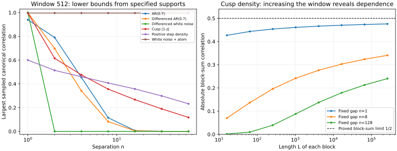

PARTIAL

Bradley Question 8 is not resolved here. No exact published answer was located in the accessible literature. The unrestricted necessity of a representation
\[
 f(z)=|P(z)|^2g(z),\qquad g\in C(\mathbb T),\quad \min g>0,
\tag{A}
\]
remains unproved in this report. In particular, a search with inaccessible books and papers cannot certify that the question remains open in print.

The following results are established below:

1. (A) is sufficient, with an explicit uniform bound on the interlaced coefficients.
2. There is an equivalence in the following large class: continuous nonnegative densities, positive except at finitely many points, with a two-sided asymptotic \(f(e^{i(\theta_j+t)})\sim c_j|t|^{\beta_j}\), where \(c_j>0\) and \(0<\beta_j<\infty\). In this class, \(r^*(n)\to0\) if and only if every \(\beta_j\) is an even integer; equivalently, (A) holds with the corresponding multiplicities.
3. Continuity, positivity almost everywhere, finitely many finite-order zeros, and even absolute summability of covariances do not suffice: \(f(e^{it})=(\pi/4)|1-e^{it}|\) has all those properties but \(r^*(n)\ge1/2\) for every \(n\).
4. The differenced white-noise example has \(r^*(1)=1\) and \(r^*(n)=0\) for \(n\ge2\), with nonsingular covariance matrices in every finite window.

These are deductions from classical results plus the arguments below, not claims of new results or of a full solution.

## Definitions and the source

Write \(dm(t)=dt/(2\pi)\) on the circle, and \(\gamma(h)=E[X_h\overline{X_0}]\). For finite coefficient arrays, put \(A(z)=\sum_{k\in S}a_kz^k\), \(B(z)=\sum_{k\in T}b_kz^k\). If the spectral measure has density \(f\), then
\[
 E\left[(\sum a_kX_k)\overline{(\sum b_kX_k)}\right]
 =\int A\overline B f\,dm.
\]
The coefficient \(r_f^*(n)\) is the supremum of the absolute value divided by \(\|A\|_f\|B\|_f\), over nonempty finite sets with \(\min_{s\in S,t\in T}|s-t|\ge n\). A zero denominator gives zero. Taking closed linear spans gives the same supremum by approximation in the Hilbert norm. This is linear correlation; arbitrary nonlinear functions of the variables are not included.

The source is [Bradley 2005](https://arxiv.org/abs/math/0511078), *Probability Surveys* **2**, 107–144. Full extracted text is `sources/bradley_2005.txt`. Read locations:

- §§6.1–6.2, journal pp.127–129, PDF pp.21–23: complex conjugation, normalized Lebesgue measure, and equations (6.1)–(6.8). Text extraction sometimes drops overbars; the formulas above restore them.
- Theorem 6.2, journal p.130, PDF p.24: \(r(n)\to0\) iff \(f=|p|^2\exp(u+\widetilde v)\), with \(p\) a polynomial and \(u,v\) continuous real functions. This is the past/future coefficient.
- Theorem 6.3, journal p.131, PDF p.25: a continuous spectral density is equivalent to either \(\zeta(n)\to0\) or \(\kappa(n)\to0\).
- Theorem 6.4, same page: for a nonzero sequence, \(r^*(1)<1\) iff the density is bounded between strictly positive constants; also equivalent is \(r(1)<1\) together with \(r^*(N)<1\) for some \(N\).
- Theorem 6.5, same page: the four equivalent conditions are a continuous strictly positive density; \(r^*(1)<1\) and \(r^*(n)\to0\); \(r(1)<1\) and \(r^*(n)\to0\); and \(r(1)<1\), \(r^*(N)<1\) for some \(N\), and \(\zeta(n)\to0\).
- Question 8 is at the end of §6.5, journal p.132, PDF p.26. It asks for a condition on the spectral density equivalent to \(r^*(n)\to0\) alone.

The VMO gloss following survey Theorem 6.2 is not used as a criterion on \(f\) itself. The precise formulation in Peller 1998 Theorem 10.1 is \(\log(f/|P|^2)\in\mathrm{VMO}\). Membership of \(f\) itself in VMO would be insufficient: every continuous density has that property, including the nonmixing example (10).

The zero process is a separate trivial case: its spectral density is zero and all these linear coefficients are zero.

## Why there is a gap

The limit assumption already implies existence of a continuous density. Here is a useful bound that also makes clear why a singular measure is impossible.

Choose \(N\) with \(\rho=r^*(N)<1\), and put \(\sigma^2=E|X_0|^2\). On any finite set \(I\) whose indices are mutually at distance at least \(N\), randomly split the coefficients of \(W=\sum_{i\in I}a_iX_i\) into two sums \(U,V\), each coefficient independently going to either side with probability \(1/2\). For every split,
\[
 (1-\rho)(\|U\|^2+\|V\|^2)\le\|W\|^2
 \le(1+\rho)(\|U\|^2+\|V\|^2).
\]
The correlation bound applies to every split; an empty side is harmless. Since
\[
 E_{\rm split}(\|U\|^2+\|V\|^2)
 =\tfrac12\|W\|^2+\tfrac12\sigma^2\sum|a_i|^2,
\]
we obtain
\[
 \frac{1-\rho}{1+\rho}\sigma^2\sum|a_i|^2
 \le\|W\|^2\le
 \frac{1+\rho}{1-\rho}\sigma^2\sum|a_i|^2.
\tag{1}
\]
Partition an arbitrary finite coefficient array into its \(N\) residue classes. Cauchy–Schwarz and the upper bound in (1) give
\[
 \|\sum a_kX_k\|^2\le M\sum|a_k|^2,
 \qquad M=N\sigma^2\frac{1+\rho}{1-\rho}.
\tag{2}
\]
If \(\nu\) is the spectral measure, (2) says \(\int|A|^2d\nu\le M\int|A|^2dm\). Approximate the square root of any nonnegative continuous function uniformly by Laurent polynomials. Passing to the limit proves \(\nu\le M m\), hence an \(L^\infty\) density exists. Moreover, the coefficient \(\kappa(n)\), whose denominator is the product of the coefficient \(\ell^2\) norms, satisfies
\[
 \kappa(n)\le M r^*(n)\longrightarrow0.
\]
Bradley's Theorem 6.3 therefore gives a continuous representative of the density. The use of Theorem 6.3 is an explicit classical dependency, not a new proof of that theorem.

If instead \(r^*(1)<1\), take \(N=1\) in (1). The lower bound then applies to *every* coefficient array and gives a uniform positive lower bound for the density. With merely \(r^*(N)<1\), combining residue classes gives the upper bound (2) but gives no lower bound: the classes may cancel. This is the missing coercivity in the proof of Theorem 6.5. In spectral form, uniform approximation of \(f\) controls normalized correlations using \(\|A\|_f\ge\sqrt{\min f}\|A\|_2\); that step fails at a zero of \(f\).

Since \(r(n)\le r^*(n)\), the past/future factorization in Theorem 6.2 is also necessary. It does not assert that the remaining factor is continuous and bounded away from zero after division by the polynomial. That extra conclusion is exactly what has not been established in general here. This necessary factorization also gives \(f>0\) almost everywhere and \(\log f\in L^1\): a nonzero polynomial vanishes at only finitely many points, and the real harmonic conjugate of continuous \(v\) belongs to \(L^2\). Thus vanishing on an interval, or on any set of positive Lebesgue measure, is excluded.

## Polynomial factors: a complete sufficiency proof

**Lemma.** If \(g\) is continuous on the circle and \(m_0=\min g>0\), define
\[
 E_j(g)=\inf\{\|g-q\|_\infty:q\text{ is a trigonometric polynomial of degree at most }j\}.
\]
Then
\[
 r_g^*(n)\le E_{n-1}(g)/m_0.
\tag{3}
\]

Indeed, \(A\overline B\) has no Fourier exponent of absolute value less than \(n\). Therefore \(\int A\overline B q\,dm=0\) for every such \(q\). Thus
\[
 |\int A\overline B g\,dm|
 \le\|g-q\|_\infty\|A\|_2\|B\|_2
 \le\frac{\|g-q\|_\infty}{m_0}\|A\|_g\|B\|_g.
\]
Take the infimum and the supremum. Uniform trigonometric approximation of a continuous periodic function gives \(E_j(g)\to0\), proving (3) and its limit.

**Proposition.** Let \(P(z)=\sum_{j=0}^dp_jz^j\ne0\), and let \(f=|P|^2g\). For \(n>d\),
\[
 r_f^*(n)\le r_g^*(n-d).
\tag{4}
\]

For any admissible \(A,B\),
\[
 \langle A,B\rangle_f=\langle PA,PB\rangle_g,
 \qquad \|A\|_f=\|PA\|_g.
\]
The Fourier supports of \(PA,PB\) are contained in \(S+\{0,\dots,d\}\) and \(T+\{0,\dots,d\}\). Any two indices in these supports differ in absolute value by at least \(n-d\). They are consequently admissible for the right side of (4), with identical correlation quotient. This proves (4), including zero-norm cases. For a Laurent polynomial, replace \(d\) by the width of its exponent support, after an irrelevant monomial shift.

Combining (3) and (4), representation (A) implies
\[
 r_f^*(n)\le \frac{E_{n-d-1}(g)}{\min g}\longrightarrow0.
\tag{5}
\]
Roots of \(P\) need not be on the circle for sufficiency; roots off the circle can be absorbed into the positive continuous factor. This proof uses arbitrary separated sets, so it proves the interlaced assertion, not just a past/future assertion.

## Exact equivalence for finitely many power-law zeros

**Theorem.** Let \(f\not\equiv0\) be continuous and nonnegative on the circle. Suppose its zeros are precisely the distinct points \(e^{i\theta_1},\ldots,e^{i\theta_J}\), and for each \(j\),
\[
 f(e^{i(\theta_j+t)})=c_j|t|^{\beta_j}(1+o(1)),
 \qquad t\to0,\quad c_j>0,\quad 0<\beta_j<\infty.
\tag{6}
\]
Here the asymptotic is two-sided with the *same* constant. Then the following are equivalent:

- \(r_f^*(n)\to0\).
- Every \(\beta_j\) belongs to \(\{2,4,6,\ldots\}\).
- \(f=|P|^2g\), where \(P(z)=\prod_j(z-e^{i\theta_j})^{\beta_j/2}\) and \(g\) extends to a strictly positive continuous function on the circle.

The zero-free case \(J=0\) is included with \(P=1\).

**Necessity.** By \(r(n)\le r^*(n)\) and Bradley's Theorem 6.2, there are a nonzero polynomial \(p\) and continuous real \(u,v\) with
\[
 \log f=2\log|p|+u+\widetilde v\quad\text{almost everywhere}.
\tag{7}
\]
All terms are integrable: (6) gives only logarithmic singularities for \(\log f\), the polynomial term is integrable, and the harmonic conjugate of \(v\in L^2\) belongs to \(L^2\).

We need the following elementary fact. At every fixed \(\theta_0\), if \(v\) is continuous, its conjugate Poisson integral satisfies
\[
 Q_r*v(\theta_0)=o\!\left(\log\frac1{1-r}\right),\qquad r\uparrow1.
\tag{8}
\]
Use normalized circle integration and
\[
 Q_r(t)=\frac{2r\sin t}{1-2r\cos t+r^2}.
\]
Its integral is zero and, for \(r\ge1/2\),
\[
 |Q_r(t)|\le C\frac{|t|}{(1-r)^2+t^2},\quad |t|\le\pi,
 \qquad \|Q_r\|_1\le C\left(1+\log\frac1{1-r}\right).
\]
For given \(\varepsilon>0\), choose \(\delta>0\) with \(|v(\theta_0-t)-v(\theta_0)|<\varepsilon\) for \(|t|<\delta\). Subtract \(v(\theta_0)\) from the integrand. The near integral is bounded by \(\varepsilon\|Q_r\|_1\), and the far integral by a constant depending on \(\delta,v\) but independent of \(r\). Divide by \(\log(1/(1-r))\), let \(r\uparrow1\), then \(\varepsilon\downarrow0\). This proves (8). The Poisson integral of \(\widetilde v\) is \(Q_r*v\), up to the immaterial choice of sign for harmonic conjugation; this also follows directly by Fourier coefficients.

Fix a zero \(\theta_j\), and let \(m_j\) be the multiplicity of \(p\) there, allowing \(m_j=0\). Set \(\psi=\log f-2\log|p|\), \(a=\beta_j-2m_j\), and \(\ell_j(t)=\log|e^{it}-e^{i\theta_j}|\). Near \(\theta_j\), (6) gives \(\psi-a\ell_j=C+o(1)\). This difference is bounded on a fixed neighborhood of \(\theta_j\), and it is integrable on the whole circle. Its Poisson integral at \(re^{i\theta_j}\) is therefore bounded: the local part is bounded by its local supremum, and outside that neighborhood the Poisson kernel is \(O(1-r)\).

The exact identity
\[
 P_r*\ell_j(\theta_j)=\log(1-r)
\]
follows either from the harmonic function \(\log|1-z|\) or from its Fourier series. Consequently
\[
 P_r*\psi(\theta_j)=(\beta_j-2m_j)\log(1-r)+O(1).
\tag{9}
\]
On the other hand, (7), boundedness of \(u\), and (8) show that the left side is \(o(\log(1/(1-r)))\). Thus \(\beta_j=2m_j\), a positive even integer. This proves the necessary condition without assuming a pointwise formula for \(\widetilde v\) at the zero itself.

**Factorization and sufficiency.** Suppose \(\beta_j=2m_j\). Define \(P(z)=\prod_j(z-e^{i\theta_j})^{m_j}\). Away from the zeros, \(g=f/|P|^2\) is continuous and positive. At \(\theta_j\), (6) and \(|e^{i(\theta_j+t)}-e^{i\theta_j}|/|t|\to1\) give
\[
 g(e^{i\theta_j})=
 \frac{c_j}{\prod_{\ell\ne j}|e^{i\theta_j}-e^{i\theta_\ell}|^{2m_\ell}}>0.
\]
These values extend \(g\) continuously. Compactness gives \(\min g>0\), and (5) proves \(r_f^*(n)\to0\). Conversely, such a factorization has the stated even orders. This completes both directions in class (6).

The hypotheses matter: a mere bound \(f\asymp|t|^{2m}\), unequal one-sided limiting constants, or a slowly varying/oscillating quotient at a zero is not covered by this theorem.

## Explicit examples and failed candidate conditions

### Differenced white noise: zeros and correlation one at lag one

Let \((Y_k)\) be centered orthogonal white noise with variance one and \(X_k=Y_k-Y_{k-1}\). Then
\[
 f(z)=|1-z|^2,
 \qquad \gamma(0)=2,\quad\gamma(\pm1)=-1,\quad\gamma(h)=0\ (|h|\ge2).
\]
When \(\operatorname{dist}(S,T)\ge2\), the corresponding sums have zero covariance, hence \(r^*(n)=0\) for \(n\ge2\).

For \(S=\{2,4,\ldots,2L\}\), \(T=\{1,3,\ldots,2L-1\}\), let \(U=\sum_{k\in S}X_k\), \(V=\sum_{k\in T}X_k\). Directly,
\[
 \operatorname{Var}U=\operatorname{Var}V=2L,
 \quad U+V=Y_{2L}-Y_0,
 \quad\operatorname{Cov}(U,V)=1-2L.
\]
Their absolute correlation is \(1-1/(2L)\), tending to one, so \(r^*(1)=1\).

Also \(r(1)=1\). Indeed,
\[
 \sum_{j=0}^{M-1}(1-j/M)X_{-j}
 =Y_0-\frac1M\sum_{j=1}^MY_{-j}\longrightarrow Y_0,
\]
while
\[
 \sum_{j=1}^M(1-(j-1)/M)X_j
 =\frac1M\sum_{j=1}^MY_j-Y_0\longrightarrow-Y_0
\]
in \(L^2\). Thus the adjacent past/future closed spans share a boundary mode. Nevertheless, every nonzero finite Laurent polynomial \(A\) has \(\int|A|^2f\,dm>0\), because \(f>0\) almost everywhere and a nonzero polynomial cannot vanish on a set of positive measure. Every finite covariance matrix is nonsingular. Correlation one in a supremum over growing sets does not require an exact finite linear relation.

This example disproves necessity of strict positivity, \(1/f\in L^1\), or \(r(1)<1\).

### A continuous Lipschitz density with no decay

Take
\[
 f(e^{it})=\frac\pi4|1-e^{it}|=\frac\pi2|\sin(t/2)|.
\tag{10}
\]
It is continuous and Lipschitz, positive except at \(t=0\), and has exactly one finite-order zero (order one). Direct integration gives
\[
 \gamma(k)=\frac1{1-4k^2},\qquad k\in\mathbb Z.
\tag{11}
\]
For example, on \([0,\pi]\), integrate \(\sin(t/2)\cos(kt)\) using product-to-sum; the normalized Fourier coefficient is one half of that integral. This gives (11), including \(\gamma(0)=1\). It follows that
\[
 \sum_{k\in\mathbb Z}|\gamma(k)|=2,
\]
since \(1/(4k^2-1)=\tfrac12((2k-1)^{-1}-(2k+1)^{-1})\).

Let \(A_L=\sum_{k=1}^LX_k\) and \(V(L)=\operatorname{Var}A_L\). From (11),
\[
 V(L)=L+2\sum_{k=1}^{L-1}(L-k)\gamma(k)
 =\sum_{j=1}^L\frac1{2j-1}
 =H_{2L}-\tfrac12H_L
 =\tfrac12\log L+O(1).
\tag{12}
\]
For completeness, the middle equality follows from \(V(1)=1\) and
\(V(L+1)-V(L)=1+2\sum_{k=1}^L\gamma(k)=1/(2L+1)\).

For adjacent equal blocks \(A_L\) and \(B_{L,1}=\sum_{k=L+1}^{2L}X_k\), stationarity and the variance of their sum give
\[
 \frac{\operatorname{Cov}(A_L,B_{L,1})}{V(L)}
 =\frac{V(2L)-2V(L)}{2V(L)}\longrightarrow-\tfrac12.
\]
For any fixed \(n\), replace the second block by \(B_{L,n}=\sum_{k=L+n}^{2L+n-1}X_k\). For \(L\ge n\), the difference \(B_{L,n}-B_{L,1}\) consists of at most \(2(n-1)\) variables with signs. Therefore its \(L^2\) norm is at most \(2(n-1)\), and
\[
 \frac{|\operatorname{Cov}(A_L,B_{L,n}-B_{L,1})|}{V(L)}
 \le\frac{2(n-1)}{\sqrt{V(L)}}\longrightarrow0.
\]
Both blocks have variance \(V(L)\); their index sets have distance exactly \(n\). Thus
\[
 r_f^*(n)\ge\tfrac12\quad\text{for every fixed }n\ge1.
\tag{13}
\]
This disproves continuity alone, continuity plus positivity almost everywhere, continuity plus finitely many finite-order zeros, Lipschitz regularity, and absolute summability of covariances as sufficient conditions. It also illustrates why checking only individual covariances \(\gamma(n)\to0\) misses the issue. It does not refute (A).

### Finite total dimension and singular spectra

A nonzero sequence whose *entire* closed linear span has finite dimension cannot have the required limit. Weak stationarity makes the shift a unitary operator on that span. Its spectral decomposition writes \(X_k=\sum_{j=1}^s\lambda_j^k Z_j\), with distinct \(|\lambda_j|=1\) and nonzero mutually orthogonal \(Z_j\). The cyclicity of \(X_0\) gives one dimension per nonzero spectral component. Any \(s\) consecutive variables span all the \(Z_j\), by the Vandermonde determinant. Two blocks of length \(s\), however far apart, consequently have the same span and correlation one. Thus \(r^*(n)=1\) for every \(n\).

More generally the continuous-density necessity above excludes every nonzero singular spectral component, not just finite atomic spectra. The allowed degeneracy concerns failure of a uniform lower bound and intersections of some infinite spans, as in the difference example; it does not allow a surviving deterministic finite-dimensional spectral summand.

## Numerical evidence and verification

All calculations use analytic covariance formulas; numerical Fourier inversion is not used to construct the matrices. For finite sets \(S,T\), let \(C_{SS},C_{TT},C_{ST}\) be their covariance blocks. With Cholesky factors \(C_{SS}=L_SL_S^{\mathsf T}\), \(C_{TT}=L_TL_T^{\mathsf T}\), the largest canonical correlation is
\[
 \sigma_{\max}(L_S^{-1}C_{ST}L_T^{-\mathsf T}).
\]
The examples are real, so transpose suffices; the complex formula uses adjoints. Every matrix used is positive definite. No diagonal regularization, pseudoinverse, or eigenvalue truncation is used.

**Exhaustive small windows.** For \(W=12\), `data/exhaustive_window12.csv` contains maxima over *all* support pairs for gaps \(1,2,3,4,6\). For each nonempty \(S\subset\{0,\ldots,W-1\}\), choose \(T\) to be every index at distance at least \(n\) from \(S\). This is exhaustive because enlarging \(T\)'s span cannot lower its maximal correlation with \(S\). Empty allowable \(T\)'s are omitted; symmetry removes duplicate evaluations. These are exact finite-window suprema up to floating-point error, not full-sequence coefficients.

**Larger windows.** `data/sampled_correlations.csv` uses \(W=64,128,256,512\), gaps \(1,2,4,8,16,32,64\) when feasible, and two explicit families: two ordered blocks, and alternating runs of widths \(1,2,4,8,16,32,64,128\), with \(n-1\) unused sites between successive runs. Width one includes regularly spaced alternating singleton sets. The maximum over these families is only a lower bound for the finite-window supremum, which is itself a lower bound for \(r^*(n)\).

The models are:

| Code name | Spectrum or spectral measure | Proved behavior |
|---|---|---|
| `white` | \(f=1\) | \(r^*(n)=0\), \(n\ge1\) |
| `ar07` | \(g=(1-a^2)/\lvert1-az\rvert^2\), \(a=0.7\) | Decays by (3) |
| `difference` | \(f=\lvert1-z\rvert^2\) | \(r^*(1)=1\), zero for \(n\ge2\) |
| `difference_ar07` | \(f=\lvert1-z\rvert^2g\) | Decays by (5), despite its zero |
| `second_difference` | \(f=\lvert1-z\rvert^4\) | Zero for \(n\ge3\), by covariance support |
| `cusp` | \(f=(\pi/4)\lvert1-z\rvert\) | \(r^*(n)\ge1/2\) for every \(n\) |
| `step` | \(f(e^{it})=1+0.6\operatorname{sgn}(\cos t)\) | Does not decay: a bounded positive density has \(r^*(1)<1\), and Theorem 6.5 would force continuity if decay held |
| `white_plus_atom` | \(\nu=m+\delta_1\) | \(r^*(n)=1\) for all \(n\); two length-\(L\) block sums have correlation \(L/(L+1)\) |

The last model has a singular component and therefore has **no spectral density for its full measure**. It is included as a diagnostic example, not as a candidate density. The step model also shows that a density bounded above and below, or \(1/f\in L^1\), is not by itself sufficient.

For the AR model, the Fourier series \(g(e^{it})=1+2\sum_{k\ge1}a^k\cos(kt)\) gives a concrete upper bound. If \(f=|P|^2g\) with \(d=\deg P\), then for \(n>d\),
\[
 r_f^*(n)\le\min\left\{1,\frac{2(1+a)}{(1-a)^2}a^{n-d}\right\}.
\tag{14}
\]
This follows by truncating the series at degree \(n-d-1\), bounding its tail by \(2a^{n-d}/(1-a)\), and using \(\min g=(1-a)/(1+a)\). Thus the observed decay for both AR examples has an analytic uniform justification.

Largest sampled values at \(W=512\) (rounded):

| Model | n=1 | n=2 | n=4 | n=8 | n=16 | n=32 | n=64 |
|---|---:|---:|---:|---:|---:|---:|---:|
| white | 0 | 0 | 0 | 0 | 0 | 0 | 0 |
| ar07 | 0.93958 | 0.7902 | 0.453892 | 0.11478 | 0.00661642 | 2.17125e-05 | 2.2924e-10 |
| difference | 0.999981 | 0 | 0 | 0 | 0 | 0 | 0 |
| difference_ar07 | 0.999409 | 0.697492 | 0.341514 | 0.0819417 | 0.0047146 | 1.55746e-05 | 1.70518e-10 |
| second_difference | 1 | 0.984526 | 0 | 0 | 0 | 0 | 0 |
| cusp | 0.995492 | 0.61515 | 0.475748 | 0.355637 | 0.267253 | 0.189544 | 0.117349 |
| step | 0.6 | 0.513694 | 0.459811 | 0.407491 | 0.357104 | 0.298344 | 0.232404 |
| white_plus_atom | 0.996109 | 0.996094 | 0.996078 | 0.996047 | 0.995984 | 0.995851 | 0.995556 |

A displayed value of 1 may be a finite-window value rounded to six significant figures. Zero entries for the finite-covariance-support examples are exact structural zeros.

For the cusp, the entries at gaps \(4,8,\ldots\) are **below the proved full-sequence lower bound** \(1/2\). This is not a contradiction: the window restricts block length. `data/cusp_block_sums.csv` follows the block-sum witness to \(L=262144\) using an \(O(L)\) multiplicity sum, without constructing a large dense matrix. At fixed gap \(128\), the absolute correlation rises from approximately \(0.03942\) at \(L=256\), to \(0.13744\) at \(L=4096\), to \(0.24030\) at \(L=262144\); the proved limit is \(1/2\). A finite-window plot by itself would be misleading evidence of decay.



**Checks performed.** `data/validation.csv` records Fourier quadrature checks for seven densities at lags \(0,1,2,3,10,31\), an independent generalized-eigenvalue check of the canonical correlations, the exact differenced-white-noise checkerboard formula \(\cos(\pi/(W+1))\), and the atom-plus-white-noise block formula \(L/(L+1)\). Cusp block variances were checked both by the odd harmonic sum (12) and by summing the covariance matrix; adjacent-block cross covariances were checked against \((V(2L)-2V(L))/2\). Maximum recorded numerical discrepancy was below \(2\times10^{-15}\). These checks validate the calculations, not any uncomputed infinite supremum.

The final numerical run took about 3.1 seconds, with one numerical-library thread, inherited nice level 10, and peak resident memory approximately 175 MB (macOS byte units). `data/run_metadata.json` gives exact versions and measurements. A first-run floating-point flag warning in the independent NumPy matrix multiplication was removed by using direct `einsum` for that small check and asserting finiteness; the final run completed without numerical warnings.

Reproduce from this directory:

```sh
OPENBLAS_NUM_THREADS=1 OMP_NUM_THREADS=1 VECLIB_MAXIMUM_THREADS=1 python3 code/compute_correlations.py
python3 code/summarize_results.py
MPLCONFIGDIR="$PWD/data/matplotlib-cache" python3 code/plot_results.py
```

The computation script checks that it runs at nice level at least 10; the recorded session already inherits 10. A fresh shell with a higher priority must first be launched at nice 10. The scripts require NumPy, SciPy, and (only for plotting) Matplotlib. Source fetching additionally requires requests and pdftotext; it streams PDF bytes in memory and retains only text.

**Proof audit.** The power-zero necessity was also checked a second way against Peller's Theorem 10.1 (1998, printed p.95). It gives \(\log(f/|p|^2)\in\mathrm{VMO}\) under past/future complete regularity. If the remaining local logarithmic order were \(a\ne0\), then on \((\delta,2\delta)\) the logarithm would be \(a\log t+C+o(1)\). Its mean oscillation tends to
\[
 |a|\int_1^2\left|\log x-(2\log2-1)\right|\,dx
 =|a|(8/e-4\log2)>0,
\]
contradicting VMO. This agrees with the independent radial Poisson argument above. Signs and constants in the cusp example were checked by both direct integration and the telescoping covariance identities. The polynomial-filter support bound loses \(d\), not \(2d\), because both supports are enlarged by the same interval \([0,d]\).

## Literature result and access limits

The following locations are verified, with original and indirect reading distinguished. The detailed search/access record is `sources/LITERATURE_LEDGER.txt`; selected raw search results are in `sources/search_results.txt`. Every retained source file is plain text. `data/plaintext_source_sha256.txt` records their hashes. No PDF or page scan is retained.

| Source | Exact location verified | Relevance |
|---|---|---|
| [Bradley 2005](https://arxiv.org/abs/math/0511078) | Theorem 6.2 p.130; Theorems 6.3–6.5 p.131; Question 8 p.132 (PDF pp.24–26) | Necessary classical facts and the exact open question |
| [Bradley 1992](https://doi.org/10.1007/BF01046741), *J. Theor. Probab.* 5, 355–373 | Publisher abstract read; survey p.131 cites its Theorem 1 | Contributions to continuous positive characterization; full text unavailable |
| [Bradley 2002](https://projecteuclid.org/euclid.bj/1078866866), *Bernoulli* 8, 175–193 | Theorems 1.6–1.7 identified through Bradley 2005 p.131; original internal pages unverified | Uniform positivity and the conjunction in Question 8; original access blocked |
| [Bradley 2003](https://doi.org/10.1016/S0047-259X(02)00044-1), *J. Multivar. Anal.* 86, 108–125 | Theorem 1.4, Remark 1.8, and Lemma 1.5/Remark 1.6 identified through survey pp.129,131; original internal pages unverified | Continuity and implications between linear coefficients |
| [Bradley 2007, vols.1–3](https://kendrick.press/Richard-Bradley-Introduction-to-Strong-Mixing-Conditions.htm) | Publisher chapter lists read; relevant Chs.8,23,27,28; full chapters unavailable | The major remaining access gap; no theorem/page claimed from an unread chapter |
| [Bradley later Philipp-volume paper](https://www.stat.tugraz.at/philipp_volume/bradley.pdf) | Remark 1.5(g), preprint p.6; Remark 1.15, pp.12–13 | Author points to vol.3 Theorems 25.47,28.38 and Chapter 28, without resolving the zero issue in the text inspected |
| [Helson–Sarason 1967](https://doi.org/10.7146/math.scand.a-10840), *Math. Scand.* 21, 5–16; Sarason 1972, *Math. Scand.* 30, 62–64 | Theorem 5 of the former and the latter's reformulation verified through Bradley 2005 Theorem 6.2 p.130; image-only/inaccessible originals not read | Characterization of past/future \(r(n)\), not \(r^*(n)\) |
| [Peller–Khrushchev 1982](https://doi.org/10.1070/RM1982v037n01ABEH003192), *Russian Math. Surveys* 37(1), 61–144 | Theorem 4.1 p.128 visible in indexed primary text; full download unavailable | VMO form of the past/future characterization |
| [Peller 1998](https://library.slmath.org/books/Book33/files/peller.pdf), MSRI Publ.33, 65–120 | §10; Theorem 10.1 p.95 (PDF p.31), proof pp.98–99 | Accessible full-text confirmation and proof of that same past/future result |
| [Bingham 2012](https://doi.org/10.1214/11-PS178), *Probab. Surv.* 9, 287–324; arXiv:1108.0368 | §7.1 p.309 (published PDF p.23) | The cited arXiv paper is by Bingham; its factorization concerns ordinary rho mixing |
| Ibragimov–Rozanov, *Gaussian Random Processes* (1978 English edition) | Ch.V.1 Theorem 1 and V.2 Theorem 3 as cited by Bingham p.309; direct chapters unavailable | Filtering and complete regularity; not a verified interlaced characterization |
| [Kolmogorov–Rozanov 1960](https://doi.org/10.1137/1105018), *Theory Probab. Appl.* 5, 204–208 | Publisher/index abstract; survey p.134 identifies Theorems 1–2; internal original pages not checked | Gaussian correlation relations and positive continuous sufficiency |
| [Miller 1994](https://doi.org/10.1007/BF02214377), *J. Theor. Probab.* 7, 867–882 | Publisher abstract read; survey §6.5 p.132 discusses the spectral-convergence result | Uniform convergence of spectra and CLTs; full text unavailable |
| [Bradley 1983](https://doi.org/10.1016/0047-259X(83)90011-8), *J. Multivar. Anal.* 13, 167–176 | Publisher/index abstract; full text blocked | Equivalence of dependence measures; no spectral characterization in the accessible abstract |

Searches also covered post-2005 work through 2026 with the requested names and variants of “interlaced,” “rho-star,” “r*,” “spectral density,” “polynomial,” “zeros,” and “characterization.” They located later mixing constructions, CLTs, and estimation papers, but no exact answer in the inspected material. A negative search with these access gaps cannot justify `RESOLVED_IN_LITERATURE` or certify the problem's current publication status.

The remaining step for candidate (A) is the unrestricted converse of (5): whether interlaced decay forces all permitted spectral zeros to be removable by a finite polynomial, leaving a continuous strictly positive quotient. The finite-power-zero theorem settles that converse under (6), and the examples identify several weaker conditions that cannot replace it.

Task: “Open problem D0036” — received 2026-11-13, approximately 10:12 +04.
