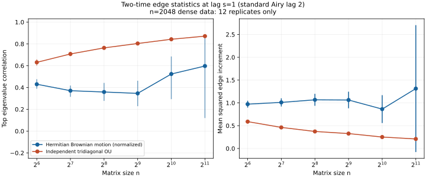

PARTIAL

# D0046: dynamics of random operator limits

## Statement and status

Virág's Question 8 (Dynamics), PDF p.25 of [*Operator limits of random matrices*](https://arxiv.org/pdf/1804.06953), is exactly:

> Are there operator limits of matrix-valued (say Hermitian) Brownian motion?

The review is dated May 25, 2014 and was uploaded to arXiv in 2018. Its operator viewpoint retains the rescaled matrix in suitable coordinates, its eigenfunctions and its resolvent, as well as its spectrum. For example, Theorem 5.1, PDF p.6, describes the static stochastic Airy operator (SAO) limit under the step-function embedding with mesh $n^{-1/3}$. A dynamic answer needs one coupling across physical times and convergence of operators in that coupling, with the correct multi-time spectrum. Brownian motion in the *spatial coordinate* of an SAO or Sine operator is not physical matrix time. Neither is the semigroup parameter in $e^{-uH}$ the evolution of a random (H(t)).

Literature searched through November 13, 2026: no checked theorem supplies the requested dynamic differential-operator limit at the edge or in the bulk. This is a scoped search conclusion, not a proof that no such theorem exists. Close recent results and their exact locations are recorded below. In particular, a fixed number of tridiagonal entry processes is insufficient: the edge involves a growing number, of order $n^{1/3}$.

**Proved here:** an explicit stationary, reversible, continuous Markov process on tridiagonal matrices, with exactly the GUE one-time law, has a *constant* edge process in its scaling limit on the Dyson Brownian motion (DBM) clock. The convergence to a constant process is uniform on compact time intervals in mean square, for each fixed number of top eigenvalues. Consequently it cannot produce the Airy line ensemble. The proof extends to reversible tridiagonal diffusions whose entry covariance matrices are uniformly bounded. This rules out a class of natural candidates; it does not disprove Question 8. No novelty claim is made for this obstruction.

## Why a static tridiagonal law does not specify dynamics

For a fixed time, the Dumitriu–Edelman model has independent entries

\[
 a_i\sim N(0,2/\beta),\qquad b_i\sim\chi_{\beta(n-i)}/\sqrt\beta,
 \quad 1\leq i\leq n,\quad1\leq i<n,
\]

and the Gaussian beta ensemble as its spectrum. This specifies no joint distribution at two times. In a moving Lanczos basis, differentiating the basis adds correlated noise and drift to the entries. Assigning independent Brownian or radial Brownian motions to the static entries does not reproduce those terms.

There is a useful correction to an overly strong formulation of this difficulty. Canonical Lanczos tridiagonalization of invariant Hermitian Brownian motion or invariant matrix OU **is Markov**, on the cyclic locus, as an orbit quotient. Indeed, fix the starting vector $e_1$. Two cyclic Hermitian matrices have the same positive-off-diagonal Jacobi representative exactly when they are conjugate by a unitary fixing $e_1$. Matrix Brownian and OU transition kernels commute with these conjugations. Thus their transition probabilities for functions of the representative are constant on each orbit, and descend to a Markov kernel. Iterated conditioning then gives the Markov property for the representative process. At each deterministic time the Gaussian matrix is cyclic almost surely; the quotient kernel gives the corresponding version. This does not supply a simple independent or uniformly bounded local coefficient SDE.

Available partial routes include independent-entry beta-Hermite dynamics (right marginals), invariant matrix dynamics of Allez–Guionnet, tridiagonal dynamics specified jointly through eigenvalues and spectral weights (Holcomb–Paquette), and infinite-particle DBM. The last route gives spectral dynamics, without identifying a continuum operator and its eigenfunction dynamics. A diagonal operator defined afterward from the limiting particles is a possible abstract spectral encoding, but does not establish the structured operator limit in the review's sense.

## The obstruction theorem

All constants and clocks in the proof use the following normalization. A stationary GUE matrix $G$ has independent $G_{ii}\sim N(0,1)$ and $G_{ij}=(U_{ij}+iV_{ij})/\sqrt2$ for $i<j$, with independent standard real normal variables. Its density is proportional to $\exp(-\operatorname{Tr}G^2/2)$, its edge is $2\sqrt n$, and stationary matrix OU has entry correlation $e^{-|t-s|}$. Its eigenvalues satisfy

\[
 d\lambda_j=\sqrt2\,dB_j+
 \left(2\sum_{\ell\ne j}\frac1{\lambda_j-\lambda_\ell}-\lambda_j\right)dt.
 \tag{1}
\]

The clock $t=s n^{-1/3}$ is used throughout. It gives a fixed rescaling of the usual Airy time; with this rate-one OU convention the standard Airy line ensemble is evaluated at $2s$. This factor has no effect on the obstruction.

**Theorem A.** Independently take stationary real OU processes $a_i(t)$ of variance one and rate one, and independent stationary vector OU processes $Z_i(t)\in\mathbb R^{2(n-i)}$, each with independent variance-one, rate-one coordinates. Put

\[
 b_i(t)=\|Z_i(t)\|/\sqrt2,\qquad
 T_n(t)=\operatorname{tridiag}(b_{i-1}(t),a_i(t),b_i(t)).
 \tag{2}
\]

Let $\lambda_{1,n}(t)>\cdots>\lambda_{n,n}(t)$ be its eigenvalues and set

\[
 X_{j,n}(s)=n^{1/6}\big(\lambda_{j,n}(s n^{-1/3})-2\sqrt n\big).
\]

For every fixed $k$ and $S<\infty$,

\[
 \mathbb E\max_{1\le j\le k}\sup_{0\le s\le S}
 |X_{j,n}(s)-X_{j,n}(0)|^2
 \le C_{k,S}\, n^{-1/4}(\log n)^{1/4}\longrightarrow0.
 \tag{3}
\]

The processes $T_n$ are stationary, reversible and Markov, have the independent Dumitriu–Edelman GUE law at every time, and have continuous paths. Thus their top $k$ scaled eigenvalues converge in $C([0,S],\mathbb R^k)$ to the *constant in time* vector having the static Airy point law. They do not converge to the GUE DBM edge process.

### Proof, including the estimates behind (3)

**1. Construction and stationarity.** A rate-one stationary scalar OU solves $dZ=-Z\,dt+\sqrt2\,dW$. Its Gaussian transition kernel is reversible. The product process consisting of all $a_i,Z_i$ is therefore stationary and reversible. Radial OU is Markov because its transition kernel is rotation invariant, so the independent radii together with the $a_i$ are Markov. Their product law has $a_i\sim N(0,1)$, $b_i\sim\chi_{2(n-i)}/\sqrt2$. This is exactly the beta-two tridiagonal law. Here the smallest radial dimension is two; its origin is polar, so $b_i(t)>0$ for all finite times almost surely. The paths and the ordered eigenvalues are continuous, and the Jacobi spectra are simple. Where written as scalar SDEs, the coefficients are

\[
 da_i=-a_i\,dt+\sqrt2\,dW_i,\qquad
 db_i=\left(\frac{2(n-i)-1}{2b_i}-b_i\right)dt+d\widetilde W_i.
 \tag{4}
\]

The equality of the one-time spectrum with GUE uses the established static Dumitriu–Edelman identity; none of the dynamic conclusions assumes a dynamic version of that identity.

**2. A reversible maximal inequality.** Let $Y_t$ be a stationary rate-one product OU, with generator $L=\Delta-y\cdot\nabla$, invariant standard Gaussian law $\gamma$, and $\Gamma(f)=|\nabla f|^2$. Then for every Lipschitz $f$ and $U>0$,

\[
 \mathbb E\sup_{0\le t\le U}|f(Y_t)-f(Y_0)|^2
 \le 20U\int\Gamma(f)\,d\gamma.
 \tag{5}
\]

For a smooth $f$, let $M_t=f(Y_t)-f(Y_0)-\int_0^t Lf(Y_r)dr$. Reversibility makes $\widehat Y_u=Y_{U-u}$ another stationary OU; let $\widehat M_u$ be its analogous martingale. Direct subtraction gives

\[
 f(Y_t)-f(Y_0)=\tfrac12 M_t-
 \tfrac12(\widehat M_U-\widehat M_{U-t}).
\]

The squared supremum is at most
$\tfrac12\sup|M|^2+2\sup|\widehat M|^2$.
The two martingales have expected terminal squares $2U\int\Gamma(f)d\gamma$. Doob's $L^2$ inequality multiplies these by at most four, proving (5). Cutoffs and convolution extend this to Lipschitz $f$: these approximations converge in Gaussian $W^{1,2}$; apply the same inequality to their differences to obtain convergence of the increment paths in $L^2(C[0,U])$. Alternatively, their locally uniform convergence identifies the continuous limit along $Y$. Thus no bound on the drift or inverse spectral gaps is required.

**3. Eigenvalue noise energy.** For a normalized real eigenvector $v=v^{(j)}$, differentiation of a simple symmetric eigenvalue gives

\[
 \partial_{a_i}\lambda_j=v_i^2,\qquad
 \partial_{b_i}\lambda_j=2v_iv_{i+1}.
\]

In the underlying Gaussian $Z_i$ coordinates, $\|\nabla b_i\|^2=1/2$. Consequently

\[
 \Gamma(\lambda_j)=\sum_i v_i^4+
                 2\sum_{i<n}v_i^2v_{i+1}^2
       \le 3\sum_i v_i^4.
 \tag{6}
\]

The eigenvalue as a function of all Gaussian coordinates is globally Lipschitz: the map into $T_n$ contracts the Euclidean distance into Frobenius distance, and ordered eigenvalues are Lipschitz in Frobenius norm. Hence (5) applies despite the exceptional null sets of the derivative formulas. For comparison, the full Hermitian OU has $\Gamma(\lambda_j)=1$, as can be checked either from (1) or by summing derivatives over all independent matrix coordinates. Its eigenvalue martingale variance is $2dt$; for (2) it is $2\Gamma(\lambda_j)dt$.

**4. Elementary delocalization, with an explicit probability bound.** We prove that the eigenvector inverse participation ratio satisfies, for each fixed $j$,

\[
 \mathbb E\sum_i(v_i^{(j)})^4
 \le 2\sqrt{\frac{6r_n+\pi^2j^2+2}{\sqrt n+r_n}}+4n^{-5},
 \qquad r_n=\sqrt{12\log n},
 \tag{7}
\]

for all sufficiently large $n$ (depending on (j)). This estimate is deliberately weaker than the expected $n^{-1/3}$ rate; it suffices here.

For a chi variable $R=\chi_d$, its squared moment generating function is $\mathbb E e^{\theta R^2}=(1-2\theta)^{-d/2}$. Chernoff optimization at $R^2=dy$ gives the tail bound $\exp[-d(y-1-\log y)/2]$, on either side of $y=1$. Since

\[
 y-1-\log y\ge (\sqrt y-1)^2,
\]

we obtain $\mathbb P(|R-\sqrt d|>u)\le2e^{-u^2/2}$, with the lower event empty for $u\ge\sqrt d$. Together with the scalar Gaussian tail and a union bound, this proves that the event

\[
 E_n=\left\{\max_i|a_i|\le r_n,
       \quad\max_{i<n}|b_i-\sqrt{n-i}|\le r_n\right\}
 \tag{8}
\]

has probability at least $1-4n^{-5}$. For the off-diagonals the individual bound is actually $2e^{-r_n^2}$.

Set $m=\lfloor n^{1/4}\rfloor$ and take $n$ large enough that $m\ge j$. On $E_n$, the first $m\times m$ block differs from the Toeplitz tridiagonal matrix with zero diagonal and off-diagonal $\sqrt n$ by operator norm at most $3r_n+2m/\sqrt n$. This follows from the row-sum bound and
$0\le\sqrt n-\sqrt{n-i}\le m/\sqrt n$ for $i<m$.
The Toeplitz eigenvalues are $2\sqrt n\cos(j\pi/(m+1))$. Interlacing, the min-max principle and $2(1-\cos u)\le u^2$ give

\[
 \lambda_{j,n}\ge2\sqrt n-3r_n-\pi^2j^2-2.
 \tag{9}
\]

In the last step, $m+1>n^{1/4}$, and $2m/\sqrt n\le2$.

Put $w_i=|v_i^{(j)}|$, $w_0=w_{n+1}=0$, $M=\sqrt n+r_n$, and
$D(w)=\sum_{i=0}^{n}(w_{i+1}-w_i)^2$.
We have $\sum w_i^2=1$. Even when the eigenvector changes sign, its Rayleigh quotient is bounded above by

\[
 \lambda_{j,n}\le r_n+2M\sum_{i<n}w_iw_{i+1}
       =r_n+2M-MD(w).
\]

Combining with (9) yields

\[
 D(w)\le\frac{6r_n+\pi^2j^2+2}{M}.
\]

For any coordinate, telescoping $w_i^2-w_0^2$ and Cauchy–Schwarz imply

\[
 w_i^2\le\sqrt{D(w)}
       \left(\sum_{\ell=0}^n(w_{\ell+1}+w_\ell)^2\right)^{1/2}
       \le2\sqrt{D(w)}.
\]

Thus $\sum v_i^4\le\max_i w_i^2\le2\sqrt{D(w)}$ on $E_n$. Off $E_n$ the inverse participation ratio is at most one. This proves (7), and its stated $O_j(n^{-1/4}(\log n)^{1/4})$ consequence.

**5. Uniform freezing.** Apply (5) to $f=n^{1/6}\lambda_j$, $U=S n^{-1/3}$, then use (6):

\[
 \mathbb E\sup_{s\le S}|X_{j,n}(s)-X_{j,n}(0)|^2
 \le60S\,\mathbb E\sum_i(v_i^{(j)})^4.
 \tag{10}
\]

Summing over $j\le k$ proves (3). The established static GUE edge limit gives convergence in law of the initial vector to its Airy point law. The map sending an initial vector to a constant continuous path is continuous, and (3) makes the difference from that path vanish in probability. This proves the asserted process convergence.

**6. Why the limiting two-time law is wrong.** For the standard Airy line ensemble $\mathcal A$, for any $s>0$,

\[
 \mathbb P\{\mathcal A_1(2s)=\mathcal A_1(0)\}=0.
 \tag{11}
\]

Here is a direct consequence of its Brownian Gibbs property. Choose an open interval containing $2s$ whose closure excludes zero. Conditional on the outside curves, the parabolically shifted top curve inside that interval is a Brownian bridge conditioned to stay above the next curve. This conditioning has positive probability: the endpoints are separated from the continuous lower boundary, and a continuous path above it has a positive-probability Brownian bridge neighborhood. The conditional law is absolutely continuous relative to the bridge law. Its value at the interior point has no atoms, whereas the value at zero is fixed by the conditioning. Undoing the deterministic parabolic shift proves (11).

The frozen limit has equality at those two times with probability one. In covariance language, its top coordinate has covariance $\operatorname{Var}(\mathrm{TW}_2)$ at every lag. For the actual edge process, stationarity and its finite second moment give

\[
 \operatorname{Cov}(\mathcal A_1(0),\mathcal A_1(2s))
 =\operatorname{Var}(\mathrm{TW}_2)
  -\tfrac12\mathbb E(\mathcal A_1(2s)-\mathcal A_1(0))^2
 <\operatorname{Var}(\mathrm{TW}_2).
 \tag{12}
\]

Equations (3) and (11) already prove incompatibility without exchanging a limit and a moment. The Gibbs input is Corwin–Hammond, Theorem 3.1, PDF p.12 of the retained version. This completes the proof. $\square$

### A broader necessary condition

**Corollary B.** Suppose a stationary reversible tridiagonal diffusion has the same independent GUE tridiagonal invariant law and carré du champ

\[
 \Gamma_n(f)\le K\left(\sum_i|\partial_{a_i}f|^2+
                     \sum_i|\partial_{b_i}f|^2\right)
 \tag{13}
\]

with (K) independent of $n$. Assume the usual diffusion martingale calculus, including its time reversal and approximation for the Lipschitz eigenvalue functions. Then its top $k$ eigenvalues also freeze as in (3).

**Proof.** Reversibility gives (5) with $\Gamma_n$ by the identical forward/backward martingale proof. Eigenvalue differentiation gives

\[
 \Gamma_n(\lambda_j)\le K\left(\sum v_i^4+4\sum v_i^2v_{i+1}^2\right)
       \le5K\sum v_i^4.
\]

The one-time estimate (7) depends only on the invariant law and applies unchanged. Replace the factor $3$ by $5K$ in (10). $\square$

Thus a reversible Jacobi representation of genuine DBM cannot have a uniformly bounded entry-noise covariance operator as $n$ grows. Allowing a bound $K_n$, the same argument rules it out whenever $K_n n^{-1/4}(\log n)^{1/4}\to0$. This is a necessary restriction, not a description of the correct unbounded or correlated noise. The conclusion concerns the physical DBM clock; arbitrary size-dependent accelerations or nonreversible candidates are outside Corollary B.

There is also a pointwise constraint for an *exact* Jacobi realization of (1). Write its entry quadratic variation as $d\langle c\rangle_t=2C_n(c_t)dt$, where $c=(a,b)$. The eigenvalue martingale variance in (1) forces

\[
 1=\nabla\lambda_j^{\mathsf T}C_n\nabla\lambda_j
 \le\|C_n\|_{\mathrm{op}}\|\nabla\lambda_j\|^2
 \le5\|C_n\|_{\mathrm{op}}\sum_i(v_i^{(j)})^4.
\]

Thus $\|C_n\|_{\mathrm{op}}\ge(5\sum_i v_i^4)^{-1}$. If its stationary entry law is the GUE tridiagonal law, estimate (7) and event (8) imply that this norm diverges in probability, and on (8) it is at least a constant times $n^{1/4}(\log n)^{-1/4}$. This constraint does not require reversibility: it follows directly from the eigenvalue quadratic variation. The finite-corner OU rates in the literature therefore cannot be extrapolated to a uniformly bounded-noise coefficient model. If needed, the factor $\|C_n\|$ can be read as the essential covariance density where the semimartingale coefficients are defined.

## Numerical evidence

Both models use independent ensemble replicates, the same edge normalization and the same physical clock. The dense simulation is literal Hermitian Brownian motion $B(u)$, initialized at $u=1$ with a GUE matrix, at times $u=\exp(2s n^{-1/3})$. Dividing by $\sqrt u$ gives exactly the stationary rate-one matrix OU process used in (1). Its transition is Gaussian; the independent tridiagonal process uses exact OU and noncentral-chi-square radial transitions. No Euler approximation of a singular SDE is used.

The two largest eigenvalues were recorded at $s=0,0.25,1,3$. At lag $s=1$ (standard Airy lag 2), the **largest** eigenvalue gives:

| $n$ | Dense replicates | Dense correlation (95% CI) | Tridiagonal correlation (95% CI) | Dense mean squared increment | Tridiagonal mean squared increment |
|---:|---:|---:|---:|---:|---:|
| 64 | 1500 | 0.430 [0.388, 0.476] | 0.631 [0.601, 0.658] | 0.972 | 0.589 |
| 128 | 1000 | 0.371 [0.315, 0.418] | 0.708 [0.687, 0.727] | 1.010 | 0.462 |
| 256 | 600 | 0.359 [0.277, 0.442] | 0.763 [0.746, 0.782] | 1.067 | 0.373 |
| 512 | 240 | 0.346 [0.229, 0.462] | 0.804 [0.788, 0.818] | 1.063 | 0.327 |
| 1024 | 64 | 0.524 [0.293, 0.685] | 0.842 [0.829, 0.854] | 0.863 | 0.251 |
| 2048 | 12 | 0.597 [0.120, 0.858] | 0.871 [0.861, 0.882] | 1.313 | 0.209 |

There are 2,000 tridiagonal replicates at every size. Correlation intervals are percentile bootstrap intervals from 500 resamples of independent paired ensemble observations. Mean squared increments are averages of $(X_j(1)-X_j(0))^2$; their standard errors are in `data/summary.csv`. The 12 dense replicates at $n=2048$ are a size-feasibility pilot with a wide interval. The 64 dense replicates at $n=1024$ are also imprecise. Neither row establishes a large-size trend for the dense model.

The tridiagonal correlations increase and their mean squared increments decrease with size, consistent with Theorem A. For the second eigenvalue, at $n=2048$ the tridiagonal correlation is 0.844; the corresponding full table at every lag and size is retained. Mean top-eigenvalue noise energy $\mathbb E\Gamma(\lambda_1)$ falls from 0.3613 at $n=64$ to 0.1149 at $n=2048$, compared with the exact value one for matrix OU. These are numerical observations; the proof does not depend on them.

Artifacts: [raw paired samples](data/edge_samples.csv), [eigenvector noise energies](data/edge_energies.csv), [correlations and increment estimates](data/summary.csv), [energy summaries](data/energy_summary.csv), [run metadata](data/edge_metadata.json), and [independent math audit](data/math_audit.json). The simulation seed is 4620261113. Reproduction commands and normalization details are in [code/README.md](code/README.md).

The complete run took 305.6 seconds and recorded a peak resident set of 692.6 MB, below the 4 GB ceiling. Inherited niceness was checked as 10 before and during the run. BLAS/vecLib/OpenMP thread limits were set to one, with an additional `threadpoolctl` limit. That library reports no recognized pools for this NumPy build; the metadata records the requested limits rather than claiming an independent operating-system thread census.

Checks: 20,000 small GUE samples gave diagonal variance 0.9956 and mean squared off-diagonal magnitude 0.9901, against exact values one. In a separate radial transition check, the empirical conditional mean was 19.6388 versus 19.6401 exactly; variance was 14.8016 versus 14.7594. Finite differences in the original Gaussian coordinates gave eigenvalue noise energy 0.710116584148 versus 0.710116584044 from (6). The min-max and discrete Sobolev bounds were checked against computed eigenvectors at sizes 64, 256 and 1024. These finite checks audit implementation and constants; they do not replace any proof.

## Literature findings and exact locations

Pages in this table are **one-based PDF pages of the text retained here**, rather than publisher pagination; form feeds in the text preserve the page boundaries. The source metadata records the URL and hashes. All links point to primary sources.

| Source | Exact location checked | What it provides, and the missing dynamic operator statement |
|---|---|---|
| [Virág, 1804.06953](https://arxiv.org/pdf/1804.06953) | Question 8 p.25; Theorem 5.1 p.6 | The question and static SAO operator convergence. |
| [Allez–Guionnet, 1206.1460](https://arxiv.org/pdf/1206.1460) | Theorems 2.2 p.4 and 2.4 pp.5–6 | Coin-switching matrix construction with DBM eigenvalues and eigenvector dynamics, for an interpolated beta in $[0,2]$. Dimension is fixed while the switching frequency tends to infinity. This is neither an independent-entry tridiagonal construction nor a microscopic infinite-dimensional operator limit. |
| [Allez–Dumaz, 1404.5265](https://arxiv.org/pdf/1404.5265) | Theorem 4.1 p.8 and Theorem 5.1 pp.9–10 | Matrix diffusions in non-confining potentials and their macroscopic spectral measures; not microscopic operator-process convergence. |
| [Li, 1007.3905](https://arxiv.org/pdf/1007.3905) | Definition 3.1.1 and Proposition 3.1.2 pp.8–9; Theorem 3.1.3 pp.10–11 | Independent OU/generalized-Bessel beta-Hermite matrix processes and one-time joint eigenvalue densities. The construction (2) is its stationary beta-two version after deterministic normalization. Its existence is prior work; the freezing estimate is proved above. |
| [Yabuoku, 2204.00736](https://arxiv.org/pdf/2204.00736) | Theorem 2.1 pp.4–5; discussion p.7 | Derives eigenvalue SDEs for independent Brownian/Bessel tridiagonal entries. Minor spectra and non-DBM quadratic variations occur. |
| [Holcomb–Paquette, 1707.02700](https://arxiv.org/pdf/1707.02700) | Theorem 2 p.5; Theorems 17–18 pp.22–23 | Tridiagonal DBM realizations via spectral weights; a fixed-corner limit for frozen weights. Neither conclusion controls an edge-scaled growing corner or a continuum resolvent in physical time. |
| [Edelman–Jeong–Nissim, 2411.01633v3](https://arxiv.org/pdf/2411.01633v3) | Theorem 3.1 p.9; Problem 4 p.18; Definitions 5.1/5.3 p.18; Remark 5.6 pp.19–20 | For GOE, finitely many tridiagonal entries converge as continuous processes to independent OU coordinates with position-dependent rates. The operator limit remains a problem. Their proposed space-dependent OU-noise SAO is challenged by a large-beta perturbative covariance calculation; this is not a theorem proving the required operator limit. Revision dated February 19, 2026. |
| [Corwin–Hammond, 1108.2291](https://arxiv.org/pdf/1108.2291) | Theorem 3.1 p.12 | Continuous nonintersecting Airy line ensemble, Brownian Gibbs property and curve convergence. Supplies the nonconstant comparison process in (11); not an SAO-process construction. |
| [Osada–Tanemura, 1408.0632](https://arxiv.org/pdf/1408.0632) | Theorems 2.1–2.4 pp.12–17; Theorems 2.6–2.7 p.19 | Airy interacting diffusions, strong-solution results under specified constraints, and finite-particle convergence for beta $1,2,4$. These are particle processes. |
| [Tsai, 1405.6692](https://arxiv.org/pdf/1405.6692) | Theorems 1.2 p.3 and 1.4 p.4 | Strong existence/uniqueness and finite-to-infinite particle convergence for bulk DBM, beta at least one, with explicit regular initial configurations. No continuum matrix-operator limit. |
| [Landon–Sosoe–Yau, 1609.09011](https://arxiv.org/pdf/1609.09011) | Theorem 2.2 p.9; Theorems 2.3–2.4 pp.10–11 | Fixed-energy universality and multitime eigenvalue statistics, not operator-valued convergence. |
| [Gorin–Kleptsyn, 2009.02006](https://arxiv.org/pdf/2009.02006) | Theorems 1.1–1.2 pp.4–5 | The beta-to-infinity Gaussian fluctuation field and its Airy covariance from corners/DBM. The order of limits includes beta tending to infinity; it is not a finite-beta operator-process theorem. |
| [Gorin–Xu–Zhang, 2411.10829](https://arxiv.org/pdf/2411.10829) | Theorem 1.4 pp.5–6; Theorem 1.6 pp.6–7 | Airy-beta line ensemble for every positive beta and convergence of DBM trajectories. Crucial progress on joint spectral laws; no operator convergence assertion. |
| [Huang–Zhang, 2411.10586v2](https://arxiv.org/pdf/2411.10586v2) | Definition 1.1/Theorem 1.2 p.4; Theorem 1.15 p.9; Theorem 1.16 p.10 | Meromorphic pole-evolution characterization and process universality for DBM/Laguerre/Jacobi edges. The SDE is for a spectral transform; a random differential operator with convergent resolvents is not established. Revised May 26, 2026. |
| [Valkó–Virág, 1604.04381](https://arxiv.org/pdf/1604.04381) | Theorem 1 p.5 | Self-adjoint Sine-beta Dirac operator. Its Brownian coordinate parametrizes space, not DBM time. |
| [Valkó–Virág, 2009.04670](https://arxiv.org/pdf/2009.04670) | Theorem 1 pp.3–4 and Theorem 3 pp.4–5 | Stochastic zeta function, static operator determinants and characteristic-polynomial approximation. This does not evolve the matrix in physical time. |
| [Li–Valkó, 2108.11039](https://arxiv.org/pdf/2108.11039) | Theorem 14 p.13 | Coupled operator limit for the circular Jacobi beta ensemble, in Hilbert–Schmidt inverse topology; static matrix laws. |
| [Bloemendal–Virág, 1109.3704](https://arxiv.org/pdf/1109.3704) | Operator definition pp.6–7; Theorem 1.2 p.7 | A matrix-valued-noise SAO for spiked ensembles. The Brownian matrix in the potential evolves in the operator's spatial coordinate. Joint dependence on a boundary/spike is not Hermitian BM evolution. |
| [Gonzalez–Holcomb, 2002.12191](https://arxiv.org/pdf/2002.12191) | Theorem 2 p.3 | A stationary centered spectrum under translation of a Dirichlet endpoint. Its eigenvalues are differentiable in that parameter, distinguishing this operator family from DBM. |
| [Assiotis–Li, 2609.26386](https://arxiv.org/pdf/2609.26386) | Theorem A p.5; Theorem B p.7 | September 2026 extension of infinite-particle DBM, initial data at infinity, and a spectral-transform SPDE. Its objects are particle processes and transforms, not the requested SAO/Sine operator process. |
| [Kwak, 2610.35808](https://arxiv.org/pdf/2610.35808) | Theorem 2.1.2 p.13; Theorems 2.2.1–2.2.2 p.26; Theorem 2.4.1 p.39 | October 2026 preprint asserting static Wigner edge operator universality and sharp static couplings. The main statements inspected do not concern Hermitian BM as an operator process. Its lengthy proofs were not independently audited here. |
| [Holcomb–Valkó, 1311.2981](https://arxiv.org/pdf/1311.2981) | Theorem 1 p.3 | Sine-beta counting large deviations, not physical-time DBM evolution. |
| [Allez–Dumaz, 1407.5402](https://arxiv.org/pdf/1407.5402) | Theorem 1.1 p.2 | The high-temperature Sine-to-Poisson limit; the carousel diffusion coordinate is not matrix time. |
| [Valkó–Virág, 1710.06988](https://arxiv.org/pdf/1710.06988) | Theorem 1 pp.2–3 | Static circular-beta/Sine-beta operator coupling by hyperbolic Brownian stopping times. No second physical-time parameter. |
| [Landon, 2009.11176](https://arxiv.org/pdf/2009.11176) | Theorems 1.1–1.3 pp.1–2 | Coupling and convergence of equilibrium DBM edge particles for beta at least one, with locally Brownian limiting increments. A spectral-process result, without a continuum operator-process convergence theorem. |
| [Osada–Tanemura, 1412.8674](https://arxiv.org/pdf/1412.8674) | Theorem 13.2 p.85 in this retained arXiv version | Strong solutions for dynamical Sine-beta at beta 1,2,4, with the stated tail-component constraints. The published numbering differs. It is an infinite-particle SDE theorem. |
| [Kawamoto–Osada, 1610.05969](https://arxiv.org/pdf/1610.05969) | Theorem 1.1 p.4 | Path-space bulk convergence of GUE particles to infinite Dyson dynamics. No operator-valued process limit. |
| [Gorin–Shkolnikov, 1601.06800](https://arxiv.org/pdf/1601.06800) | Theorem 2.8 pp.5–6 | Limits of powers of a static tridiagonal matrix to a stochastic Airy semigroup. Its semigroup parameter does not evolve the random matrix environment. |

The Brownian carousel and its limiting phase function were checked in the Sine-operator sources. The diffusion coordinate there should not be identified with physical DBM time.

One audit point in the nearby literature: the final large-time display in Edelman–Jeong–Nissim Remark 5.6 has an inconsistent power in its second integral. Since the normalized deterministic Airy eigenfunction has $\psi(0)=0$, $\psi'(0)=1$, direct Laplace asymptotics give
$\int\psi^4e^{-tx}dx\sim24t^{-5}$ and
$\int\psi^2e^{-tx}dx/x\sim t^{-2}$.
The discrepancy remains, but a perturbative argument is not a fixed-beta obstruction proof. Theorem A avoids that issue entirely.

## What remains open in this work

No nonconstant SAO- or Sine-operator process with the DBM joint spectral law is constructed here. Nor is there a no-go theorem for all such operator limits. A successful Jacobi route must control the joint dynamics of a growing corner, including its noise covariance and basis motion, and prove compactness in a topology that preserves the spectrum. Correct stationary marginals alone do not do this.

Task: “Open problem D0046.” Received 2026-11-13 10:46 +04 (Asia/Tbilisi).
