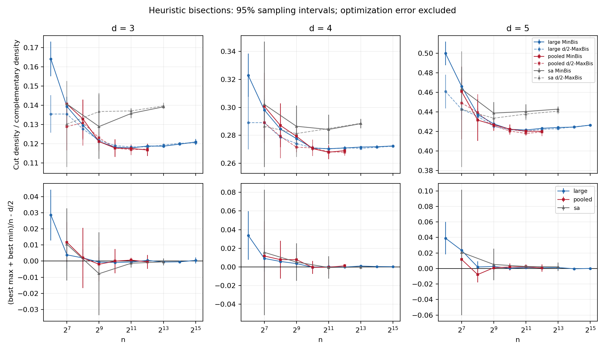

PARTIAL

# E0053: maximum and minimum bisections of random regular graphs

No proof or counterexample for any fixed d>=3 was established here. The literature search through 13 November 2026 did not find a printed resolution of the requested identity. The known rigorous small-degree bounds do not contradict it. The elementary cases d=0,1,2 are proved below, together with reductions and a first-moment bound. The numerical study supplies feasible cut witnesses and small-graph exact optima; its confidence intervals are sampling intervals, not guarantees about optimization error.

## Statement and source

For even n and fixed nonnegative integer d, let G be uniform on labeled simple d-regular graphs on n vertices. For S of size n/2, let cut_G(S) count the edges between S and its complement, and let MaxBis and MinBis be the maximum and minimum of cut_G(S) over those S. The question is whether

    [MaxBis(G)+MinBis(G)]/n = d/2 + o_p(1)

for every fixed d. Convergence in probability is the interpretation used here; the expected formulation is equivalent by the concentration proof below. No almost-sure coupling across n is asserted.

The downloaded [October 10, 2016 notes](sources/bandeira_notes.pdf), PDF page 117 (printed page 117), Section 8.6, state this formula as Conjecture 8.5 and ask for its proof or disproof as Open Problem 8.5. The [MIT problem extract](sources/bandeira_problem_8_5.pdf) agrees. In particular, the source uses maximum **bisection**, and the error tends to zero with **n at fixed d**. Its statement about Dembo–Montanari–Sen concerns a separate large-d error, not a fixed-d proof.

## Literature outcome

The original Zdeborová–Boettcher paper offers a cavity-method argument and extremal-optimization evidence. Dembo–Montanari–Sen, Theorem 1.5, proves the expansions

    MinBis/n = d/4 - P_* sqrt(d)/2 + o_d(sqrt(d)) + o_n(1),
    MaxBis/n = d/4 + P_* sqrt(d)/2 + o_d(sqrt(d)) + o_n(1),

with P_* approximately 0.7632. Adding them leaves an o_d(sqrt(d)) term; it need not vanish at d=3 or d=4.

Three later results need particular care:

- Gheissari–Perkins–Yap (2025), Corollary 1.2, proves a positive-temperature analogue for inverse temperature below reconstruction. Its parameter range is bounded and does not reach the zero-temperature optima.
- Aronow–Lopatto (2026), Theorem 1.1, states E MaxCut - E MaxBis=o(n). This is a different conjecture and does not compare MinBis with either maximum. Its full proof has not been independently checked here, and no conclusion below depends on it.
- Csóka–Fekete–Nagy–Szemerédi (2025), Conjecture 1.1, still formulates the cut/bisection identity as a conjecture. Their Section 3.1 even records an opposing intuition that the sum could be smaller than the edge count, but gives no counterexample. Lichev–Mitsche's November 2026 revision explicitly says its cubic bounds do not settle this relation.

Thus RESOLVED_IN_LITERATURE is not justified by the sources inspected. A literature search cannot certify the absence of every possible later result. Exact references, versions, links and relevance are given below; source downloads and SHA-256 hashes are in [sources/manifest.json](sources/manifest.json).

## Rigorous small-degree bound comparison

All numbers in this section count edges **per vertex** unless explicitly stated otherwise. Bounds are asymptotic with high probability; an arbitrarily small slack may be added. The following conservative bounds are sufficient for the contradiction check:

| d | lower MinBis/n | upper MinBis/n | lower MaxBis/n | upper MaxBis/n | resulting interval for the sum/n | target |
|---:|---:|---:|---:|---:|---:|---:|
| 3 | 0.103295 | 0.139822 | 1.3377398280 | 1.385802 | [1.4410348280, 1.525624] | 1.5 |
| 4 | alpha_4 = 0.2200557289... | 1/3 | 5/3 | 1.735804 | [1.8867223955..., 2.0691373334...] | 2 |
| 5 | alpha_5 = 0.3652560085... | 0.496488 | 1.9879180882... | 2.086595 | [2.3531740967..., 2.583083] | 2.5 |

Cubic minimum bounds are Lichev–Mitsche, Theorem 1.1. Quartic minimum upper and maximum lower bounds follow from Lyons, Theorem 4.1 (also earlier algorithmic work). The other maximum-bisection lower bounds in the table use the same theorem. Alpha_d is the exact entropy root proved below. The degree-five minimum upper bound is Csóka et al., Theorem 1.2.

Maximum upper bounds use MaxBis<=MaxCut and Harangi, Theorem 1.2. His normalization is by **total edges**, m=dn/2. I independently substituted his printed Table 2 parameters into the formula with outward interval arithmetic, obtaining the edge fractions

    d=3: 0.9238674766043736381...
    d=4: 0.8679013142663060437...
    d=5: 0.8346377978544107843...

Multiplying the relaxed upper fractions 0.923868, 0.867902, 0.834638 by d/2 gives the table. This avoids treating truncated printed decimals as rigorous upper bounds. The enclosing intervals and parameter choices are saved in [data/harangi_intervals.json](data/harangi_intervals.json); [code/harangi_interval.py](code/harangi_interval.py) reproduces them. The analytic guarantee is Harangi's theorem; this calculation audits the numerical substitutions, not the theorem's full proof.

Neither the upper-bound sums fall below the target nor the lower-bound sums exceed it. For example, combining the cubic n/6 minimum upper bound with 1.385802n gives 1.5524687n, also above 1.5n. An upper bound on MinBis cannot be added to a lower bound on MaxBis to obtain an upper bound on their sum. Gamarnik–Li's 1.36000...n lower bound is for MaxCut; transporting it to MaxBis would require an additional result such as the 2026 theorem. Even that stronger lower bound, added to 0.103295n, remains below 1.5n.

A source discrepancy was checked visually: Díaz–Do–Serna–Wormald's abstract reports cubic 1.32697, while Theorem 3 of the downloaded author manuscript states 1.32595. Its Theorem 4 prints a universally quantified lower bound 5n/3+epsilon*n, which cannot hold for arbitrary epsilon as written. See [the saved page](sources/diaz_author_page3.png). I use Lyons's independent, unambiguous bounds for the comparisons above; I do not silently turn either discrepancy into a new theorem. The original minimum-bisection Theorems 1/2 give 1/3+epsilon for d=4 and 0.17404 for d=3.

The arithmetic and inequality directions are recorded independently in [data/bounds_audit.json](data/bounds_audit.json).

## Rigorous partial results and proofs

These are elementary partial results and reductions, not a solution for any fixed d>=3.

## 1. Degrees 0, 1 and 2

**Proposition.** The requested conclusion holds for d=0,1,2. For d=0,1 it holds for every admissible graph, and for uniform simple 2-regular graphs the defect is O_p(log n/n).

**Proof.** Degree zero is immediate. A 1-regular graph is a perfect matching. Put one endpoint of every edge on each side to get MaxBis=n/2. If n/2 is even, put whole matching edges on each side to get MinBis=0. If n/2 is odd, split exactly one matching edge and otherwise use whole edges, giving MinBis=1. Thus the normalized defect is at most 1/n.

Every simple 2-regular graph is a disjoint union of cycles. Write O(G) for its number of odd cycles and C(G) for its total number of cycles. Alternating colors on each even cycle cuts all its edges with equal side sizes. An odd cycle loses exactly one edge and has side imbalance one; because n is even, the number of odd cycles is even. Choose opposite majority colors on half of them to cancel the imbalance. This proves the exact deterministic formula MaxBis=n-O(G): no cut can do better on an odd cycle. To construct a small bisection, order the cycles and take whole cycles until adding another would pass n/2, then take a contiguous segment of that one cycle to reach exactly n/2. At most two edges cross, so 0<=MinBis<=2. Consequently

    (MaxBis+MinBis)/n - 1 = (MinBis-O(G))/n,
    |(MaxBis+MinBis)/n - 1| <= (C(G)+2)/n.

It remains to bound C(G) for a uniform simple 2-regular graph. Use a uniform pairing of 2n labeled half-edges, two at each vertex. For 3<=l<=n, counting cyclic choices of l distinct vertices and their half-edges gives

    E C_l = (n)_l 2^l/(2l) * (2n-2l-1)!!/(2n-1)!!
          = 1/(2l) * product_{j=0}^{l-1} [2(n-j)/(2(n-j)-1)].

For l<=n/2, log of the product is at most sum 1/(2(n-j)-1) <= l/(n+1)<1/2; hence E C_l<=1/l. There is deterministically at most one component cycle longer than n/2. Therefore E C<=H_floor(n/2)+1=O(log n), allowing the harmless loop/double-edge components to be handled separately. More explicitly their expected counts are n/(2n-1) and n(n-1)/[(2n-1)(2n-3)], respectively. The probability of a nonsimple pairing is at most their sum=3/4+o(1), so simplicity has probability bounded away from zero. Conditional on simplicity, every simple labeled 2-regular graph has equally many pairings, and E C remains O(log n). Markov's inequality yields C=O_p(log n), proving the claim. □

Here O_p is boundedness in probability at that scale, not an assertion of a particular uniform high-probability constant. For every diverging a_n, the bound gives C<=a_n log n with probability tending to one.

## 2. First-moment bounds with exact complement symmetry

**Proposition.** Let d>=3 be fixed, and let q_d be the unique root in (0,1/2) of

    H(q_d) = (1-2/d) log 2,
    H(q) = -q log q -(1-q) log(1-q), with H(0)=H(1)=0.

Set alpha_d=d q_d/2. For every epsilon>0, with probability tending to one in the uniform simple d-regular model,

    MinBis/n >= alpha_d-epsilon,
    MaxBis/n <= d/2-alpha_d+epsilon.

**Proof.** In the pairing model fix a bisection; each part has a=dn/2 half-edges. For k crossing edges, choose k half-edges from each part, match them bijectively, and pair the remaining half-edges internally. Thus, when a-k is even,

    P(cut=k) = binom(a,k)^2 k! [(a-k-1)!!]^2 / (2a-1)!!,

and the probability is zero for the other parity. Adopt (-1)!!=1. Stirling's formula, uniformly in k with an O(log n) error, gives

    log P(cut=k) = a[H(k/a)-log 2]+O(log n).

There are binom(n,n/2) candidate sets, at most exp(n log 2). Hence the expected number of bisections of size k=xn has exponent at most

    n Phi_d(x)+O(log n),
    Phi_d(x)=log 2+(d/2)[H(2x/d)-log 2].

This is strictly negative on closed subintervals below alpha_d and above d/2-alpha_d, since H(q)=H(1-q). A union bound over the O(n) possible k proves the exclusions for the pairing model. For fixed d, the probability of simplicity converges to exp(-(d^2-1)/4)>0, so conditioning on simplicity preserves events whose failure probability tends to zero. Each simple labeled graph has (d!)^n representing pairings, giving the required uniform model. □

The standard simplicity limit is used only for this transfer; it is also implicit in all cited configuration-model papers. Approximate roots (not required for the symbolic proof) are alpha_3=0.0922357051181, alpha_4=0.220055728877, alpha_5=0.365256008530. The complementary bounds do NOT establish a direction for MinBis+MaxBis: one is a lower bound and the other an upper bound.

## 3. Ground-state and finite-temperature reduction

Let Omega={sigma in {-1,+1}^n : sum sigma=0}, m=dn/2, and Q_G(sigma)=sum_{uv in E}sigma_u sigma_v. Put A=max_Omega Q and B=min_Omega Q. Since cut(sigma)=(m-Q(sigma))/2,

    MaxBis+MinBis-m = -(A+B)/2.                         (1)

This identity is deterministic. If Z_G(beta)=sum_{sigma in Omega}exp(beta Q_G(sigma)) and beta>0, then

    A <= log Z_G(beta)/beta <= A+log|Omega|/beta,
    -B <= log Z_G(-beta)/beta <= -B+log|Omega|/beta.

Subtracting, the two nonnegative entropy errors differ in absolute value by at most log|Omega|/beta. Combining with (1) gives

    | (MaxBis+MinBis-m)/n
      + [log Z_G(beta)-log Z_G(-beta)]/(2 beta n) |
       <= log binom(n,n/2)/(2 beta n) <= log 2/(2 beta). (2)

Thus equality of the limiting normalized log partition functions at positive and negative beta for an unbounded sequence beta->infinity would imply the conjecture. Agreement only for beta below a finite reconstruction threshold cannot make the right side vanish. This explains precisely the gap left by the 2025 positive-temperature theorem; its Hamiltonian conventions differ by a harmless affine change from Q.

## 4. Concentration: expected versus typical formulation

For fixed d, the conjecture in probability is equivalent to

    E[MaxBis+MinBis]/n -> d/2.

**Proof.** A two-edge switching of a pairing changes the crossing size of every fixed cut by at most two. Taking a maximum or a minimum preserves this Lipschitz bound. Their sum F=MaxBis+MinBis therefore changes by at most four. Reveal a uniform perfect matching pair by pair; alternative partners can be coupled by one two-edge switching of the unexposed completion. The Doob martingale has increments of absolute value at most four and at most dn/2 steps. Azuma-Hoeffding gives, for the pairing-model expectation,

    P(|F-E_pair F|>=t) <= 2 exp[-t^2/(16dn)].          (3)

Conditional on simplicity, divide this probability by the fixed positive simplicity probability. Integrating (3) shows E_simple|F-E_pair F|=O_d(sqrt n), so the two expectation centers differ by O_d(sqrt n). Hence F/n-E_simple F/n converges to zero in probability. This proves sufficiency of the expected formulation. Necessity follows from 0<=F/n<=d and bounded convergence in probability (uniform integrability). □

The balance condition does not alter the Lipschitz argument, as the admissible family of vertex subsets is identical before and after a switching.

## 5. Complementary local rules and a sufficient reduction

**Proposition (tree-gauge pairing).** Fix d>=2 and a finite radius r. Suppose a sequence of d-regular graphs has, for every fixed radius, tree neighborhoods at all but o(n) vertices. Let F be an isomorphism-invariant rule on a rooted radius-r d-regular tree with independent standard Gaussian vertex labels, taking values in {-1,+1}, and suppose F(-x)=-F(x) almost surely under the Gaussian labels. Define its companion by

    F^-(x on B(v,r)) = F(((-1)^dist(v,w) x_w)_{w in B(v,r)}).

For each rule, label the vertices independently by standard Gaussians (the two rules may share the labels), and repair its side sizes to n/2. If C_F and C_Fminus are the resulting cut sizes, then

    (C_F+C_Fminus)/n -> d/2 in probability.

**Proof.** On the union of the two radius-r neighborhoods of the endpoints u,v of an edge, suppose the neighborhood is a tree. Set x'_w=(-1)^dist(u,w) x_w. These are still independent standard Gaussians. The companion output at u equals the original F output with labels x'. At v the transformed labels are the negatives of x' on its neighborhood, so oddness makes its output the negative of the original F output there. Thus the probability that the companion cuts uv is exactly one minus the probability that F cuts uv. Edges whose radius-(r+1) neighborhood contains a cycle are only o(n); their total contribution to the error is o(n). Summing edge expectations therefore gives E(C_F+C_Fminus)=dn/2+o(n), before balancing.

Oddness and label symmetry give mean-zero output spin at each tree vertex. On the exceptional vertices one can use the sign of the root label, preserving mean zero and locality. For a fixed graph of bounded degree and fixed r, outputs on disjoint radius-r neighborhoods are independent. The dependency degree is bounded in terms of d,r, so both the sum of spins and each cut count have variance O_{d,r}(n). Consequently the two side imbalances are O_p(sqrt n), and the cut sums differ from their expectations by O_p(sqrt n). Flip half the excess spins to make each labeling an exact bisection. Each flip changes at most d crossing edges, so the total repair cost is O_p(sqrt n)=o_p(n). This proves the assertion. The same argument conditional on a random locally tree-like graph proves the corresponding random-graph statement. □

The transformation F -> F^- is an involution and preserves oddness and invariance. Hence, if both true optimum densities at a fixed d can be approximated arbitrarily closely by this class of finite-radius odd local rules, the requested identity follows: the achievable local cut-density set is invariant under c -> d/2-c, so its infimum and supremum add to d/2. Approximability of both global optima is an additional hypothesis, not proved here.

A simple example shows the limitation of observing complementary values. Take

    F_v = sign(sqrt(d) X_v + sum_{w~v} X_w),
    F^-_v = sign(sqrt(d) X_v - sum_{w~v} X_w).

On a tree their adjacent Gaussian inputs have correlations 1/sqrt(d) and -1/sqrt(d). The usual planar-angle argument for a centered Gaussian pair gives disagreement probability arccos(rho)/pi: rotate two independent standard Gaussian coordinates, whose direction is uniform on the circle; the sign-disagreement sectors have total angle 2 arccos(rho). Thus their cut densities are

    d/(2pi) arccos(1/sqrt(d)),
    d/2 - d/(2pi) arccos(1/sqrt(d)).

For d=3 these are about 0.45613 and 1.04387, whose sum is exactly 1.5 despite being far from the optima. This is a standard tree-gauge idea (related to the symmetry in Lyons's local-rule constructions), made explicit here. EO's global ranks and balance constraint are not covered by this finite-radius proposition; the example nevertheless establishes that a near-correct sum alone need not indicate accurate endpoints.

## 6. Why a deterministic regular-graph inequality cannot replace randomness

For the disjoint union of an even number of K4 components, MinBis=0 and MaxBis=n, so the sum is n<3n/2. Thus even asymptotically, regularity alone does not imply the identity or a lower inequality. For the finite cubic graph K4, MinBis=MaxBis=4, and the sum is 8>6; a universal finite upper inequality also fails. These are not counterexamples to the uniform random asymptotic conjecture. No all-graph inequality in either direction is being used.


## Numerical study

All planned batches have finished.

The sampler shuffles dn labeled half-edges and rejects the entire pairing whenever a loop or repeated edge occurs. Each simple labeled graph has exactly (d!)^n pairings, so this is exactly uniform sampling conditioned on simplicity, rather than an approximately uniform rewiring chain. Distinct graph seeds are saved. Edges, sampler attempts, all restarts and the balanced spin witnesses are retained in data/.

For n=12,16,20,24, all bisections modulo complementation were enumerated: 12 graphs per degree and size, 144 graphs altogether. Fixing vertex 0 on one side leaves exactly binom(n-1,n/2) partitions. A separately formulated binary ILP using HiGHS agrees on 12 of these graphs. Both optima were also solver-certified on 12 graphs at n=32 and six at n=48. All 162 small graphs' heuristic witnesses attained both certified optima. ILP status, objective bounds and gap are stored, rather than labeling an uncertified incumbent exact.

The larger search uses tau-extremal optimization with tau alternating between 1.2 and 1.3. The fitness is the negative number of unsatisfied incident edges: crossing edges for minimization, uncut edges for maximization. Bucket selection uses a rank law proportional to rank^(-tau), with uniform selection inside each sign/fitness bucket. Single-spin updates allow at most a two-vertex side-size difference; only perfectly balanced states can set a record. Each run ends with a complete improving exchange search over opposite-side vertex pairs. Python independently recomputes each saved crossing count and checks balance and parity.

The main batch contains 306 graphs and uses four independent restarts per objective, 2000 sweeps/restart through n=2048 and 1000 for larger sizes. The deeper batch uses 12 restarts of 6000 sweeps through n=1024 (four graphs per degree/size) and eight restarts of 4000 sweeps at n=2048,4096 (three graphs per degree/size). Pooled values retain the best witnesses across main and deep runs on these matched graphs. These pooled summaries are kept separate from the larger, uniform-budget main sample. The separate simulated-annealing check uses four restarts of 2000 sweeps on three graphs per degree/size at n=128,512,2048,8192. Its implementation uses uniformly chosen opposite-side exchanges (Kawasaki dynamics), geometrically cools T from 2 to 0.04 every 400 sweeps, and uses the same final exchange quench. Its purpose is a method check, not an assertion that annealing is exact.

Each endpoint mean has an approximate two-sided Student-t 95% interval across independent graphs. If the observed variance is zero, the interval is marked unestimable; identical observations do not establish zero population variance. The sum uses the paired per-graph difference Delta=(best_min+best_max)/n-d/2, preserving covariance. These intervals describe random-graph sampling of **algorithm outputs**. Min witnesses are upper bounds on the true minimum and max witnesses are lower bounds on the true maximum; their errors enter Delta with opposite signs. Consequently, cancellation can make an inaccurate pair of endpoints appear to satisfy the conjecture.

| batch | d | n | graphs | MinBis/n estimate | MaxBis/n estimate | Delta |
|---|---:|---:|---:|---:|---:|---:|
| large | 3 | 128 | 12 | 0.139323 ± 0.005112 | 1.364583 ± 0.006466 | +0.003906 ± 0.008598 |
| large | 3 | 512 | 12 | 0.121094 ± 0.001497 | 1.378255 ± 0.002072 | -0.000651 ± 0.003145 |
| large | 3 | 2048 | 12 | 0.117757 ± 0.000672 | 1.381673 ± 0.000830 | -0.000570 ± 0.000971 |
| large | 3 | 8192 | 8 | 0.118683 ± 0.000834 | 1.380737 ± 0.000779 | -0.000580 ± 0.001281 |
| large | 3 | 32768 | 4 | 0.120895 ± 0.001599 | 1.379547 ± 0.000376 | +0.000443 ± 0.001889 |
| large | 4 | 128 | 12 | 0.298177 ± 0.007872 | 1.710938 ± 0.010792 | +0.009115 ± 0.014329 |
| large | 4 | 512 | 12 | 0.277669 ± 0.002235 | 1.725911 ± 0.002766 | +0.003581 ± 0.004293 |
| large | 4 | 2048 | 12 | 0.270426 ± 0.001484 | 1.729736 ± 0.000655 | +0.000163 ± 0.001772 |
| large | 4 | 8192 | 8 | 0.271606 ± 0.000523 | 1.729309 ± 0.000738 | +0.000916 ± 0.001127 |
| large | 4 | 32768 | 4 | 0.272400 ± 0.000609 | 1.727798 ± 0.001026 | +0.000198 ± 0.000601 |
| large | 5 | 128 | 12 | 0.466146 ± 0.007125 | 2.057292 ± 0.010653 | +0.023438 ± 0.014355 |
| large | 5 | 512 | 12 | 0.427734 ± 0.002698 | 2.074870 ± 0.002556 | +0.002604 ± 0.003233 |
| large | 5 | 2048 | 12 | 0.421468 ± 0.001530 | 2.079834 ± 0.001523 | +0.001302 ± 0.002055 |
| large | 5 | 8192 | 8 | 0.424072 ± 0.000926 | 2.077179 ± 0.001502 | +0.001251 ± 0.002097 |
| large | 5 | 32768 | 4 | 0.426514 ± 0.001090 | 2.073593 ± 0.000568 | +0.000107 ± 0.001501 |

All sizes, small exact-graph means and follow-up batches are in [data/NUMERICS.md](data/NUMERICS.md). The plot also shows MinBis/n beside d/2-MaxBis/n so that cancellation is visible.



### Finite-size extrapolation and optimization uncertainty

For each degree I fit the two endpoint means and paired Delta to c+a*n^(-p) for p in {1/2,2/3,0.85,1}, and also c+a*n^(-2/3)+b/n. Fits are repeated after dropping sizes below 128,256,512 or 1024 when enough sizes remain. Additional window fits cap the largest included size at 1024,2048 or 4096, so that fixed-budget degradation at larger n is visible. Within-size paired bootstrap resampling gives conditional 95% sampling intervals for the intercepts. Weight floors prevent a zero observed variance from implying certainty. These are sensitivity calculations, not a proved scaling ansatz. Model spread and search-budget changes must be compared with any apparent nonzero intercept. All fits, chi-square diagnostics and bootstrap intervals are saved in data/fits.json.

| batch | d | power p | fitted limiting Delta | bootstrap 95% sampling interval | chi-square / dof |
|---|---:|---:|---:|---:|---:|
| large | 3 | 0.5 | -0.000389 | [-0.000842, -0.000006] | 6.93/6 |
| large | 3 | 0.666667 | -0.000388 | [-0.000731, -0.000100] | 6.92/6 |
| large | 3 | 0.85 | -0.000388 | [-0.000680, -0.000152] | 6.91/6 |
| large | 3 | 1 | -0.000388 | [-0.000654, -0.000175] | 6.89/6 |
| large | 4 | 0.5 | +0.000041 | [-0.000356, +0.000438] | 8.98/6 |
| large | 4 | 0.666667 | +0.000119 | [-0.000182, +0.000455] | 8.38/6 |
| large | 4 | 0.85 | +0.000169 | [-0.000110, +0.000458] | 7.61/6 |
| large | 4 | 1 | +0.000195 | [-0.000073, +0.000474] | 6.95/6 |
| large | 5 | 0.5 | -0.000363 | [-0.001115, +0.000365] | 3.65/6 |
| large | 5 | 0.666667 | -0.000139 | [-0.000786, +0.000446] | 3.91/6 |
| large | 5 | 0.85 | -0.000003 | [-0.000567, +0.000525] | 4.27/6 |
| large | 5 | 1 | +0.000065 | [-0.000475, +0.000554] | 4.59/6 |
| pooled | 3 | 0.5 | +0.000157 | [-0.002698, +0.003062] | 1.75/3 |
| pooled | 3 | 0.666667 | +0.000361 | [-0.001651, +0.002412] | 1.77/3 |
| pooled | 3 | 0.85 | +0.000465 | [-0.000936, +0.001921] | 1.78/3 |
| pooled | 3 | 1 | +0.000504 | [-0.000556, +0.001648] | 1.79/3 |
| pooled | 4 | 0.5 | -0.000807 | [-0.002860, +0.001229] | 5.39/3 |
| pooled | 4 | 0.666667 | -0.000174 | [-0.001517, +0.001258] | 5.05/3 |
| pooled | 4 | 0.85 | +0.000239 | [-0.000768, +0.001273] | 4.70/3 |
| pooled | 4 | 1 | +0.000462 | [-0.000412, +0.001345] | 4.47/3 |
| pooled | 5 | 0.5 | +0.003861 | [+0.001538, +0.005999] | 7.56/3 |
| pooled | 5 | 0.666667 | +0.003334 | [+0.001676, +0.004928] | 6.82/3 |
| pooled | 5 | 0.85 | +0.002963 | [+0.001679, +0.004165] | 6.01/3 |
| pooled | 5 | 1 | +0.002745 | [+0.001611, +0.003789] | 5.37/3 |

Endpoint extrapolations for p=2/3, n>=256 (algorithm outputs; systematic optimization error excluded):

| batch | d | endpoint | fitted density | bootstrap 95% sampling interval | chi-square / dof |
|---|---:|---|---:|---:|---:|
| large | 3 | min | 0.118867 | [0.118491, 0.119207] | 96.90/6 |
| large | 3 | max | 1.379708 | [1.379479, 1.379909] | 64.24/6 |
| large | 4 | min | 0.271536 | [0.271230, 0.271827] | 73.99/6 |
| large | 4 | max | 1.728766 | [1.728441, 1.729099] | 39.85/6 |
| large | 5 | min | 0.424748 | [0.424345, 0.425154] | 94.50/6 |
| large | 5 | max | 2.074051 | [2.073700, 2.074323] | 123.77/6 |
| pooled | 3 | min | 0.114210 | [0.112979, 0.115442] | 5.44/3 |
| pooled | 3 | max | 1.384618 | [1.383745, 1.385499] | 7.61/3 |
| pooled | 4 | min | 0.266330 | [0.264978, 0.267420] | 15.41/3 |
| pooled | 4 | max | 1.733683 | [1.732403, 1.734942] | 1.56/3 |
| pooled | 5 | min | 0.418596 | [0.417816, 0.419411] | 5.64/3 |
| pooled | 5 | max | 2.085644 | [2.084316, 2.086795] | 9.85/3 |

The large chi-square values for the main endpoint fits diagnose the fixed-budget upturn in the plot. They make these endpoint intercepts unsuitable as calibrated estimates of the true optimum densities. Different metrics use their own sampling weights, so their separate fitted intercepts need not add exactly to the directly fitted paired sum.

Matched-graph follow-up comparisons (best over main plus the indicated follow-up versus main alone; positive endpoint improvement means a better feasible cut):

| batch | d | n | graphs | decrease in min estimate | increase in max estimate | change in Delta |
|---|---:|---:|---:|---:|---:|---:|
| deep | 3 | 512 | 4 | +0.000977 | +0.000000 | -0.000977 |
| deep | 3 | 1024 | 4 | +0.000488 | +0.000000 | -0.000488 |
| deep | 3 | 2048 | 3 | +0.000651 | +0.000977 | +0.000326 |
| deep | 3 | 4096 | 3 | +0.001953 | +0.000814 | -0.001139 |
| deep | 4 | 512 | 4 | +0.000000 | +0.000000 | +0.000000 |
| deep | 4 | 1024 | 4 | +0.001953 | +0.001465 | -0.000488 |
| deep | 4 | 2048 | 3 | +0.000326 | +0.001628 | +0.001302 |
| deep | 4 | 4096 | 3 | +0.002930 | +0.001790 | -0.001139 |
| deep | 5 | 512 | 4 | +0.000000 | +0.000000 | +0.000000 |
| deep | 5 | 1024 | 4 | +0.000000 | +0.001953 | +0.001953 |
| deep | 5 | 2048 | 3 | +0.002930 | +0.000977 | -0.001953 |
| deep | 5 | 4096 | 3 | +0.002604 | +0.003092 | +0.000488 |
| sa | 3 | 512 | 3 | +0.000000 | +0.000000 | +0.000000 |
| sa | 3 | 2048 | 3 | +0.000000 | +0.000000 | +0.000000 |
| sa | 3 | 8192 | 3 | +0.000000 | +0.000000 | +0.000000 |
| sa | 4 | 512 | 3 | +0.000000 | +0.000000 | +0.000000 |
| sa | 4 | 2048 | 3 | +0.000000 | +0.000000 | +0.000000 |
| sa | 4 | 8192 | 3 | +0.000000 | +0.000000 | +0.000000 |
| sa | 5 | 512 | 3 | +0.000000 | +0.000000 | +0.000000 |
| sa | 5 | 2048 | 3 | +0.000000 | +0.000000 | +0.000000 |
| sa | 5 | 8192 | 3 | +0.000000 | +0.000000 | +0.000000 |

The main cubic p=2/3 paired fit is approximately -0.000388, with conditional bootstrap interval [-0.000731,-0.000100]. The corresponding main d=4 and d=5 intervals include zero. The pooled deeper cubic fit includes zero. The pooled deeper d=5 fit over n>=256 instead gives +0.003334 with interval [+0.001676,+0.004928]; dropping n=256 changes it to +0.001712 with interval [-0.000380,+0.003747]. Thus the apparent sign/significance depends on the search budget and size window.

At n=4096, adding the deeper cubic runs decreases the minimum estimate by 0.001953 and increases the maximum estimate by 0.000814 on matched graphs, shifting their paired sum by -0.001139. This observed budget effect exceeds the magnitude of the main cubic fitted residual. The remaining gap to either true optimum is unknown. The numerics therefore do not establish a nonzero limiting deviation of the true-optimum sum beyond total uncertainty.

A nonzero residual outside a sampling interval would still not refute the conjecture: finite-size terms and optimization bias remain. The current methods do not supply a rigorous or calibrated narrow error interval for the infinite-n **true-optimum** sum. No numerical counterexample is claimed.

## Reproduction, resource use and audit

All work is local. There were no subagents, pushes, commits, deployments or publication. The process inherited nice=15 (more yielding than nice=10); the sandbox refuses priority changes, so that setting was retained. The C++ optimizer is single-threaded. Python sets BLAS/OpenMP/HiGHS thread limits to one. A governor-aware runner stops its own child on detecting distress and restricts it to a 20% wall-clock run allowance in throttle/owner-present mode. Main runs are sequential. Recorded resident memory is far below 4 GB.

From this directory:

```sh
clang++ -O3 -std=c++17 code/archive/bisection_initial.cpp -o code/bisection_initial
clang++ -O3 -std=c++17 code/bisection.cpp -o code/bisection
clang++ -O3 -std=c++17 code/bisection_fast.cpp -o code/bisection_fast
python3 code/experiments.py small
python3 code/experiments.py large
python3 code/experiments.py deep
python3 code/experiments.py sa
python3 code/bounds.py
python3 code/harangi_interval.py
python3 code/audit_math.py
python3 code/analyze.py
python3 code/write_report.py
```

The runner requires inherited nice>=10; launch it through nice -n 10 if needed and permitted. On this session it already inherits 15. Python packages used are NumPy, SciPy/HiGHS, mpmath, matplotlib and pypdf (the latter only for source extraction); installed versions are recorded in data/environment.json. Follow-ups use code/bisection_fast.cpp, which integrates the same rank law over buckets and was checked against the original for identical-seed witness equality. The small batch's initial source snapshot is preserved in code/archive/bisection_initial.cpp; every experiment row records its source SHA-256. A source hash identifies an implementation, not an optimality certificate.

The final finite check record currently covers 570 experiment records and 5472 witnesses, including 162 graphs with both optima certified. See [data/audit_math.json](data/audit_math.json) and the [final audit](data/final_audit.json).

## References and search coverage

The requested identity was not found proved or refuted. This is a search result, not a proof of absence. Primary PDFs, extracted text, source URLs and SHA-256 hashes are saved here. Search engine snippets and automated problem registries were used only to find sources, not to establish results.

- A. S. Bandeira, *Ten Lectures and Forty-Two Open Problems in the Mathematics of Data Science*, October 10, 2016 version, PDF p.117, Section 8.6, Conjecture and Open Problem 8.5. Exact statement confirmed in the full PDF and MIT extract.
- L. Zdeborová and S. Boettcher, *A conjecture on the maximum cut and bisection width in random regular graphs*, J. Stat. Mech. (2010) P02020, [doi:10.1088/1742-5468/2010/02/P02020](https://doi.org/10.1088/1742-5468/2010/02/P02020), [arXiv:0912.4861](https://arxiv.org/abs/0912.4861). Physics argument and extremal-optimization evidence, not a rigorous proof. Their fixed-magnetization spin formulation directly includes maximum bisection. The extrapolation discussion warns that formal fit errors understate scaling uncertainty.
- A. Dembo, A. Montanari and S. Sen, *Extremal cuts of sparse random graphs*, Ann. Probab. 45(2) (2017), 1190–1217, [doi:10.1214/15-AOP1084](https://doi.org/10.1214/15-AOP1084), [arXiv:1503.03923](https://arxiv.org/abs/1503.03923). Theorem 1.5: matching large-degree expansions with opposite sqrt(d) corrections. Does not prove an o_n(1) error at fixed d.
- S. Sen, *Optimization on sparse random hypergraphs and spin glasses*, Random Structures & Algorithms 53(3) (2018), 504–536, [doi:10.1002/rsa.20774](https://doi.org/10.1002/rsa.20774), [arXiv:1606.02365](https://arxiv.org/abs/1606.02365). General sparse-to-Gaussian comparison in the large-degree limit; no fixed-degree resolution.
- A. Jagannath and S. Sen, *On the unbalanced cut problem and the generalized Sherrington–Kirkpatrick model*, Ann. Inst. H. Poincaré D 8(1) (2021), 35–88, [doi:10.4171/AIHPD/97](https://doi.org/10.4171/AIHPD/97), [arXiv:1707.09042](https://arxiv.org/abs/1707.09042). Theorem 1.1 compares unbalanced cuts across random graph ensembles at large degree; it does not compare minimum and maximum bisections at fixed degree.
- D. Gamarnik and Q. Li, *On the max-cut of sparse random graphs*, Random Structures & Algorithms 52(2) (2018), 219–262, [arXiv:1411.1698](https://arxiv.org/abs/1411.1698). Erdős–Rényi bounds and Theorem 1.5 cubic MaxCut lower bound 1.36000... per vertex. MaxCut lower bounds require a separate balancing argument before use for MaxBis.
- R. Lyons, *Factors of IID on Trees*, Combin. Probab. Comput. 26(2) (2017), 285–300, [doi:10.1017/S096354831600033X](https://doi.org/10.1017/S096354831600033X), [arXiv:1401.4197](https://arxiv.org/abs/1401.4197). Theorem 4.1 gives MinBis < d/(2pi) arccos(2sqrt(d-1)/d) and the complementary MaxBis lower bound for locally tree-like graphs. Includes cubic 0.1622602 / 1.3377398 and quartic 1/3 / 5/3. Erratum (10 April 2020) read; it does not withdraw these bounds.
- J. Díaz, N. Do, M. J. Serna and N. C. Wormald, *Bounds on the max and min bisection of random cubic and random 4-regular graphs*, Theor. Comput. Sci. 307(3) (2003), 531–547, [doi:10.1016/S0304-3975(03)00236-6.](https://doi.org/10.1016/S0304-3975(03)00236-6.) Original Norman Do download URLs are now 404; the Wormald author manuscript is saved as diaz_do_serna_wormald_author.pdf. Theorems 1–4 are inspected in the bound-audit discussion of REPORT.md, with a rendered page retained for the source discrepancies.
- J. Díaz, M. J. Serna and N. C. Wormald, *Bounds on the bisection width for random d-regular graphs*, Theor. Comput. Sci. 382 (2007), 120–130 (author manuscript bisdreg.pdf). Local algorithms with complementary bounds; not equality of the optima.
- L. Lichev and D. Mitsche, *On the minimum bisection of random 3-regular graphs*, Electron. J. Combin. 30(2) (2023), Paper P2.40, [doi:10.37236/11085](https://doi.org/10.37236/11085); downloaded [arXiv:2009.00598v4](https://arxiv.org/abs/2009.00598v4) (3 November 2026; manuscript dated 5 November). Theorem 1.1 gives 0.103295 <= MinBis/n <=0.139822 a.a.s.; introduction explicitly says the paper does not shed light on the Zdeborová–Boettcher conjecture. Its Monte Carlo refinement is distinguished from the rigorous theorem.
- A. Coja-Oghlan, P. Loick, B. F. Mezei and G. B. Sorkin, *The Ising antiferromagnet and Max Cut on random regular graphs*, SIAM J. Discrete Math. 36(2) (2022), 1306–1342, [doi:10.1137/20M137999X.](https://doi.org/10.1137/20M137999X.) Corollary 1.3 proves the 1-RSB variational upper bound for MaxCut. Authors explicitly distinguish it from the unresolved min-bisection conjecture.
- V. Harangi, *RSB bounds on the maximum cut*, [arXiv:2506.21296](https://arxiv.org/abs/2506.21296) (2025), Theorem 1.2, Tables 1/2. Rigorous 2-RSB upper-bound formula; parameter substitutions evaluated numerically. Table 2 gives bounds 0.923867, 0.867901, 0.834637 for d=3,4,5 in units of total edges. Use upward-rounded relaxed constants when comparing.
- E. Csóka, P. T. Fekete, Z. L. Nagy and L. Szemerédi, *Bisection width, max-cut and internal partitions of 5-regular graphs*, [arXiv:2509.08531](https://arxiv.org/abs/2509.08531) (2025). Conjecture 1.1 restates the unresolved relation. Theorems 1.2/1.3: MinBis/n <0.496488 and MaxCut/n >2.003 for d=5. Section 3.1 describes a possible opposite conjecture, not a counterexample.
- R. Gheissari, W. Perkins and C. Yap, *Fixed-magnetization Ising on random graphs up to reconstruction*, [arXiv:2511.16620](https://arxiv.org/abs/2511.16620) (2025). Theorem 1.1 and Corollary 1.2 establish a positive-temperature analogue below reconstruction. The restriction prevents passing to beta=infinity; fixed-degree ground-state equality is not proved.
- P. M. Aronow and P. Lopatto, *Maximum cut and maximum bisection in random regular graphs*, [arXiv:2609.19057v1](https://arxiv.org/abs/2609.19057v1) (2026). Theorem 1.1 states E MaxCut - E MaxBis=o(n) for every fixed d. This resolves the maximum-versus-maximum comparison, not the maximum-plus-minimum identity. No claim here of independent verification of this preprint's full proof.
- A. El Alaoui, A. Montanari and M. Sellke, *Local algorithms for maximum cut and minimum bisection on locally treelike regular graphs of large degree*, Random Structures & Algorithms 63(3) (2023), 689–715, [doi:10.1002/rsa.21149](https://doi.org/10.1002/rsa.21149), [arXiv:2111.06813](https://arxiv.org/abs/2111.06813). Large-degree algorithms, with stated assumptions; not fixed small-degree optimality.
- P. Šulc and L. Zdeborová, *Belief propagation for graph partitioning*, J. Phys. A: Math. Theor. 43 (2010), 285003, [arXiv:0912.3563](https://arxiv.org/abs/0912.3563). Related statistical-physics/numerical study; not a proof of the conjecture.

Searches included combinations of Zdeborová/Boettcher + conjecture/proved/refuted/counterexample, minimum bisection + cubic/3-regular/4-regular, and 2016–2026 follow-up work. Bandeira's Randomstrasse 101 post [“Bisections of large random sparse regular graphs (problems 32 and 33)”](https://randomstrasse101.math.ethz.ch/posts/GraphBisections/) still formulates the two separate questions in 2026. The 2026 maximum-versus-maximum theorem is not grounds for RESOLVED_IN_LITERATURE here.

The suggested “Bhattacharya et al.” could not be identified as a primary paper resolving or directly bounding this fixed-degree relation despite several author/topic searches; no reference is invented. Gao–Wormald appears in the generation literature (uniform regular graph generation), not as a found numerical refutation. The Boettcher–Percus numerical lineage is described and cited in the original 2010 paper; its actual direct minimum/maximum comparison is the strongest numerical source found in this search.

Additional numerical-method reference: S. Boettcher and A. G. Percus, *Extremal optimization for graph partitioning*, Phys. Rev. E 64 (2001), 026114, [doi:10.1103/PhysRevE.64.026114](https://doi.org/10.1103/PhysRevE.64.026114), [arXiv:cond-mat/0104214](https://arxiv.org/abs/cond-mat/0104214). Downloaded and read as a numerical-method source. It studies heuristic accuracy and run-time scaling, not a rigorous equality of the two optima.


Task: “Open problem E0053” — received 13 November 2026, 05:17 +04 (Asia/Tbilisi).
