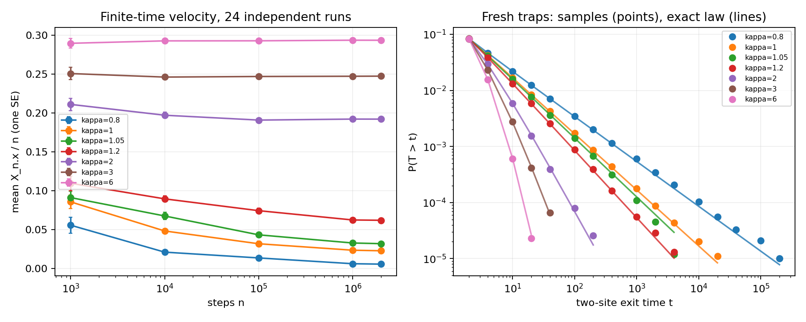

PARTIAL

# F0136: two-dimensional random walk in Dirichlet environment

Date: 2026-11-13. The full conjecture is not proved here. The literature search
found no unconditional resolution. The principal recent result found is
Perrel–Sabot (2025), Theorem 2.3, which constructs the invariant probability
under the additional condition (T'). Their Conjecture 1 still asks to remove
that condition. This is a report of a bounded literature search, not a guarantee
that no further result exists.

The complete arguments below establish an exact trap law, a logarithmic
obstruction to the old flow estimate, and a sufficient uniform-integrability
reduction to the conjecture. They do not establish the missing uniform
integrability. The ballisticity results under (T') or strong drift are already
in the literature; no new parameter region is claimed.

## Statement and laws

Write e3=-e1 and e4=-e2, A=alpha1+alpha2+alpha3+alpha4, and

    d_alpha=(alpha1-alpha3, alpha2-alpha4),
    kappa=2A-max(alpha1+alpha3,alpha2+alpha4).

All four parameters are strictly positive. At each x independently, the vector
(omega(x,x+ei))_{i=1}^4 has Dirichlet(alpha1,...,alpha4) distribution. Denote the
product environment law by P^(alpha). For fixed omega, P_{0,omega} is the
nearest-neighbor Markov-chain law starting at zero with these transition
probabilities. The annealed law is

    P_0^(alpha)(B)=integral P_{0,omega}(B) P^(alpha)(d omega).

An annealed almost-sure assertion is equivalent, by Fubini, to the same
quenched almost-sure assertion for P^(alpha)-almost every environment.
The quenched laws are not asserted to have the same exceptional set for
uncountably many separately chosen directions.

The conjecture is: if d_alpha is nonzero and kappa>1, there is a deterministic
v=c d_alpha, c>0, such that X_n/n converges to v almost surely in dimension two.
Here d_alpha is the unnormalized drift; the mean first step is d_alpha/A.
Some older papers call the latter vector d_alpha. Their zero/nonzero drift
criteria coincide, but their formulas must be normalized accordingly.

In the supplied overview v1, Theorem 1 (PDF p. 12) already gives, in dimension
two, directional transience whenever d_alpha dot ell>0, directional oscillation
when that scalar product is zero, and asymptotic direction d_alpha/|d_alpha|
when d_alpha is nonzero. Proposition 2 (p. 11) gives zero speed when kappa<=1.
Theorem 5(i) (p. 16) gives the desired positive-speed result for d>=3;
Remark 7 (p. 17) explains the dimensional obstruction. In particular,
directional transience and an asymptotic direction do not by themselves give
integrable travel times.

## Literature outcome

The saved texts and retrieval hashes are in sources/. Page numbers below
are one-based PDF pages of the saved text's source, unless journal pages are
explicitly specified. The form-feed characters preserve page boundaries.
This matters: the 2017 published overview renumbers theorems (for example,
the arXiv Theorem 5 becomes Theorem 5.10). The 2012 Bouchet preprint also
uses different numbering from the published article.

1. Sabot–Tournier, *Random walks in Dirichlet environment: an overview*,
   [arXiv:1601.08219v1](https://arxiv.org/abs/1601.08219v1), Sections 2–5,
   PDF pp. 3–17; Sections 6–7 supply regeneration and proof details.
   Published in Ann. Fac. Sci. Toulouse 26 (2017), 463–509,
   DOI 10.5802/afst.1542. The sentence after Proposition 2, p. 11, and
   Remark 7, p. 17, are the precise open-problem locations.

2. Sabot, *Random Dirichlet environment viewed from the particle in dimension
   d>=3*, Ann. Probab. 41 (2013), 722–743, DOI 10.1214/11-AOP699,
   [arXiv:1007.2565v3](https://arxiv.org/abs/1007.2565v3).
   Theorem 1, PDF p. 4, is the invariant-probability and L^p-density theorem;
   Theorem 2, p. 5, is the ballistic classification. Section 3, pp. 6–13,
   constructs torus densities. Lemma 1, p. 7, is their uniform L^p bound;
   Lemma 2, p. 10, supplies a capacity-constrained flow of bounded energy;
   Lemma 3 starts on p. 14 and constructs dispersed flows. Section 5,
   pp. 19–21, uses stationarity and directional transience to prove speed
   is nonzero. Those are different steps.

3. Bouchet, *Sub-ballistic random walk in Dirichlet environment*, Electron.
   J. Probab. 18 (2013), paper 58, 1–25, DOI 10.1214/EJP.v18-2109,
   [arXiv:1205.5709v1](https://arxiv.org/abs/1205.5709v1).
   In the saved preprint, Theorem 1, PDF p. 3, gives the accelerated invariant
   probability for kappa^Lambda>1; Theorem 2, p. 4, gives nonzero accelerated
   speed for nonzero drift; Theorem 5, p. 5, gives the sub-ballistic power
   exponent. Section 3.1, starting p. 6, repeats the reversal/flow argument
   with local acceleration. The overview cites the published accelerated-speed
   theorem as Theorem 2.4. Acceleration removes finite traps but does not
   remove the two-dimensional finite-energy obstruction to this proof.

4. Sabot, *Random walks in random Dirichlet environment are transient in
   dimension d>=3*, Probab. Theory Related Fields 151 (2011), 297–317,
   [arXiv:0811.4285](https://arxiv.org/abs/0811.4285).
   Theorem 1, PDF p. 3, gives the sharp Green-function moment exponent.
   Theorem 2, pp. 6–7, explicitly assumes transience of simple random walk
   on the underlying undirected graph. Theorem 3, p. 11, is the finite-energy
   flow estimate; Section 5 proves it by changing Dirichlet parameters along
   a flow. It cannot be invoked from biased RWDE transience alone.

5. Enriquez–Sabot, *Random walks in a Dirichlet environment*, Electron.
   J. Probab. 11 (2006), paper 31, 802–817, DOI 10.1214/EJP.v11-350,
   [arXiv:math/0503713](https://arxiv.org/abs/math/0503713).
   Theorem 1, PDF p. 2, proves ballisticity if some
   alpha_i-alpha_{i+d}>1 and gives coordinate speed bounds.
   Tournier, *Integrability of exit times and ballisticity for random walks
   in Dirichlet environment*, Electron. J. Probab. 14 (2009), 431–451,
   DOI 10.1214/EJP.v14-609,
   [arXiv:0801.2875](https://arxiv.org/abs/0801.2875), Theorem 6,
   PDF p. 5, improves this to sum_i |alpha_i-alpha_{i+d}|>1.
   Theorem 3, p. 4, is the finite-set Green-function integrability criterion.
   The saved journal version independently locates Theorem 6 on journal
   p. 436 (PDF p. 6), Theorem 3 on p. 435 (PDF p. 5), and the zero-speed
   Proposition 12 on p. 448 (PDF p. 18).

6. Berger–Drewitz–Ramírez, *Effective polynomial ballisticity conditions for
   random walk in random environment*, Comm. Pure Appl. Math. 67 (2014),
   1947–1973, DOI 10.1002/cpa.21500,
   [arXiv:1206.6377v2](https://arxiv.org/abs/1206.6377v2), Theorem 1.6,
   PDF p. 4, is a quantitative polynomial-to-(T') implication under uniform
   ellipticity. Campos–Ramírez, *Ellipticity criteria for ballistic behavior
   of random walks in random environment*, Probab. Theory Related Fields
   160 (2014), 189–251, DOI 10.1007/s00440-013-0527-7,
   [arXiv:1212.4020](https://arxiv.org/abs/1212.4020), Theorem 1.1,
   PDF p. 3, extends the equivalence to (E)_0, which every positive-parameter
   Dirichlet law satisfies. These criteria require quantitative box-exit
   control, not merely almost-sure escape.

7. Bouchet–Ramírez–Sabot, *Sharp ellipticity conditions for ballistic behavior
   of random walks in random environment*, Bernoulli 22 (2016), 969–994,
   DOI 10.3150/14-BEJ683,
   [arXiv:1310.6281v3](https://arxiv.org/abs/1310.6281v3).
   Theorem 1, PDF p. 4, gives a regeneration-tail bound under (P)_M and
   (E')_beta; Theorem 2, pp. 4–5, gives ballisticity under (E')_1.
   Remark 5, p. 6, permits replacement by (T'). Section 1.3.2, pp. 7–9,
   identifies (E')_beta with beta<kappa for Dirichlet laws.
   Theorem 5, p. 8, proves (P)_M when a backward parameter is sufficiently
   small with the other parameters fixed. Its epsilon depends on those
   parameters; it is not a uniform theorem for arbitrary nonzero drift.

8. Bouchet–Sabot–dos Santos, *A quenched functional central limit theorem
   for random walks in random environments under (T)_gamma*, Stochastic
   Processes Appl. 126 (2016), 1206–1225,
   [arXiv:1409.5528](https://arxiv.org/abs/1409.5528), Theorem 1.1,
   PDF p. 3, is a quenched CLT with the additional moment hypothesis
   E[tau_1^2 (log tau_1)^m]<infinity, m>1+1/gamma. It is not an unconditional
   ballisticity theorem. In the Dirichlet case the sharp conditional
   regeneration exponent makes kappa>2 sufficient for this moment assumption.

9. Fribergh–Kious, *Local trapping for elliptic random walks in random
   environments in Z^d*, Probab. Theory Related Fields 165 (2016), 795–834,
   DOI 10.1007/s00440-015-0646-4,
   [arXiv:1404.2060v2](https://arxiv.org/abs/1404.2060v2).
   Theorem 3.1, PDF p. 8, gives a zero-speed obstruction from infinite
   hypercube exit-time mean. Theorem 3.2, p. 10, gives a local ellipticity
   criterion together with (P)_M. It does not remove (P)_M.

10. Guerra–Ramírez, *A proof of Sznitman's conjecture about ballistic RWRE*,
    Comm. Pure Appl. Math. 73 (2020), 2087–2103,
    DOI 10.1002/cpa.21877,
    [arXiv:1809.02011](https://arxiv.org/abs/1809.02011), Theorem 2.1,
    PDF p. 3, proves (T') implies (T) for iid uniformly elliptic environments.
    The title refers to the equivalence of quantitative conditions; it does
    not give transience implies (T') for Dirichlet environments.

11. Ramírez–Ribeiro, *Computable criteria for ballisticity of random walks in
    elliptic random environment*,
    [arXiv:2107.00113v2](https://arxiv.org/abs/2107.00113v2) (2021).
    Theorem 1, PDF p. 4, is a planar computable local condition (X)_1
    together with (P)_M, M>35. Theorem 2, p. 6, also retains (P)_M.
    Thus the new local exit criteria do not settle the missing global control.

12. Poudevigne-Auboiron, *Limit theorem for sub-ballistic random walks in
    Dirichlet environment in dimension d>=3*, Electron. J. Probab. 29 (2024),
    paper 51, DOI 10.1214/23-EJP945,
    [arXiv:1909.03866](https://arxiv.org/abs/1909.03866), Theorem 1,
    PDF p. 4; Perrel, *Limit theorem for subdiffusive random walk in Dirichlet
    random environment in dimension d>=3*,
    [arXiv:2404.06502](https://arxiv.org/abs/2404.06502) (2024), Theorem 6,
    PDF p. 8. These are d>=3 fluctuation results; the latter also assumes (T).

13. Perrel–Sabot, *Invariant measure for the process viewed from the particle
    for 2D random walks in Dirichlet environment*,
    [arXiv:2501.06767v1](https://arxiv.org/abs/2501.06767v1) (2025).
    Theorem 2.3, PDF p. 8: under (T') and kappa>1 an absolutely continuous
    invariant probability exists, with density in every L^p, p<kappa.
    Theorem 2.4, p. 8: under (T') local acceleration can produce arbitrarily
    high density moments; recurrent centered environments admit no such
    absolutely continuous invariant measure. Conjecture 1, p. 9, retains
    the unconditional nonzero-drift classification as a conjecture.
    Lemma 2.1, p. 6, is a new product-ratio identity, inspired by the
    nonreversible star-VRJP. Section 6 proves the conditional existence
    theorem; it does not derive (T') from nonzero drift.

14. A search through 2026 also found *Directional transience implies
    ballisticity*, OpenAI, September 23, 2026,
    [manuscript](https://mathcommunity.github.io/oai-math-revised/papers/Directional-transience-implies-ballisticity-September-23-2026/paper.pdf).
    Theorem 1.1, PDF p. 3, explicitly assumes uniform ellipticity, defined
    on p. 2. Dirichlet laws with finite positive parameters violate that
    hypothesis. Its proof is not relied on here; its stated scope does not
    settle F0136. Clipping small probabilities would need a uniform positive
    lower bound on speed as the clipping disappears, which it does not state.

The searches used the original arXiv identifier, its published overview title,
the planar conjecture, the named authors, and year-specific searches for
2016–2026. They included later limit-theorem papers and the 2025 authors'
references. This was not a complete export of every citing paper from a
citation database. sources/search_notes.txt records the search scope.

## Where the old proof uses dimension

On a finite torus T_N, let pi_N^omega be the stationary distribution of the
quenched walk and let f_N=N^d pi_N^omega(0). Translation invariance gives
E[f_N]=1. The environment seen from the particle has an invariant torus law
Q_N=f_N P_N. To pass to infinite volume with an absolutely continuous
probability one must prevent these densities from concentrating on
environments of vanishing P_N-probability.

Define the reversed environment by

    check_omega(x,y)=pi_N(y) omega(y,x)/pi_N(x).

The weights are divergence-free in every dimension, so the reversed law is
again Dirichlet, with opposite directional weights exchanged. This finite
identity does not require d>=3 and does not assume that an infinite-volume
reversed walk has already been constructed.

For a nonnegative flow theta, direct multiplication gives

    product_e check_omega(reverse(e))^theta(e) / omega(e)^theta(e)
       = product_x pi_N(x)^div(theta)(x).

Arithmetic-geometric mean, followed by a flow with
div(theta)=p(delta_0-uniform_T_N), bounds f_N^p by this ratio.
Hölder's inequality separates the forward and reversed factors; the
Dirichlet moment formula evaluates each as products of Gamma functions.
The first-order terms in their logarithms cancel. Taylor estimates leave
a bound of the form

    E[f_N^p omega(0,e_i)^kappa] <= C exp(C' sum_e theta_N(e)^2).

The edge factor raises the admissible capacity locally. A max-flow/min-cut
argument makes the relevant capacity threshold kappa, rather than the
smaller min_i alpha_i. The proof needs both this capacity control and a
bound on flow energy independent of N. Increasing capacities does not by
itself control energy.

The bounded-energy flows exist for d>=3 because the underlying undirected
unit-conductance lattice is transient. A radial flow has size of order
r^{1-d} on order r^{d-1} edges in a shell, giving shell energy of order
r^{1-d}. Its sum is finite exactly for d>2. Sabot's Lemmas 2–3 make this
compatible with the capacities and the torus geometry. In dimension two,
the shell sum is harmonic and diverges logarithmically.

The analogous Green-function proof adds a cemetery edge and changes
parameters from alpha to alpha+gamma theta to correct the divergence.
Time reversal gives a Beta-distributed escape lower bound in the changed
environment. Changing back costs exp(C sum theta^2). The overview,
Section 7.2, PDF pp. 21–23, relates that sum to electrical resistance.
Resistance to distance N is bounded for d>=3 and grows as log N for d=2.
The two-dimensional bound there decays with N and does not give a positive
infinite-volume escape bound by this argument.

Thus “the walk is transient” has two different roles. Nonzero drift already
makes the actual two-dimensional RWDE transient. What fails in the above
construction is transience of the undirected reference network used to
bound the change of measure. Opposite weights can also be combined into
bounded positive symmetric conductances; such a network on Z^2 remains
recurrent by comparison with unit conductances. A biased homogeneous walk
can be transient while its symmetric reference network is recurrent.
Replacing the reference-network hypothesis with biased-walk transience
silently changes the proof.

### A quantitative impossibility for these flows

**Proposition.** On the directed square torus of side N>=16, every flow
theta with div(theta)=p(delta_0-uniform), p>0, satisfies

    sum_e theta(e)^2 >= (p^2/96) sum_{r=1}^{floor(N/8)} 1/r.

The conclusion holds also for signed flows; in particular it applies to
the nonnegative flows used above.

**Proof.** Embed the squares B_r=[-r,r]^2, 1<=r<=floor(N/8), without
wrapping around the torus. Summing the divergence over B_r gives net outward
flux p(1-(2r+1)^2/N^2)>=p/2. Its edge boundary has 8r+4 undirected edges,
or 16r+8 directed edges. Cauchy–Schwarz, including the signs of incoming
edges, implies that the squared flow summed over this cut is at least
p^2/[4(16r+8)]>=p^2/(96r). These cuts have disjoint edges: an edge crosses
at most one of the nested square boundaries. Summing proves the claim. QED.

This proves failure of the bounded-energy input even for arbitrarily large
fixed alpha. It does not prove failure of bounded L^p norms of f_N: the
flow method supplies an upper bound, and a divergent upper bound is
inconclusive. It also does not disprove existence of a different invariant
measure construction. The 2025 theorem is evidence that a different
construction is useful.

More precisely, Perrel–Sabot Section 6 uses a torus with a cemetery vertex
joined to every site by edges of small weight epsilon. Lemma 6.1, PDF p. 25,
uses (T') to obtain moments of the total number of returns to zero, by
confining the walk before regeneration to a box of polylogarithmic radius.
Lemma 6.2 transfers the bound to the killed torus. The product-ratio identity
then controls normalized stationary-mass ratios (Lemma 6.3, p. 27).
The resulting measures are approximately invariant, with an error of order
epsilon (Lemmas 6.5–6.6, pp. 28–29). Section 6.3, p. 30, first takes the
torus size to infinity and then epsilon to zero. This explains both the
new route around the old energy bound and the exact place where the extra
spatial control remains. These are the paper's theorem and proof structure;
the report does not independently reprove every lemma of that paper.

## Complete sufficient reduction to ballisticity

Let K be the discrete-time environment kernel

    Kg(omega)=sum_{i=1}^4 omega(0,e_i) g(tau_{e_i} omega).

The overview sometimes calls K-I the generator; the invariant measures are
the same for these two conventions.

**Proposition.** Suppose d_alpha is nonzero. If the torus densities
f_N=N^2 pi_N(0) are uniformly integrable under P_N^(alpha), that is,

    lim_{M->infinity} sup_N E_N[f_N 1_{f_N>M}]=0,

then there is an invariant probability Q absolutely continuous with respect
to P^(alpha), and the two-dimensional walk is ballistic with deterministic
velocity c d_alpha, c>0. In particular it suffices to prove, for one p>1,
sup_N E_N[f_N^p]<infinity. Under kappa>1 one may seek p in (1,kappa).

**Proof, construction.** Work on the compact product of closed probability
simplexes, allowing zero entries temporarily. Extend torus environments
periodically. Then P_N converges weakly to P, since every finite set of
distinct sites has independent Dirichlet rows once N is sufficiently large.
Translation invariance gives E_N[pi_N(0)]=1/N^2, so Q_N=f_N P_N is a
probability. It is K-invariant: average the rooted expression over all roots,
then apply the quenched stationarity of pi_N to sum over the next root.

Take a weakly convergent subsequence Q_N -> Q by compactness. K maps
continuous cylinder functions to continuous cylinder functions, so Q is
K-invariant. For continuous g>=0,

    Q(g) <= M P(g) + ||g||_infinity eta(M),
    eta(M)=sup_N E_N[f_N 1_{f_N>M}].

This follows first for Q_N by splitting the density at M, and then by weak
convergence. Regularity of measures on the compact product extends it to
indicators of Borel sets. For a P-null set, let M tend to infinity to get
Q(B)=0. Thus Q<<P, and Q is supported on positive transition probabilities.
A uniform L^p bound implies uniform integrability by
E[f_N 1_{f_N>M}]<=M^{1-p} E[f_N^p]. Hölder duality also gives an L^p
density for Q when that stronger bound is available.

**Proof, equivalence and ergodicity.** Put h=dQ/dP. Invariance and shift
invariance of P give

    h(omega)=sum_i omega(-e_i,0) h(tau_{-e_i} omega), P-a.s.

All coefficients are positive. Therefore {h=0} implies that h vanishes at
each neighboring shift. Shift invariance of P makes these inclusions
equalities modulo null sets. The zero set is translation invariant. Since
the product law P is ergodic and integral h dP=1, P(h=0)=0. Hence Q and P
are equivalent.

For completeness the stationary environment chain, with its step marks,
is ergodic as well. If a bounded g is K-harmonic, stationarity gives

    integral [K(g^2)-(Kg)^2] dQ = 0.

The integrand is nonnegative. Equality forces g(tau_{e_i} omega)=g(omega)
for every i, almost surely. Equivalence to P and translation ergodicity
make g constant. For a time-shift invariant path event B, its conditional
probability g(omega) is K-harmonic. The Markov property identifies
g(omega_n) with the conditional probability of B given the history through
n. Martingale convergence gives g(omega_n)->1_B. Thus B has probability
zero or one. This argument also covers the recorded step mark at each
transition, since it is sampled from the row at the current environment.

It follows that the bounded increments Delta_n=X_{n+1}-X_n are stationary
and ergodic under Q(d omega) P_{0,omega}. Birkhoff's theorem gives

    X_n/n -> v=integral sum_i omega(0,e_i)e_i Q(d omega)

with deterministic v, and equivalence transfers this assertion to the
original annealed law and hence to almost every quenched law.

**Proof, why v cannot vanish.** Choose a signed coordinate direction u
with d_alpha dot u>0. The overview's Theorem 1 gives S_n=X_n dot u ->+infinity
under P, hence under Q. Its increments are stationary ergodic and take
values in {-1,0,1}. Define

    m_n=inf_{k>=n} S_k,    Y_n=m_{n+1}-m_n.

The minima are finite integers and m_n->+infinity. Since
m_n=min(S_n,m_{n+1}) and S_{n+1}<=S_n+1, Y_n belongs to {0,1}. Both Y_n
and D_n=S_n-m_n are shift-covariant functions of the stationary increment
sequence; they are stationary, and Y_n is ergodic. If E[Y_0]=0, then every
Y_n=0 almost surely, contradicting m_n->infinity. Thus c_u=E[Y_0]>0, and
Birkhoff gives m_n/n->c_u.

The finite nonnegative variables D_n have the same distribution for every
n, so D_n/n->0 in probability, without any integrability assumption on
D_0. Since S_n/n->v dot u and m_n/n->c_u almost surely, this forces
v dot u=c_u>0. Finally the already known asymptotic direction implies
v=c d_alpha for c>0. QED.

This isolates a sufficient analytic target. Directional transience is
already supplied by the overview, and stationarity makes its upgrade to
positive speed rigorous. What is not proved here is the uniform
integrability hypothesis for general planar parameters with kappa>1.

## What follows under extra assumptions

Define (T)_gamma in direction ell by stretched-exponential decay of backward
slab exit probabilities, uniformly for each direction in a neighborhood of
ell: for every such ell' and b>0,

    limsup_{L->infinity} L^{-gamma}
       log P_0(T_{-bL}^{ell',-}<T_L^{ell',+}) < 0.

Here T_L^{ell',+} is the first time X_n dot ell'>=L and T_{-bL}^{ell',-}
the first time it is <=-bL. (T) means gamma=1; (T') means (T)_gamma for
every 0<gamma<1. The spatial regeneration formulation used by Perrel–Sabot
requires directional transience and a stretched-exponential moment of the
maximum displacement up to the first regeneration, for every gamma<1.
Its content is spatial control; heavy holding times can remain.

**Conditional conclusion, already known.** If a planar RWDE satisfies (T')
and kappa>1, it is ballistic, its environment kernel has the invariant
probability of Perrel–Sabot Theorem 2.3, and its first regeneration time in
the asymptotic direction has finite s-moment exactly for 0<s<kappa.

Here is the explicit parameter check in the moment argument. The condition
(E')_beta of Bouchet–Ramírez–Sabot asks for positive numbers a_i with

    2 sum_i a_i-max(a1+a3,a2+a4)>beta,
    E[product_i omega(0,e_i)^(-a_i)]<infinity.

For Dirichlet parameters alpha, choose a_i=(1-epsilon)alpha_i. The moment is

    Gamma(A)/Gamma(epsilon A)
       product_i Gamma(epsilon alpha_i)/Gamma(alpha_i),

which is finite. For any beta<kappa choose epsilon>0 sufficiently small
that (1-epsilon)kappa>beta. Conversely finite negative joint moments
require a_i<alpha_i for every i. Each expression
2 sum a_i-a_j-a_{j+2} has positive coefficients, so its minimum is strictly
smaller than kappa. Thus (E')_beta holds exactly when beta<kappa.
Also (E)_0 holds: choose any positive q<min_i alpha_i and use the finite
Beta inverse moments E[omega(0,e_i)^(-q)].

Campos–Ramírez Theorem 1.1 now converts (T') to (P)_M. Choose M=36 in
dimension two to avoid endpoint conventions at 35. BRS Theorem 1 gives

    limsup log P_0(tau_1>t)/log t <= -beta

for every beta<kappa, where tau_1 is in the asymptotic direction. For
s<kappa choose s<beta'<beta<kappa. For large t this bounds the tail by
t^{-beta'}, and the tail-integral formula gives E[tau_1^s]<infinity.
BRS Theorem 2 gives ballisticity directly when kappa>1. The converse
moment obstruction is proved from the exact two-site law below: survival
in the pair until time 2m prevents any strict nonbacktracking record before
that time, hence P(tau_1>2m)>=P(T_pair>2m), with exponent kappa.

This proof uses the stated general RWRE theorems as inputs; it is not a
new proof of those theorems. Crucially, it does not derive (T') from drift.

For an entirely explicit parameter region, put
D=|alpha1-alpha3|+|alpha2-alpha4|. Tournier Theorem 6 gives ballisticity
when D>1 and the bound

    |(A-1)v-d_alpha|_1 <= 1,
    |v|_1 >= (D-1)/(A-1)>0.

The second inequality follows from the reverse triangle inequality; A>1
because A>=D>1. For a fixed positive shape b with nonzero drift, alpha=lambda b
is therefore ballistic whenever

    kappa(alpha)>K(b),
    K(b)=[2 sum b_i-max(b1+b3,b2+b4)]/
                       [|b1-b3|+|b2-b4|].

This is a shape-dependent threshold, not a universal larger K. For the
simulated horizontal shape b=(3/8,1/8,1/8,1/8), K(b)=4. The kappa=6 sample
lies in this already proved region; the same criterion does not cover
the kappa=1.05,1.2,2,3 samples. A different sufficient result, BRS
Theorem 5, permits a sufficiently small backward parameter while other
parameters are fixed; its threshold is not given as an explicit universal
number. None of these statements supplies a universal planar threshold
depending on kappa alone for arbitrary nonzero drift.

## Exact two-site trap law and proof

Choose an axis i and the pair {0,e_i}. Put u=omega(0,e_i),
w=omega(e_i,0). These are independent Beta(alpha_i,A-alpha_i) and
Beta(alpha_{i+2},A-alpha_{i+2}) variables. Let T be the first exit time
from the pair, starting at zero, and let G be the quenched number of visits
to zero in the pair, including time zero. Then

    G=1/(1-uw),
    P(T>2m)=E[(uw)^m]
      = Gamma(A)^2 Gamma(alpha_i+m) Gamma(alpha_{i+2}+m)
          /[Gamma(alpha_i) Gamma(alpha_{i+2}) Gamma(A+m)^2].

**Proof.** Survival through 2m steps consists of exactly m crossings in
each direction, so its quenched probability is (uw)^m. The number of
complete return cycles is geometric, which also gives G. Integrating
u^m and w^m with their Beta densities gives the displayed Gamma ratios.
The Gamma-ratio asymptotic gives

    P(T>2m) ~ C_i m^{-r_i},
    r_i=2A-alpha_i-alpha_{i+2},
    C_i=Gamma(A)^2/[Gamma(alpha_i)Gamma(alpha_{i+2})].

Since this tail is monotone, its values at even times also determine the
moment criterion at all times: E[T^s]<infinity iff s<r_i. To see the
endpoint explicitly, the tail-sum expression for E[T^s] has summands
asymptotic to a positive constant times m^{s-1-r_i}; its series diverges
when s>=r_i.

For the quenched G tail one can also compute the constant. Let a=1-u,
b=1-w, with Beta densities having leading terms
a^{A-alpha_i-1}/B(A-alpha_i,alpha_i) and
b^{A-alpha_{i+2}-1}/B(A-alpha_{i+2},alpha_{i+2}) at zero.
The event a+b-ab<epsilon forces a,b<epsilon. Rescale
a=epsilon x, b=epsilon y in the integral. The limiting domain is
x,y>=0, x+y<1; the integrable powers on [0,1]^2 justify dominated
convergence. The Dirichlet integral on that triangle gives

    P(G>t) ~ [C_i/Gamma(r_i+1)] t^{-r_i}.

Hence E[G^s]<infinity iff s<r_i as well. Minimize r_i over the two axes
to obtain kappa. These are annealed tail laws for a freshly sampled pair.
They are not claims that all trap encounters along a walk are independent. QED.

## Computation and checks

The code is in code/simulate.cpp, with reproduction instructions in
code/README.md. There are nine parameter choices, 24 independent
environment/trajectory replicas per choice, and 2,000,000 steps per replica:
432,000,000 walk steps in total. Checkpoints are 10^3, 10^4, 10^5, 10^6 and
2*10^6. A separate experiment samples 1,000,000 fresh two-site traps for each
choice, nine million in total, using their exact conditional geometric law.
The base RNG seed is 13620261113; individual seeds are saved in paths.csv.

All horizontal samples use alpha=kappa*(3/8,1/8,1/8,1/8). The additional
vertical-trap sample is (0.1,0.4,0.05,0.4), kappa=1.1. The weak-drift sample
is (1.05/1.55)*(0.30,0.25,0.25,0.25), kappa=1.05. In each case the drift
points along +x. The last two choices have different drift magnitude and
trap geometry, so their speeds should not be compared to the horizontal
family using kappa alone.

The following are means of X_n.x/n at n=2,000,000. SE is the sample standard
deviation across the 24 independent replicas divided by sqrt(24); it measures
finite-time Monte Carlo variability, not an error bar for the limiting speed.

| Parameters | kappa | Mean X_n.x/n | SE |
|---|---:|---:|---:|
| horizontal family | 0.8 | 0.0054894 | 0.0007187 |
| horizontal family | 1 | 0.0226693 | 0.0015504 |
| horizontal family | 1.05 | 0.0317694 | 0.0018936 |
| horizontal family | 1.2 | 0.0618610 | 0.0020228 |
| horizontal family | 2 | 0.1918984 | 0.0001967 |
| horizontal family | 3 | 0.2471424 | 0.0001729 |
| horizontal family | 6 | 0.2932805 | 0.0001531 |
| vertical traps | 1.1 | 0.0009539 | 0.0000823 |
| weak drift | 1.05 | 0.0008398 | 0.0000798 |

The kappa=0.8 mean falls from 0.05554 at 1,000 steps to 0.00549 at two
million; the kappa=1 mean falls from 0.08554 to 0.02267. Both have rigorously
zero limiting speed by Proposition 2. The near-threshold samples also slow
substantially over the observed range: for kappa=1.05 the mean falls from
0.09104 to 0.03177, and for kappa=1.2 from 0.10946 to 0.06186. Consequently
the positive numbers in this table do not distinguish slow convergence to a
small positive speed from eventual zero speed. The kappa=2,3,6 samples
are substantially steadier on these scales. The kappa=6 case is also
covered by the known strong-drift theorem: D=1.5, A=4.5, so v.x>=1/7.

For fresh traps the empirical survival probabilities are compared against
the exact Gamma-ratio formula at 17 even thresholds from 2 to 1,000,000.
Across comparisons with at least ten expected survivors and ten expected
nonsurvivors, the largest absolute binomial z-score is 3.2133. This is a
descriptive sampler check across correlated thresholds, not 153 independent
statistical tests. The Gamma ratios were separately checked against their
finite-product form for m=1,2,5,50,500. The exponent predicted by kappa
also appears in elementary log-log fits to the fresh-pair tails:

| kappa / sample | fitted exponent | exact-law exponent on same finite range | time range |
|---|---:|---:|---:|
| 0.8 horizontal | 0.768 | 0.800 | 100–20,000 |
| 1 horizontal | 0.996 | 1.000 | 100–2,000 |
| 1.05 horizontal | 1.111 | 1.050 | 100–1,000 |
| 1.2 horizontal | 1.200 | 1.199 | 100–1,000 |
| 1.1 vertical traps | 1.117 | 1.099 | 100–2,000 |
| 1.05 weak drift | 1.061 | 1.050 | 100–1,000 |

Fits use t>=100 and at least 50 observed survivors, with at least three
thresholds. Counts at nested thresholds are correlated, and the selection
of the fitting range uses the data. No independent uncertainty estimate or
asymptotic claim is assigned to these fitted slopes. For kappa=2,3,6 this
criterion leaves too few tail points for a fit, so none is reported.

Along the walks, completed maximal alternating runs across a single
unordered edge were also counted. Their median maximum lengths at the
final checkpoint are 112,809.5, 53,557, 46,526.5, 28,945.5, 1,243.5,
268 and 47.5 for the seven horizontal choices in increasing kappa order.
The final, possibly unfinished run is saved separately. In one kappa=0.8
replica it already has length 1,796,606 at the two-million-step endpoint.
These run statistics detect actual trapping along trajectories, but their
law is affected by encounter bias, repeated visits and censoring. They are
not pooled with the independent fresh-pair samples when estimating tails.

Raw checkpoint data, parameter vectors, encounter counts, trap counts,
summaries, exact-law comparisons and fits are in data/. The environment is
sampled lazily on the unbounded lattice and reused at every revisit; there
are no periodic boundaries in these walk experiments. Standard-library
Gamma draws generate the Dirichlet vectors. Each replicate uses a new
independent pseudorandom stream. Floating-point sampling is evidence, not
a mathematical proof.

Checks in code/analyze.py validate the lattice parity and displacement
constraints, checkpoint counts, exact trap probabilities, parameter values,
and tail-count monotonicity. code/audit_artifacts.py independently
recomputes the velocity means and SEs from integer displacements using
rational arithmetic, verifies all saved source-text hashes, and checks that
no PDF file is retained. The main C++ program compiled with C++17,
-O2, -Wall, -Wextra and -pedantic without diagnostics. Its reported peak
resident memory was 166,297,600 bytes (158.59375 MiB), using one worker at
niceness 10. Numerical-library threads were capped at one. The only image
is the original simulation figure above, not a paper page or scan.

## What remains open in this work

No counterexample was found. No unconditional proof of ballisticity, of the
planar invariant probability for all nonzero drift and kappa>1, or of a
universal larger threshold K was obtained. The complete uniform-integrability
reduction above is a sufficient target, while the cut calculation proves
that the old bounded-energy flow lemma cannot simply be reused. The 2025
theorem under (T') is substantive progress already in the literature.
The numerical results agree with the finite-trap exponent and remain
inconclusive about the unconditional conjecture near kappa=1.

Task: “Open problem F0136.” Received 2026-11-13 08:25 +04 (Asia/Tbilisi).
