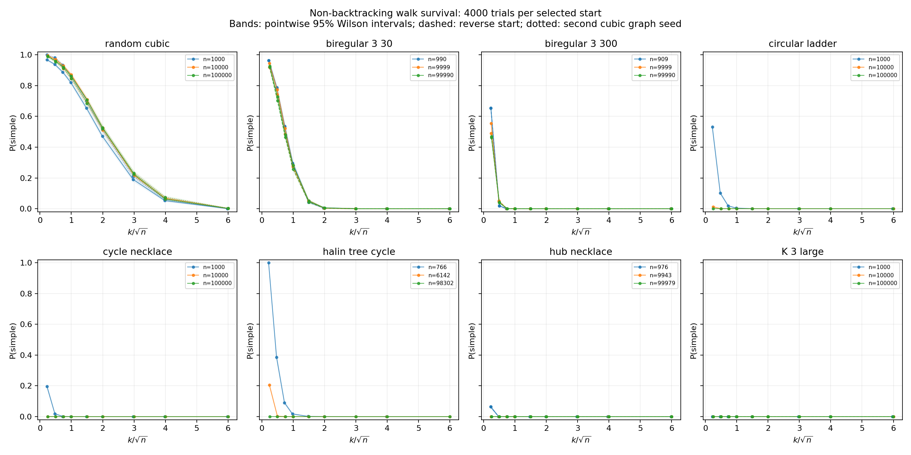

PARTIAL

# G0012: the non-backtracking birthday conjecture

13 November 2026. The full conjecture is unresolved in this work. No verified literature resolution for all finite simple graphs of minimum degree three was found. The result proved here covers bounded degree ratio, uniformly over the absolute degree, and therefore also bounded maximum degree. No simple-graph counterexample was found.

For minimum degree m>=3 and maximum degree M, put Q=M/(m-1). For every directed starting edge delta,

\[
 \Pr(\text{length-}k\text{ NBW is vertex-simple})
 \leq\min\{1,256Q(1+Q)n/k^2\}.
\]

In particular, the conjecture holds with C(epsilon,D)=32D/sqrt(epsilon) when M/m<=D. Under m>=3 and M<=Delta, it holds with C(epsilon,Delta)=8 sqrt(Delta(Delta+2)/epsilon). These formulas are for 0<epsilon<1; for larger epsilon the value at epsilon=1/2 suffices. The proof also bounds the expected first-collision time by 32 sqrt(Q(1+Q)n)+2. These are mathematical deductions below, not conclusions inferred from simulation. No novelty claim relative to unlocated work is made.

## Source and exact problem

The source is Benjamin Dozier, *The Birthday Paradox for non-backtracking walks on regular graphs*, [arXiv:2608.26321v1](https://arxiv.org/abs/2608.26321), submitted 26 August 2026. The PDF title page is dated 28 August 2026. The single author is Dozier. Conjecture 1.5 is in Section 1, PDF p.2; the fixed-degree result is Theorem 1.1, PDF p.1.

The conventions on PDF p.1 specify finite undirected graphs with no loops or parallel edges. An edge is directed when used in a walk. A walk is simple precisely when none of its visited vertices, including the initial vertex, is repeated. Length k counts k edges, including the prescribed first edge delta=(x_0,x_1). The conjecture asks whether for each epsilon>0 there is one constant C(epsilon), independent of the graph, n, every degree, and delta, such that k>C(epsilon)sqrt(n) implies probability less than epsilon. Connectedness is not imposed. Theorem 1.1 assumes d-regularity for a fixed d>=3 and allows C to depend on d as well as epsilon.

Dozier does not write a separate transition formula for irregular graphs. This report uses the standard sequential law: conditional on the last edge (u,v), the next edge is (v,w), with each w in N(v) minus {u} chosen with probability 1/(d(v)-1). This is explicitly the definition in Bencs et al., [arXiv:2608.09729v1](https://arxiv.org/abs/2608.09729), PDF p.1. It agrees with uniform counting of all length-k walks on regular graphs. On irregular graphs, uniform sampling of complete length-k walks would be a different law; none of the conclusions here is asserted for that alternative interpretation.

The full Dozier text was saved in `sources/dozier_2608.26321v1.txt`, with mathematical formulas preserved from HTML, and independently in `sources/dozier_2608.26321v1_pages.txt`, with PDF page boundaries. The PDF was parsed only in RAM. The paper has Section 1 on pp.1-3 and Section 2 on pp.3-8, followed by references on pp.8-9. It has no Section 3. Both sections and the entire regular-case proof were read.

## The regular-case proof and the actual gap

Dozier's proof counts plans and uses excursion reversal. It is not a collision second-moment proof and does not assume mixing or expansion. A plan assigns a derangement of incident edge labels to every vertex, giving invertible routing on directed edges. Lemma 2.1 (p.4) identifies its simple-walk probability. Lemma 2.2 (pp.5-7) packs disjoint departing trajectories and pairs returning excursions with their reversals. Lemma 2.3 (pp.7-8) counts the resulting nonsimple plans using the location of their first collision. Theorem 1.1 is concluded on p.8.

The exact uses of regularity are as follows.

| Place in Dozier | Regular expression | Irregular issue or surviving fact |
|---|---|---|
| Lemma 2.1, p.4 | Every simple path has probability (d-1)^{-(k-1)}; N(k,delta)=(d-1)^{k-1}. | Path probabilities become products of 1/(d(v)-1). Uniform plan measure still reproduces the correct sequential probabilities; the unweighted ratio of path counts does not. |
| Lemma 2.2, pp.5-6 | Exactly (k-1)(d-2) departures per simple plan; nd directed edges for packing. | Departure counts depend on the path; ambient edge count is sum_v d(v). A bound in n alone no longer follows from this raw count. |
| Lemma 2.2(Bii), p.6 | At most d-1 terminal returns, compared with (k-1)(d-2) departures. | The terminal vertex can have much higher degree than departure vertices. |
| Lemma 2.2(Biii), pp.6-7 | Excursion reversal preserves base plan count. | The involution survives; normalized departure weights change by endpoint degree factors. |
| Lemma 2.3, p.8 | At most R_d(L+1) preimages; a uniform fraction of departures is lost near time k. | Deterministic replacement can cost max_v R_{d(v)}, and unweighted departures can concentrate at large-degree vertices. Conditional resampling below removes the factorial cost. |

Double stochasticity does survive irregularity. For any directed edge (v,w), the column sum of the transition matrix is

\[
 \sum_{u\in N(v)\setminus\{w\}}P((u,v),(v,w))
 =\sum_{u\in N(v)\setminus\{w\}}\frac1{d(v)-1}=1.
\]

Thus the uniform stationary measure on directed edges also survives. This is Kempton's Lemma 1, [arXiv:1603.05553v1](https://arxiv.org/abs/1603.05553), PDF p.4. The vertex marginal is d(v)/sum_w d(w), uniform only in regular graphs. Stationarity alone gives no arbitrary-graph mixing or collision-concentration bound. Bottlenecks can retain walks even in cubic graphs; retention is not a demonstrated mechanism for avoiding collisions. For independent vertex samples, nonuniformity increases the collision sum, since sum_v pi(v)^2>=1/n. Correlations, rather than that marginal inequality, obstruct a direct birthday/second-moment argument.

Minimum degree three gives alternative-departure weight (d(v)-2)/(d(v)-1)>=1/2. At degree two there is no departure. An n-cycle refutes the degree-two variant: all NBWs of length k<n are simple. For degree-three vertices any prescribed continuation has probability at most 1/2 at each step, but this alone does not bound the sum over all simple paths. Ladders and trees closed with cycles were therefore tested rather than dismissed on that observation.

## Complete proof of the partial results

The proof below is also in `PROOF.md`. It adapts Dozier's plans and excursion reversal by conditional resampling. It was checked by the finite audits below; it has not been formally verified in Lean or independently refereed.

**Theorem A.** Let G be a finite simple undirected graph with n vertices, minimum degree m >= 3, and maximum degree M. Put Q=M/(m-1). For every directed starting edge delta and integer k>=1,

\[
 p_k(\delta):=\Pr(\text{the length-}k\text{ NBW from }\delta\text{ is vertex-simple})
 \leq \min\{1,256Q(1+Q)n/k^2\}.
\]

The NBW chooses uniformly among all neighbors other than the preceding vertex. Length counts edges and includes delta. If k>=n, the probability is zero.

Consequently, for 0<epsilon<1:

* If M/m<=D, one may take C(epsilon,D)=32D/sqrt(epsilon).
* If m>=3 and M<=Delta, one may take C(epsilon,Delta)=8 sqrt(Delta(Delta+2)/epsilon).

These constants are not optimized. In particular the first result is uniform over the absolute degree, including regular graphs of degree growing with n.

## 1. Product measure on plans

At each vertex v, independently choose a uniformly random derangement pi_v of its neighbor set N(v). An incoming edge (u,v) is followed by (v,pi_v(u)). The resulting map phi on directed edges is a permutation: at each v its incoming edges map bijectively onto its outgoing edges. Write mu for the product measure on plans with fixed start delta, and S for those whose first k edges form a vertex-simple path x_0,...,x_k.

Let R_d be the number of derangements of d objects. For distinct a,b in N(v), exactly R_d/(d-1) derangements send a to b. This follows by conjugating by permutations fixing a, which acts transitively on the possible b. Thus every specified simple path has mu-probability

\[
 \prod_{i=1}^{k-1}\frac1{d(x_i)-1}.
\]

The constraints concern distinct vertices and so are independent. This is also exactly its NBW probability. Summing over the simple paths proves mu(S)=p_k(delta). We do not identify the plan walk with the NBW after its first repeated vertex; that identification would be false in general.

## 2. Departures and certificates

For a plan rho in S, a departure is a pair (i,beta) where 1<=i<=k-1 and beta=(x_i,z) is an outgoing edge other than (x_i,x_{i-1}) and (x_i,x_{i+1}). Assign this departure weight

\[
 w_i=1/(d(x_i)-1).
\]

Its total weight, for a fixed rho, is

\[
 T(rho)=\sum_{i=1}^{k-1}\frac{d(x_i)-2}{d(x_i)-1}\geq(k-1)/2.
\]

Take an integer L>=1. Follow beta and thereafter the original plan, stopping at the first return to P={x_0,...,x_k}, or after L edges after departure, whichever comes first. At vertices outside P this trajectory uses only the original local derangements. Thus it is independent of how the local derangement at x_i is replaced, provided the replacement sends x_{i-1} to z.

A departure is **certified bad** if the original prefix x_0,...,x_i followed by this stopped trajectory repeats a vertex. This includes an internal repeat along the excursion, a return to x_i, and a return to any earlier vertex of the prefix. The certificate occurs by time i+L and holds for every such replacement of the departure derangement. Departures that return to a later point of P without a repeat before that return are not certified, even if a repeat could occur subsequently.

We bound the average weight of certified bad departures.

### Non-returning departures

Consider departures that do not return to P in their first L edges and have no certificate. Their L-edge pieces use distinct directed edges. Pieces from distinct departures have disjoint directed-edge sets. Indeed, if two pieces met at a directed edge, apply the inverse permutation phi backwards along both pieces. The two backwards sequences agree until one reaches its first edge. If the other has not reached its first edge, it must have passed through the tail of that first edge, a vertex of P, contradicting non-return. If both reach their first edges together, the departure location and outgoing edge coincide, so these are the same departure.

There are at most sum_v d(v)<=nM directed edges. Hence there are at most nM/L such departures, and their total weight U(rho) is at most

\[
 U(rho)\leq\frac{nM}{(m-1)L}=Qn/L. \tag{1}
\]

### Returns to the terminal vertex

At most d(x_k) departures can first return to P at x_k. To see this, associate a returning departure to its last directed edge into x_k. Given that edge, trace the original permutation backwards outside P. It determines uniquely the excursion back to its departure tail on P. Thus distinct departures have distinct final incoming edges. Their total weight E(rho) is bounded by

\[
 E(rho)\leq M/(m-1)=Q. \tag{2}
\]

This bound counts all such returns, including those already certified bad. Their exclusion only weakens the estimate.

### Returns to the initial or an interior vertex

A first return to x_0 is always certified bad. For a first return to x_l with 1<=l<=k-1, reverse the excursion as follows. Invert pi_v at every vertex of the excursion outside P; leave all local permutations on P and off the excursion unchanged. Call the resulting base plan rho_tilde. It has the same main simple path P, so still belongs to S. The reversed departure is at x_l, along the reverse of the last edge of the original excursion.

This is an allowed departure. Its first outgoing edge cannot be the reverse of the preceding main-path edge, or the next main-path edge: otherwise the last edge of the original excursion comes from a main-path neighbor of x_l, so it would have hit P before its final step. In the one-edge excursion case these two exceptions would respectively force the original departure to follow the main path or to backtrack, both excluded.

At every exterior vertex, inverting pi_v reverses the transitions: if pi_v(a)=b, then pi_v^{-1}(b)=a. This remains true if the excursion visits an exterior vertex more than once. A returning excursion cannot repeat a directed edge before returning, because outside P the routing is deterministic and such a repetition would trap it in a cycle forever. Therefore the construction follows the entire excursion backwards and first returns to P at x_i, in the same number of edges, at most L. Applying the construction twice restores rho and the original departure. It is an involution on interior-returning triples (rho,i,beta).

At least one member of every involution pair is certified bad. If the excursion itself repeats a vertex, both are certified. Otherwise, when l<=i the original departure hits its visited prefix, while when l>i the reversed departure hits its visited prefix.

The two triples have the same mu-mass on their base plans: mu is uniform on all plans, and inversion preserves the local derangement spaces. Their departure weights have ratio

\[
 \frac{w_i}{w_l}=\frac{d(x_l)-1}{d(x_i)-1}\in[1/Q,Q], \tag{3}
\]

where the actual maximal ratio (M-1)/(m-1) is even smaller. Fixed points of the involution are necessarily certified bad. Thus the weighted mass of non-certified interior returns is at most Q times the weighted mass of certified interior returns. This assertion holds after summing over all rho in S, rather than separately for each rho. No invariance of the departure weights is assumed.

Let B be the mean certified-bad weight, averaged over rho conditioned on S. If S is empty the theorem already holds. Partition all departures into certified bad, non-certified non-returns, terminal returns, and non-certified interior returns. Initial returns are certified bad. Equations (1)-(3) give

\[
 (1+Q) B\geq\frac{k-1}{2}-\frac{Qn}{L}-Q. \tag{4}
\]

## 3. A resampling flow and its congestion

Keep only certified bad departures at indices i<=k-L. Deleting the other indices removes at most L in departure weight for every rho, since the weight of all departures at any one index is less than 1. Write B_0 for the remaining conditional mean weight. Thus B_0>=B-L.

From a retained triple (rho,i,beta=(x_i,z)), choose uniformly a replacement derangement sigma at x_i satisfying sigma(x_{i-1})=z. Leave all other local derangements unchanged to produce a plan psi. Every resulting psi has a repeated vertex by time i+L<=k, by its certificate.

Send mass mu(rho) w_i, distributed uniformly over these replacements. If d=d(x_i), there are R'_d=R_d/(d-1) possible replacements. For each resulting ordered pair (rho,psi), the flow mass is

\[
 \frac{\mu(rho)}{(d-1)R'_d}=\frac{\mu(rho)}{R_d}. \tag{5}
\]

Fix an output plan psi and let j be the first edge index at which its walk repeats a vertex. An incoming source that deviates at i agrees with psi through edge i, so i<j. The certificate gives j<=i+L. Hence

\[
 j-L\leq i\leq j-1,
\]

at most L possible indices. For a specified such i, the departure vertex and incoming edge are known from psi's prefix. Its outgoing beta is also known. The source plan can differ from psi only in its local derangement at this vertex, with at most R_d choices. All these sources have mu(rho)=mu(psi), since the whole plan space carries uniform measure (the number of local choices may depend on v but is fixed for that vertex). By (5), their total contribution is at most mu(psi). Restricting to simple sources and certified departures reduces it. Thus the total incoming mass at psi is at most L mu(psi).

Summing gives

\[
 p_k(delta) B_0\leq L\mu(S^c)\leq L. \tag{6}
\]

This resampling is why no factor R_M appears. A deterministic choice of a distinguished replacement, followed by unweighted preimage counting, loses this cancellation.

## 4. Constants, including integer endpoints

It suffices to consider 1<=k<n and k^2>=256Q(1+Q)n; otherwise the claimed upper bound is 1. Set A=1+Q and

\[
 L=\left\lceil16Qn/k\right\rceil.
\]

The assumption gives 16Qn/k<=k/(16A). Also n>k implies k>256QA, and hence k>=16A. Consequently

\[
 L\leq16Qn/k+1\leq k/(8A).
\]

In particular L<k. By (4), Qn/L<=k/16 and Q<=k/16. Since k>=4,

\[
 B\geq\frac{(k-1)/2-k/16-k/16}{A}\geq k/(4A).
\]

It follows that B_0>=k/(8A). Equation (6) then implies

\[
 p_k(delta)\leq\frac{8AL}{k}
 \leq\frac{128AQn}{k^2}+\frac{8A}{k}
 \leq\frac{136AQn}{k^2}
 \leq\frac{256AQn}{k^2},
\]

using k<n and Q>=1 in the penultimate inequality. This proves Theorem A.

If M/m<=D, then Q<=3D/2, so 256Q(1+Q)<=960D^2<1024D^2. The first stated C follows. If M<=Delta and m>=3, Q<=Delta/2, so 256Q(1+Q)<=64Delta(Delta+2), proving the second. For epsilon>=1 one can use the constant for epsilon=1/2.

## 5. Expected first collision

Let tau be the first edge index at which the ordinary NBW repeats a vertex, including its initial vertex among visited vertices. Then P(tau>k)=p_k for k>=1 and P(tau>0)=1. With B_*=256Q(1+Q)n and a=ceil(sqrt(B_*)), Theorem A gives

\[
 E\tau=\sum_{k\geq0}P(\tau>k)
 \leq a+1+B_*\sum_{k=a+1}^\infty k^{-2}
 \leq a+1+B_*/a
 \leq 32\sqrt{Q(1+Q)n}+2.
\]

Thus E tau=O_D(sqrt(n)) for bounded degree ratio and O_Delta(sqrt(n)) for bounded maximum degree, uniformly over the starting edge. This also holds for a random first edge from a specified initial vertex, by averaging. This is about the first collision time, not the expected number of collision pairs.

## 6. The unresolved step

Without a bound on degree ratio, the packing bound Qn/L, the terminal-return bound Q, and the weight distortion in (3) are not uniformly controlled by this proof. Double stochasticity survives, but does not bound these terms. No assertion here proves the unrestricted conjecture or supplies a simple-graph counterexample.

## 7. Why the simple-graph convention matters

The multigraph variant is false. This is a version of the example after Question 4 of Bencs et al., PDF p.3, with multiplicities doubled so the minimum degree is at least three. On vertices 1,...,N, put b_j=2^{j^2+1} parallel edges between j and j+1, for 1<=j<N. There are no other edges. The first vertex has degree 4 and every vertex has degree at least 4. Start with any fixed directed edge from 1 to 2. Here non-backtracking excludes just the reverse of the previously used edge, as usual for edge-based NBW on a multigraph.

Conditional on progressing monotonically through vertex j, the probability of going next to j+1 is

\[
 \frac{b_j}{b_j+b_{j-1}-1}
 \geq\frac1{1+2^{-(2j-1)}}\qquad(2\leq j<N).
\]

Thus the probability of a vertex-simple walk of length N-1 is at least

\[
 \prod_{j=2}^{N-1}(1+2^{-(2j-1)})^{-1}
 \geq\exp\left(-\sum_{j=2}^{\infty}2^{-(2j-1)}\right)
 =e^{-1/6}.
\]

The inequality uses log(1+x)<=x. These lengths grow linearly in N, disproving the multigraph variant even for a specified starting edge. This is not a counterexample to Dozier's conjecture, which excludes parallel edges.


## What was checked, and how

The analytic proof was checked again at its three load-bearing steps: the reverse trajectory uses inverse local permutations only outside the main path; certified collisions occur before any second use of the changed routing; and conditional resampling gives mass mu(rho)/R_d, cancelling all local derangement counts in the incoming-flow estimate. Integer rounding was checked separately in Section 4. These checks establish a written argument; finite computation does not replace it.

`code/audit_proof.py` independently enumerates every plan on K4, K5 minus an edge (both low-to-high and high-to-low starts), K3,3, and the cube. There are 6,168 plan/start cases in total, including 2,916 plans for each orientation of the irregular five-vertex example. For every k=2,...,n-1 and L=1,...,n+1 it verifies the equality of plan probabilities and rational dynamic-programming probabilities, disjointness of non-returning pieces, the injection into final incoming edges, excursion reversal and its involution property, degree-weight distortion, certificate persistence for every conditional replacement, first-collision localization, and the incoming-mass bound. Totals: 35,624 reversal checks, 26,750 replacement checks, 23,200 non-return packing checks, and 8,010 output congestion checks. All passed. Exact output: `data/proof_audit.json`.

For an independent probability computation, `code/experiment.py` uses exact rational dynamic programming with state (previous vertex, current vertex, visited-vertex mask). An unvisited neighbor receives the current mass divided by d(current)-1; continuations to visited vertices are killed. Summing live masses gives the exact survival probability at each length. This was run on K4, K5 minus an edge, the cube, Petersen graph, K3,8, and a 12-vertex circular ladder. `data/exact.json` contains every rational answer, state count, and a separate 20,000-trial Monte Carlo comparison for each graph. Every comparison passed a six-standard-error tolerance plus 0.002. Examples: K4 has p_3=1/2; K5 minus an edge from (0,2) has p_3=7/9 and p_4=8/27; the cube has p_7=3/32; Petersen has p_9=1/32. All have p_n=0 as required.

The large experiment used 27 graphs, 39 selected directed starts, and 4,000 walks per start: 156,000 walks, plus the 120,000 small-graph comparison walks. Target sizes were 1,000, 10,000 and 100,000, with nearby admissible sizes when the construction requires them. The largest graph had 100,000 vertices. All sampled graphs were validated for distinct neighbors, symmetric adjacency, no loops, and minimum degree at least three.

| Family | Construction and starts | Observed behavior |
|---|---|---|
| Random cubic | Two NetworkX graph seeds at each size; one fixed edge per graph | Survival curves roughly align when plotted against k/sqrt(n). |
| Degrees 3 and 30 | Bipartite configuration pairing, repaired by degree-preserving switches; both orientations | Faster collision than the cubic examples. |
| Degrees 3 and 300 | Same construction, both orientations | Faster still; no survivors at k/sqrt(n) near 1 at the largest size. |
| Circular ladder | Two cycles joined by rungs; cubic | Small cycles produce early collisions. |
| Cycle necklace | Ring of K4-minus-edge cells with their degree-two ports joined; cubic | Early collisions inside cells. |
| Halin tree-cycle | Degree-three root, binary branching below it, leaves joined in cyclic order; cubic | Initial outward motion does not sustain long survival after reaching the leaf cycle. |
| Hub necklace | Ring of hubs, each joined to a separate 60-cycle; degrees 3 and 62; both orientations of a hub edge | Early collisions. |
| K3,n-3 | Degrees 3 and n-3, both orientations | Rapid collisions because one bipartition has only three vertices. |

The repaired bipartite configurations are explicit reproducible samples, not claimed uniform samples from the simple biregular graph space. Graph seeds, actual sizes, degrees, fixed starts, adjacency hashes, software version, resource measurements, and trial counts are recorded in `data/experiment_metadata.json`. Raw collision times are in `data/collision_times.jsonl`; times exceeding the largest tested k are right-censored and encoded as kmax+1. The CSV reports each actual k and k/sqrt(n), survivor count, probability estimate, and a pointwise 95% Wilson interval. No worst-case-start optimization was performed.

For the first cubic graph with n=100,000, the probabilities at k/sqrt(n) approximately 1, 2, 4 and 6 were 0.86175, 0.52650, 0.06275 and 0.00150. For the largest degree-(3,30) graph, one orientation gave 0.28100 near scale 1 and 0.00500 near scale 2. A zero count in 4,000 trials is not zero probability: its pointwise Wilson upper endpoint is about 0.00095944. The simulations provide no counterexample and do not prove the conjecture.



The plot is also available as `data/survival.svg`. Large Monte Carlo and graph-generation work took 17.98 seconds before plotting. The measured peak process RSS during that phase was 254,443,520 bytes, about 243 MiB. Runs inherited nice 10, verified with `os.getpriority`; numerical libraries were restricted to one thread, and no worker processes or language-model subagents were started. No publication, deployment, git push, or external message was made.

To reproduce from a shell already running at nice 10:

```sh
PYTHONDONTWRITEBYTECODE=1 OPENBLAS_NUM_THREADS=1 OMP_NUM_THREADS=1 VECLIB_MAXIMUM_THREADS=1 python3 code/audit_proof.py
PYTHONDONTWRITEBYTECODE=1 OPENBLAS_NUM_THREADS=1 OMP_NUM_THREADS=1 VECLIB_MAXIMUM_THREADS=1 python3 code/experiment.py
```

The experiment uses Python, NetworkX, and Matplotlib; source extraction additionally uses pypdf. No dependencies were installed for this task. `code/fetch_sources.py` retrieves related papers as text using PDF buffers in RAM. All saved source files are plain text, with no PDF or paper-page images retained. `LOG.md` records progress and retrieval limitations. The shared brain/mesh database was read-only under the directory-only sandbox, so checklist and mesh updates could not be written there.

## Literature result and limits of the search

The strongest directly relevant verified general result located is Bencs–Goldberg–Jenssen–Jerrum–Pete–Regts–Yin, *On the self-intersection time of non-backtracking random walks*, arXiv:2608.09729v1, Theorem 1, PDF p.2: O_Delta(sqrt(n) log n) expected first collision on connected graphs of minimum degree three and maximum degree Delta. Theorem 2, on the same page, removes the logarithm for regular graphs with the stated spectral gap. Question 4, p.3, asks the unrestricted O(sqrt(n)) expected-time question. This is earlier than Dozier and is cited by him, not a later resolution. Dozier's verified contribution is Theorem 1.1, p.1, proved by Lemmas 2.1–2.3 on pp.4–8, for each fixed regular degree. These sources justify neither RESOLVED_IN_LITERATURE nor PROVED for the unrestricted problem.

The following primary papers were located and their relevant statements checked. Page references concern the saved arXiv/preprint versions.

| Reference | Exact location checked | Relevance |
|---|---|---|
| Alon–Benjamini–Lubetzky–Sodin, *Non-backtracking random walks mix faster*, Commun. Contemp. Math. 9(4) (2007), 585–603; [math/0610550](https://arxiv.org/abs/math/0610550) | Theorem 1.1, PDF p.5; Theorem 1.3, p.6 | Regular-expander mixing and high-girth vertex-load results. |
| Barnes–Feige, *Short Random Walks on Graphs*, SIAM J. Discrete Math. 9(1) (1996), 19–28; earlier STOC 1993, 728–737; [MPI preprint](https://pure.mpg.de/rest/items/item_1834237_4/component/file_2019502/content) | Theorems 1–3, PDF p.4, printed p.2 | Ordinary random-walk exploration bounds, not the NBW conjecture. |
| Fitzner–van der Hofstad, *Non-backtracking random walk*, [1212.6390](https://arxiv.org/abs/1212.6390) | Theorem 2.4, PDF p.6; Theorem 3.1, p.13 | Lattice functional CLT and Fourier bounds for tori. |
| Lubetzky–Sly, *Cutoff phenomena for random walks on random regular graphs*, Duke Math. J. 153(3) (2010), 475–510; [0812.0060](https://arxiv.org/abs/0812.0060) | Theorem 2, PDF p.3 | NBW cutoff on random regular graphs, not all graphs. |
| Angel–Friedman–Hoory, *The non-backtracking spectrum of the universal cover of a graph*, Trans. Amer. Math. Soc. 367(6) (2015), 4287–4318; [0712.0192](https://arxiv.org/abs/0712.0192) | Theorem 1.2, PDF p.2 | Ratio-system characterization of a universal-cover spectrum. |
| Kempton, *Non-backtracking random walks and a weighted Ihara's theorem*, Open J. Discrete Math. 6 (2016), DOI 10.4236/ojdm.2016.64018; [1603.05553](https://arxiv.org/abs/1603.05553) | Lemma 1, PDF p.4; Theorem 4, p.10 | General double stochasticity; weighted Ihara identity. |
| Glover–Kempton, *Spectral properties of the non-backtracking matrix of a graph*, [2011.09385v1](https://arxiv.org/abs/2011.09385) | Theorem 2.2 and Proposition 2.3, PDF p.3 | Spectrum formula and irreducibility, not a birthday bound. |
| Hermon, *Reversibility of the non-backtracking random walk*, Ann. Inst. H. Poincare Probab. Statist. 55(4) (2019), 2295–2319; [1707.01601v2](https://arxiv.org/abs/1707.01601) | Proposition 1.1, PDF p.2; Theorem 1, p.5 | Infinite-graph recurrence comparisons and time changes. |

The origin search found an indexed author draft by Noga Alon, *The Birthday Paradox for Non-Backtracking Random Walks*, at an [old author URL](https://www.cs.tau.ac.il/~nogaa/PDFS/birthday.pdf). The indexed excerpt describes Theorems 1 and 2 with unspecified polylogarithmic losses, for maximum degree at most log n and for cubic graphs respectively. Direct retrieval at this and three alternative author hosts returned 404. The draft's full content and date were therefore not verified. It is a lead, not a verified origin citation or a solution. No joint Alon–Peres paper or talk with the exact conjecture was verified; Dozier's Conjecture 1.5 and acknowledgement on p.3 provide the direct attribution found. Searches for the supplied phrase “random walks on graphs and the birthday problem” did not yield a verified exact origin document.

For later 2026 citers, exact arXiv-ID, title, author/keyword, irregular-graph and Alon–Peres searches found the paper, mirrors, the author page and summaries, with no later mathematical resolution verified. OpenAlex returned cited_by_count=0 for work W7204519595, with a metadata update dated 7 November 2026. Semantic Scholar returned HTTP 429. An empty index is not a complete citation census; later or poorly indexed work could be missing. Retrieval statuses and the OpenAlex response are saved in `sources/retrieval_limitations.json.txt`; detailed notes are in `sources/LITERATURE_NOTES.txt`.

The remaining mathematical gap is a bound uniform over unbounded degree ratios. In this proof the obstruction is explicit: Q enters packing, terminal-return control and reversal-weight comparison. No simple-graph counterexample is supplied, and the multigraph construction above is excluded by the source's conventions.

Task: “Open problem G0012” — received 13 November 2026, 09:39 Asia/Tbilisi.
